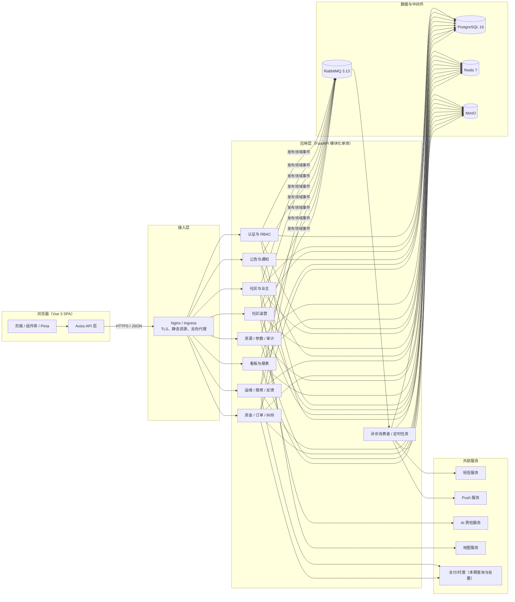
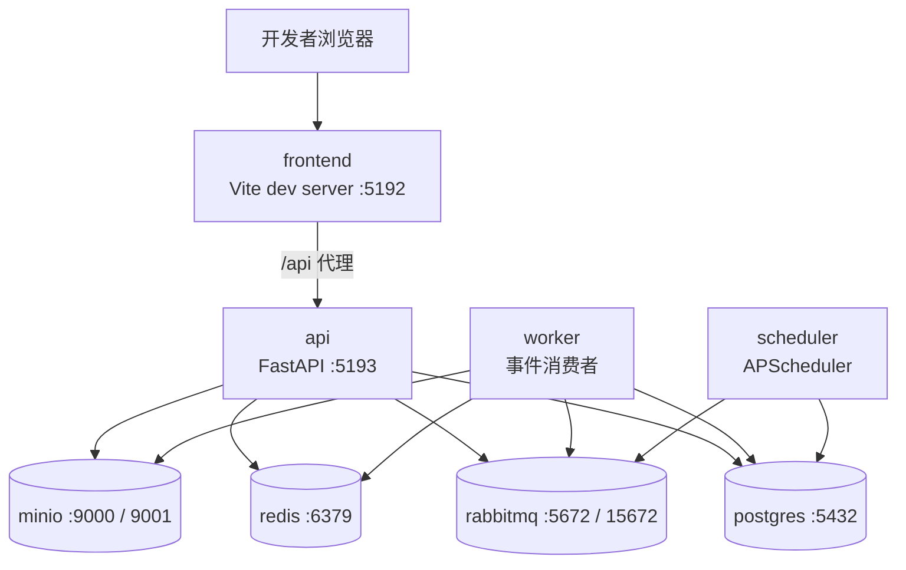
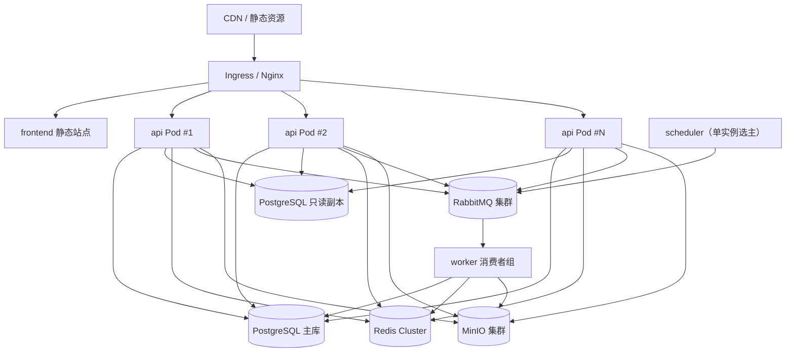
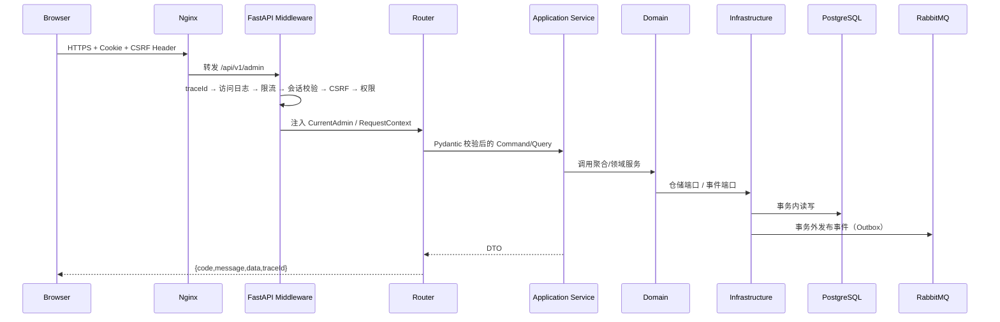
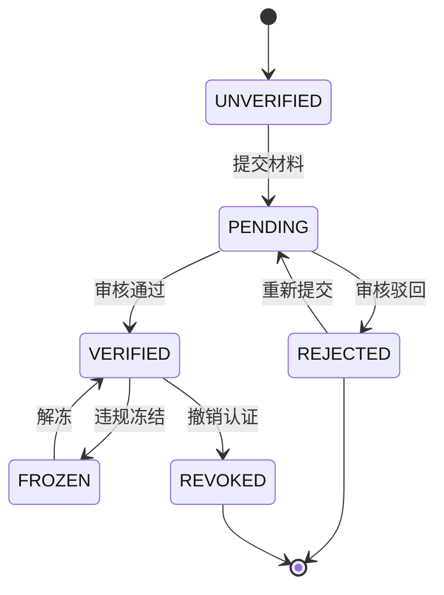
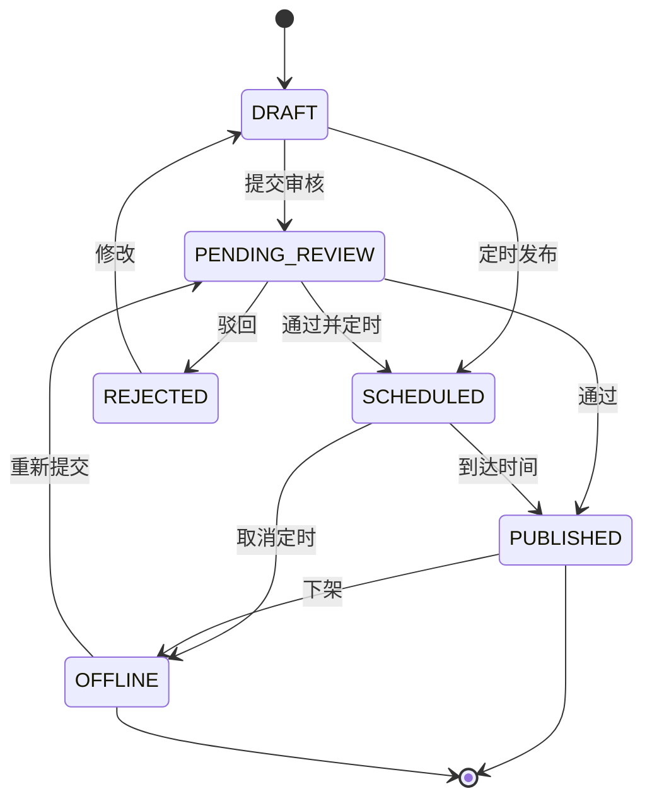
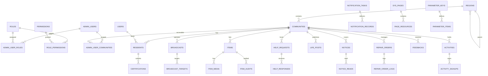
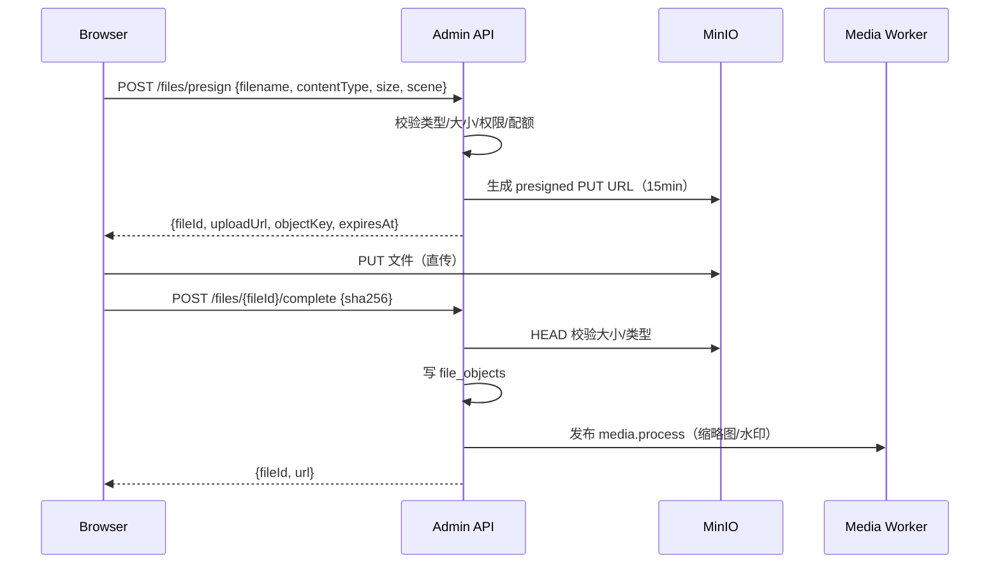

# 邻里小栈（Neighbor's Inn）后台管理系统详细设计说明书

| 项目 | 内容 |
| --- | --- |
| 项目中文名称 | 邻里小栈 |
| 项目英文名称 | Neighbor's Inn |
| 项目代码 | NeighInn |
| 子工程 | `web/`（后台管理系统，含 `backend/` 与 `frontend/`） |
| 文档名称 | 邻里小栈后台管理系统详细设计说明书 |
| 文档版本 | v1.1 |
| 编写日期 | 2026-11-14 |
| 文档状态 | 初稿（1.7 决策已确认，待评审） |
| 视觉基线 | Figma Make：<https://www.figma.com/make/G7lQQrOmmixUe5CKDbJ1NY/web> |
| 前端技术栈 | Vue 3 + TypeScript + Pinia + Vue Router + Vite + SCSS + ECharts |
| 后端技术栈 | Python 3.12 + FastAPI + SQLAlchemy 2.0 + Pydantic 2 |
| 数据与中间件 | PostgreSQL 16、Redis 7、RabbitMQ 3.13、MinIO |
| 适用范围 | 平台运营人员、物业/社区工作人员、数据分析员、系统管理员 |

---

## 目录

1. [方案概述](#1-方案概述)
2. [总体架构](#2-总体架构)
3. [前端设计系统（严格对齐 Figma）](#3-前端设计系统严格对齐-figma)
4. [前端工程与页面详细设计](#4-前端工程与页面详细设计)
5. [后端架构与设计模式](#5-后端架构与设计模式)
6. [数据模型与数据库设计](#6-数据模型与数据库设计)
7. [中间件、接口与集成设计](#7-中间件接口与集成设计)
8. [安全、性能与可观测性](#8-安全性能与可观测性)
9. [测试与验收](#9-测试与验收)
10. [实施计划与风险](#10-实施计划与风险)
11. [附录](#11-附录)
12. [版本记录](#12-版本记录)

---

## 1. 方案概述

### 1.1 编写目的

本文档是“邻里小栈”后台管理系统（Web 管理端）的实现基线，面向产品、UI/UX、前端、后端、测试、运维与安全评审人员，明确：

- 前端页面布局、组件结构、交互方式、颜色、字体与字号如何**逐像素对齐** Figma Make 设计稿；
- 基于 Vue 3 + Pinia + TypeScript 的前端工程分层、路由、状态、权限与 API 约定；
- 基于 Python + FastAPI 的后端分层架构、领域划分、数据库与中间件设计；
- **23 种 GoF 设计模式**在真实业务场景中的落地位置、解决的问题与代码骨架；
- 安全、性能、可观测性、测试验收、部署与实施计划；
- 与既有《邻里小栈需求规格说明书》（SRS）及移动端详细设计之间的边界、映射与差异。

本文档不替代 SRS 的业务规则。凡涉及资金、认证、隐私、审核的规则，以 SRS 第 4/7/9 章及本文件第 5、8 章为准。

### 1.2 设计来源与优先级

| 来源 | 内容 | 在本项目中的角色 |
| --- | --- | --- |
| **Figma Make：web** | 13 个主导航页面、7 个快捷/预留管理页、完整布局、配色、字体、字号、组件与交互样例 | **视觉与交互的第一优先级**；前端布局、样式、文案、交互必须逐项对齐 |
| 《邻里小栈需求规格说明书》v1.1 | 角色权限、W01–W08 后台需求、AI 审核、资金担保、纠纷、非功能与验收 | **业务规则的第一优先级**；与 Figma 冲突时，业务规则以 SRS 为准 |
| 《邻里小栈概要设计说明书-移动端》 | 移动端旧版架构与接口契约 | 接口命名、实体与错误码的参考 |
| 《邻家小栈移动端详细设计方案》 | 移动端 uni-app x 实现、数据模型、交易/认证流程 | 跨端字段、状态机、API 语义的对齐来源 |
| 本文件 | Web 端技术架构、设计模式、数据库、接口与验收 | 前后端实现与评审的直接依据 |

**冲突裁决规则**：

1. 页面布局、颜色、字体、字号、间距、圆角、阴影、文案、交互反馈：以 Figma 为准；
2. 业务规则、权限边界、资金与隐私合规：以 SRS 为准；
3. Figma 未覆盖但 SRS 要求的能力（如强制放款/退款、纠纷调解、资金对账）：沿用本文件第 3 章设计系统扩展，**不得擅自改变已有页面的视觉语言**；
4. 本文件中的技术选型、分层、模式落点：作为实现基线；如需变更，走架构决策记录（ADR）。

### 1.3 设计基准与运行环境

| 项 | 基准 |
| --- | --- |
| 设计画布 | 桌面端 1440 × 900；内容区最大宽度 1500px |
| 推荐分辨率 | 1920 × 1080；最低可用宽度 320px |
| 浏览器 | Chrome / Edge / Firefox / Safari 近两年主版本 |
| 语言 | 简体中文；金额、日期、距离格式遵循 SRS 与移动端规范 |
| 时区 | 服务端统一 UTC 存储，接口返回 Unix 毫秒；前端按浏览器时区展示 |
| 登录方式 | 管理员账号密码 + 强制双因素认证（TOTP 优先，短信兜底） |
| 账号体系 | 与 C 端业主账号隔离的后台管理员账号体系；共享同一套服务端基础设施与社区主数据 |
| 多社区 | 一个后台可管理多个社区；侧边栏“当前运营空间”切换，权限受数据范围约束 |

### 1.4 术语与命名

| 术语 | 说明 | 数据库/代码命名 |
| --- | --- | --- |
| 社区 | 后台的运营空间，对应 SRS 中的“小区”；是绝大多数业务数据的租户边界 | `community` |
| 社区业主 | 后台“社区业主”页面中的人员档案，含业主、家属、租户、商务人员 | `resident`（C 端账号仍为 `user`） |
| 运营空间 | 侧边栏顶部当前选中的社区 | `currentCommunity` |
| 社区喇叭 | 面向移动端“小区喇叭站”的即时播报、话题、提醒 | `broadcast` |
| 社区物品 | 移动端闲置市集的物品管理与审核 | `item` |
| 邻里互助 | 求助、响应、撮合、履约与互助信用 | `help_request` |
| 社区生活 | 移动端小区生活的内容运营 | `life_post` |
| 公告 | 社区级通知公告，支持定时发布与阅读统计 | `notice` |
| 通知任务 | 站内信、短信、Push 的批量/触发式触达任务 | `notification_task` |
| 社区运维 | 按全国行政区划维护城市、街道、社区基础信息 | `community` + `region` |
| 角色权限 | RBAC 角色、菜单权限、页面资源权限、数据范围 | `role` / `permission` |
| 资源管理 | 系统页面、菜单结构与页面内可授权资源 | `sys_page` / `page_resource` |
| 参数配置 | 按参数键组织的多环境业务配置 | `parameter_key` / `parameter_item` |
| 页面资源 | 页面内的输入框、按钮、下拉列表、弹出菜单、表格、开关等可授权元素 | `page_resource` |
| 数据范围 | 角色可访问的社区集合：全部、指定社区、本社区、仅本人 | `data_scope` |

> **命名约束**：对外文案使用“社区”，数据库与接口统一使用 `community`；移动端与 SRS 中的“小区”在网关层做同义映射，不新增第二套实体。

### 1.5 范围与边界

**本期范围（按 Figma 设计稿）**：

- 登录、双因素认证、退出、修改密码（登录页已由 Figma 覆盖并按设计稿还原；2FA 步骤按同一设计系统补齐）；
- 工作台：核心指标、社区活跃趋势、待办事项、社区运行概览、最新动态；
- 社区运营：社区喇叭、社区物品、邻里互助、社区生活；
- 触达中心：公告管理、通知任务；
- 社区管理：社区运维（行政区划 + 社区目录）、社区业主（社区选择 + 人员档案 + 认证状态）；
- 系统管理：用户管理、角色权限、资源管理、参数配置；
- 工作台快捷入口/预留页面：邻里动态、社区活动、报事报修、投诉建议、住户认证、闲置市集、便民服务；
- **资金与治理（Figma 未覆盖，按同一设计系统本期补齐）**：托管资金看板、资金流水、提现审核、对账、订单查询、纠纷调解、审计日志；
- 全局能力：命令面板（⌘K）、通知弹层、Toast、批量操作、导出。

**本期不包含**：

- C 端交易功能（下单、支付、验货确认、评价），后台只做查询、审核、调解与资金处置；
- AI 模型训练与提示词平台（只消费 AI 质检结果，不在此系统训练模型）；
- 支付渠道商户进件、清结算系统本身（后台只做托管资金的查询、复核与处置）；
- 面向业主的自助服务门户；
- 深色模式与多语言（Figma 仅提供浅色简体中文桌面设计；如后续需要，另立设计任务）。

**SRS 要求但 Figma 未覆盖、本期以同一设计系统补齐的页面**：

| 能力 | SRS 编号 | 处理方式 |
| --- | --- | --- |
| 资金与担保支付看板、资金流水、提现审核、对账 | W06 | **本期**新增 `/finance/*`，复用工作台指标卡、表格、状态标签、抽屉组件 |
| 订单查询与成交快照 | W05-01 | **本期**新增 `/finance/orders`，在资金模块内提供只读订单检索 |
| 纠纷调解工作台 | W05-02 | **本期**新增 `/governance/disputes`，复用报事报修工作台与证据抽屉 |
| 内容举报处理 | W03-04 / W05-03 | **本期基础**新增 `/governance/reports`，复用通用管理页 |
| AI 质检报告详情与人工复核 | W03-01 | **本期**在“社区物品/闲置市集”详情抽屉中扩展 AI 报告标签页 |
| 操作审计日志查询 | W01-03 | **本期**新增 `/system/audit-logs`，复用表格 + 高级筛选（资金/纠纷操作必须可追溯） |
| 报表导出中心 | W08-03 | **本期基础（可裁剪）**新增 `/analytics/exports`，复用通知任务列表 + 异步任务状态 |

### 1.6 与 SRS 的对齐和差异

| SRS 模块 | Figma 对应页面 | 对齐情况 | 说明 |
| --- | --- | --- | --- |
| W01 管理端账号与权限 | 登录、角色权限、资源管理 | 部分覆盖 | Figma 已提供完整登录页与 RBAC/资源树；2FA 绑定/验证画面未覆盖，按设计系统补齐 |
| W02 业主资质审核 | 社区业主、住户认证 | 覆盖 | Figma 的认证状态、认证编号、审核抽屉可直接承载 |
| W03 商品审核与 AI 复核 | 社区物品、闲置市集 | 覆盖 | 需在物品详情增加 AI 质检报告与复核操作 |
| W04 小区与基础数据 | 社区运维、参数配置 | 覆盖 | 行政区划树 + 社区目录 + 参数键 |
| W05 交易与纠纷 | 报事报修、投诉建议、纠纷调解 | 覆盖 | 纠纷调解工作台本期新增；订单查询随资金模块本期提供 |
| W06 资金与担保支付 | 资金管理（本期新增） | 覆盖 | 按同一设计系统新增资金看板/流水/提现/对账 |
| W07 用户管理 | 用户管理、社区业主 | 覆盖 | Figma 用户管理为通用账户列表 |
| W08 数据看板与报表 | 工作台、报表导出中心 | 部分覆盖 | 工作台 + 导出中心本期基础；小区维度报表后续增强 |

**Figma 独有、SRS 未细化的能力**（纳入本期范围，作为社区运营增强）：社区喇叭、社区生活、公告管理、通知任务、社区运维、报事报修、投诉建议、邻里互助、社区活动、便民服务。

**关键差异与处理**：

1. Figma 的“社区”是运营空间，SRS 的“小区”是交易边界；本方案用 `community` 统一，移动端接口不变。
2. Figma 的“社区物品”包含二手交易管理，但后台不提供 C 端交易按钮；只提供审核、推荐、下架、查看。
3. Figma 的“用户级别”（普通/活跃/社区达人/重点关怀）是运营标签，SRS 未定义；作为可配置字典，不参与权限判定。
4. Figma 的示例数据（云栖里社区、2025-03-20 等）仅作为视觉验收夹具，生产环境使用真实数据与当前日期。

### 1.7 已确认决策清单（2026-11-14）

> 以下决策已由项目方确认，作为本期实现与验收基线；如后续变更，按 10.5 节走变更评审并更新 ADR。

| 编号 | 决策事项 | 确认结论 | 落地影响 |
| --- | --- | --- | --- |
| D-01 | 后台是否支持多社区运营 | **支持多社区运营**；以 `community_id` 做租户隔离，角色绑定数据范围 | 数据库、权限、缓存键、社区切换器 |
| D-02 | 资金/纠纷页面是否本期实现 | **本期实现**资金看板、资金流水、提现审核、对账、订单查询与纠纷调解 | 本期新增 `/finance/*`、`/governance/disputes`；数据库、API、排期同步调整 |
| D-03 | Figma 8–11px 小字号是否原样还原 | **是**：基线原样还原，并提供 100%/125%/150% 界面缩放开关；验收记录可读性风险 R-01 | UI 验收、无障碍 |
| D-04 | 通知渠道是否包含短信/Push | **包含**站内信、短信、Push；通过适配器接入，开发环境用 Mock | 第三方资质、成本、通知任务 |
| D-05 | 管理员账号来源 | **独立后台账号表**（`admin_users`）；预留企业 SSO/OIDC 接入 | 认证模块、RBAC |
| D-06 | 是否启用 PostgreSQL 行级安全（RLS） | **不启用**；以应用层 `DataScope` 为强制隔离层，配合越权测试与审计 | 仓储层统一注入数据范围 |
| D-07 | 审计日志与业务数据留存期限 | **审计日志 ≥ 3 年**；业务数据按 **SRS 9.2** 执行 | 分区、归档、备份、成本 |
| D-08 | 图片/视频处理方式 | **MinIO 私有桶 + 预签名 URL**；图片异步生成缩略图 | 存储桶、上传流程、媒体 Worker |

**D-02 的范围说明**：资金/纠纷页面本期实现，但不包含支付渠道商户进件、清结算系统本身；后台提供托管资金查询、提现审核、异常资金处置（双人复核）、纠纷调解与订单快照查看。Figma 主导航保持 13 项不变，扩展页面通过侧边栏新增“资金与治理”分组进入（样式复用 `nav-group`/`nav-item`），详见 4.1.1。

---

## 2. 总体架构

### 2.1 逻辑架构



**架构要点**：

- **前后端分离**：前端为独立 SPA，后端仅提供 `/api/v1/admin/**` JSON 接口与 OpenAPI 文档；Nginx 托管前端静态资源并反代 API。
- **模块化单体**：按业务边界拆分为多个 Python 包（bounded context），单进程部署、单数据库事务；模块之间通过应用服务与领域事件解耦，后续可按边界拆服务。
- **读写分离思路**：后台以管理写操作为主、读多写少；列表/看板使用缓存与只读查询模型，导出与统计走异步任务。
- **多租户**：`community_id` 为数据隔离主线；RBAC 的数据范围在仓储层强制注入，缓存键包含社区维度。
- **异步优先**：通知、导出、统计、AI 回调等耗时操作全部走 RabbitMQ；接口只返回任务 ID，前端轮询或订阅。
- **可审计**：所有写操作记录操作人、IP、前后快照、traceId；资金类操作（本期）双人复核。

### 2.2 技术选型

#### 2.2.1 前端

| 类别 | 选型 | 版本基线 | 选择理由 |
| --- | --- | --- | --- |
| 框架 | Vue | 3.5.x | 组合式 API、`<script setup>`、类型友好；与团队现有 Vue 经验一致 |
| 语言 | TypeScript | 5.7+ | 全量类型；接口类型由 OpenAPI 生成 |
| 构建 | Vite | 7.x | 快速冷启动、ESM、按需分包 |
| 状态 | Pinia | 3.x（兼容 2.x） | 官方推荐、模块化、DevTools 支持 |
| 路由 | Vue Router | 4.5+ | 动态路由、路由守卫、权限元信息 |
| 样式 | SCSS + CSS Custom Properties | Dart Sass | 将 Figma Token 固化为变量；避免运行时 CSS-in-JS 开销 |
| 图标 | lucide-vue-next | 锁定版本 | 与 Figma Make 使用的 Lucide 图形一致（线性、2px 描边） |
| 图表 | ECharts | 5.6+ | 柱状图、环图、趋势图；按需引入减少体积 |
| 请求 | Axios | 1.x | 拦截器、取消、错误统一处理 |
| 工具 | VueUse、dayjs | 最新稳定 | 组合式工具与日期格式化 |
| 测试 | Vitest、Vue Test Utils、Playwright | 最新稳定 | 单测、组件测试、E2E 与视觉回归 |
| 质量 | ESLint、Prettier、Stylelint、vue-tsc | 最新稳定 | 统一代码与样式规范 |

> **UI 组件库决策**：不引入 Element Plus / Ant Design Vue 等重型组件库作为视觉基座。Figma 的侧边栏、表格、状态标签、抽屉、树、级联选择器均为定制样式，直接套用组件库会破坏间距与配色。采用**自研 `ni-*` 管理端组件 + lucide 图标 + ECharts**，仅借鉴成熟组件的无障碍与键盘行为。

#### 2.2.2 后端

| 类别 | 选型 | 版本基线 | 选择理由 |
| --- | --- | --- | --- |
| 语言 | Python | 3.12 | 类型、性能、生态；FastAPI 兼容良好 |
| Web 框架 | FastAPI | 0.115+ | 异步、Pydantic 校验、OpenAPI 自动生成 |
| ASGI | Uvicorn + Gunicorn | 最新稳定 | 多 worker、优雅重启 |
| ORM | SQLAlchemy | 2.0（async） | 显式事务、类型化查询、成熟生态 |
| 迁移 | Alembic | 最新稳定 | 版本化 DDL |
| 校验 | Pydantic | 2.9+ | 请求/响应模型、配置管理 |
| 数据库 | PostgreSQL | 16 | JSONB、窗口函数、分区、可靠事务（本期不启用 RLS） |
| 缓存 | Redis | 7 | 会话、缓存、分布式锁、限流、幂等 |
| 消息 | RabbitMQ | 3.13 | 可靠投递、死信、延迟、路由灵活 |
| 对象存储 | MinIO | 最新稳定 | S3 兼容、私有桶、预签名 URL |
| 消息客户端 | aio-pika | 9.x | 异步、显式交换机/队列拓扑 |
| 定时任务 | APScheduler | 3.x | 轻量 cron；与 FastAPI 同进程或独立进程 |
| 认证 | Argon2id + PyJWT + pyotp | 最新稳定 | 密码哈希、会话令牌、TOTP |
| 加密 | cryptography（AES-256-GCM） | 最新稳定 | 敏感字段应用层加密 |
| 可观测 | structlog、OpenTelemetry、Prometheus | 最新稳定 | 结构化日志、链路追踪、指标 |
| 测试 | pytest、pytest-asyncio、httpx、testcontainers | 最新稳定 | 单元/集成/契约测试 |
| 质量 | Ruff、mypy、bandit、pip-audit | 最新稳定 | 静态检查与依赖安全 |
| 包管理 | uv | 最新稳定 | 快速、可复现的依赖锁定 |

#### 2.2.3 基础设施

| 组件 | 开发环境 | 生产环境 |
| --- | --- | --- |
| 容器 | Docker Compose | Kubernetes（Deployment + HPA + PDB） |
| 反向代理 | Nginx | Ingress Controller |
| 数据库 | 单实例 PostgreSQL | 主备 + 只读副本 + PITR |
| 缓存 | 单实例 Redis | Redis Sentinel/Cluster |
| 消息 | 单节点 RabbitMQ | 3 节点镜像队列 + 持久化 |
| 对象存储 | 单节点 MinIO | MinIO 分布式集群 / S3 兼容云存储 |
| 密钥 | `.env`（不入库） | KMS / Vault |
| 监控 | 本地日志 | Prometheus + Grafana + Loki + Tempo |

### 2.3 分层架构与依赖规则

#### 2.3.1 后端分层

```text
┌────────────────────────────────────────────────────────────┐
│ Interface / API 层                                          │
│ FastAPI Routers、Pydantic Schema、依赖注入、HTTP 语义        │
├────────────────────────────────────────────────────────────┤
│ Application 层                                              │
│ 用例（Command/Query）、事务边界、权限与数据范围编排、DTO        │
├────────────────────────────────────────────────────────────┤
│ Domain 层                                                   │
│ 实体、值对象、聚合、领域服务、状态机、策略、仓储接口、领域事件   │
├────────────────────────────────────────────────────────────┤
│ Infrastructure 层                                           │
│ SQLAlchemy 仓储、Redis 缓存、RabbitMQ 事件总线、MinIO 适配器、 │
│ 第三方服务适配器、任务消费者                                  │
└────────────────────────────────────────────────────────────┘
```

**依赖规则**：

1. `interfaces → application → domain`；`infrastructure` 实现 `domain` 定义的端口（依赖倒置）。
2. `domain` 不依赖 FastAPI、SQLAlchemy、Redis、RabbitMQ、MinIO 等任何框架/中间件。
3. `application` 不得直接拼 SQL、不得直接访问 Redis/队列；通过仓储、缓存端口、事件总线端口。
4. `infrastructure` 可以被 `application` 通过端口引用，但不得反向依赖 `interfaces`。
5. 跨模块调用只能通过：应用服务接口、领域事件、共享只读查询模型；禁止跨模块直接操作对方表。

#### 2.3.2 前端分层

```text
pages → components（ni-*） → composables → stores/services → api → request
                              ↓
                         styles/tokens
```

- 页面只负责编排与展示，不直接写 Axios；
- 业务状态放 Pinia，页面局部状态留在组件；
- 权限判断统一走 `usePermission()`，不散落 `v-if`；
- 设计 Token 只从 `styles/tokens.scss` 与 CSS 变量读取，禁止页面硬编码十六进制色值；
- API 类型由 OpenAPI 生成，禁止手写两套 DTO。

### 2.4 部署架构

#### 2.4.1 开发/测试环境（Docker Compose）



#### 2.4.2 生产环境



**部署原则**：

- API 无状态，可水平扩容；会话存 Redis；文件走 MinIO。
- worker 与 scheduler 独立进程，避免长任务阻塞 API。
- 数据库迁移以 Kubernetes Job 在发布前执行，失败即停止发布。
- 蓝绿/滚动发布；API 保持至少 2 个副本，PDB 保证滚动期间可用。
- 所有服务输出 `/health/live` 与 `/health/ready`。

### 2.5 请求处理链



**中间件顺序（由外到内）**：

1. `TraceIdMiddleware`：生成/透传 `X-Trace-Id`，写入日志上下文；
2. `AccessLogMiddleware`：方法、路径、状态码、耗时、管理员 ID、IP、UA；
3. `SecurityHeadersMiddleware`：CSP、X-Content-Type-Options、Referrer-Policy、HSTS；
4. `RateLimitMiddleware`：登录、导出、写操作分级限流；
5. `SessionAuthMiddleware`：读取 `ni_admin_session` Cookie，校验 Redis 会话，加载管理员与权限快照；
6. `CsrfMiddleware`：写操作校验 `X-CSRF-Token`（与 Cookie 双提交）；
7. `PermissionMiddleware`（路由级依赖）：校验接口权限码；
8. `DataScopeMiddleware`（应用服务内）：注入当前管理员可访问的社区集合；
9. `AuditMiddleware`（写用例装饰器）：记录前后快照与操作结果。

### 2.6 工程目录结构

#### 2.6.1 后端 `web/backend/`

```text
backend/
├── pyproject.toml
├── uv.lock
├── alembic.ini
├── alembic/
│   └── versions/
├── docker/
│   ├── Dockerfile
│   └── entrypoint.sh
├── src/
│   └── neighinn_admin/
│       ├── main.py                     # FastAPI 应用工厂
│       ├── core/
│       │   ├── config.py               # Settings（pydantic-settings）
│       │   ├── container.py            # 轻量 DI 容器 / 单例装配
│       │   ├── security.py             # 密码、会话、CSRF、TOTP
│       │   ├── errors.py               # 业务异常与错误码
│       │   ├── pagination.py           # 页码/游标分页
│       │   ├── logging.py              # structlog 配置
│       │   ├── tracing.py              # OpenTelemetry
│       │   └── middleware/
│       ├── interfaces/
│       │   └── api/v1/
│       │       ├── deps.py             # get_db / get_current_admin / require_perm
│       │       ├── router.py           # 汇总路由
│       │       └── routers/
│       │           ├── auth.py
│       │           ├── dashboard.py
│       │           ├── communities.py
│       │           ├── residents.py
│       │           ├── broadcasts.py
│       │           ├── items.py
│       │           ├── help_requests.py
│       │           ├── life_posts.py
│       │           ├── notices.py
│       │           ├── notification_tasks.py
│       │           ├── repair_orders.py
│       │           ├── feedbacks.py
│       │           ├── content_posts.py
│       │           ├── activities.py
│       │           ├── services.py
│       │           ├── verifications.py
│       │           ├── disputes.py
│       │           ├── reports.py
│       │           ├── users.py
│       │           ├── roles.py
│       │           ├── pages.py
│       │           ├── parameters.py
│       │           ├── audit_logs.py
│       │           ├── files.py
│       │           ├── exports.py
│       │           ├── analytics.py
│       │           └── finance.py       # 本期：资金看板/流水/提现/对账/订单
│       ├── application/
│       │   ├── common/
│       │   │   ├── unit_of_work.py
│       │   │   ├── command.py
│       │   │   ├── query.py
│       │   │   └── decorators.py        # @transactional/@audited/@requires_perm
│       │   └── modules/
│       │       ├── auth/
│       │       ├── dashboard/
│       │       ├── community/
│       │       ├── resident/
│       │       ├── operation/
│       │       ├── communication/
│       │       ├── governance/
│       │       ├── finance/
│       │       ├── system/
│       │       └── reporting/
│       ├── domain/
│       │   ├── shared/
│       │   │   ├── entity.py
│       │   │   ├── value_object.py
│       │   │   ├── aggregate_root.py
│       │   │   ├── domain_event.py
│       │   │   ├── repository.py
│       │   │   └── errors.py
│       │   └── modules/
│       │       ├── identity/
│       │       ├── community/
│       │       ├── resident/
│       │       ├── operation/
│       │       ├── communication/
│       │       ├── governance/
│       │       ├── finance/
│       │       ├── system/
│       │       └── reporting/
│       ├── infrastructure/
│       │   ├── db/
│       │   │   ├── session.py
│       │   │   ├── base.py
│       │   │   ├── models/
│       │   │   └── repositories/
│       │   ├── cache/
│       │   │   ├── redis_client.py
│       │   │   ├── cache_service.py
│       │   │   └── locks.py
│       │   ├── messaging/
│       │   │   ├── rabbit_bus.py
│       │   │   ├── topology.py
│       │   │   ├── outbox.py
│       │   │   └── consumers/
│       │   ├── storage/
│       │   │   ├── minio_storage.py
│       │   │   └── signed_url.py
│       │   ├── external/
│       │   │   ├── sms_adapter.py
│       │   │   ├── push_adapter.py
│       │   │   ├── ai_audit_adapter.py
│       │   │   └── map_adapter.py
│       │   └── security/
│       │       ├── crypto.py
│       │       └── masking.py
│       ├── workers/
│       │   ├── main.py
│       │   ├── consumers/
│       │   └── jobs/
│       └── shared/
│           ├── constants.py
│           ├── enums.py
│           └── utils.py
└── tests/
    ├── unit/
    ├── integration/
    ├── contract/
    └── fixtures/
```

#### 2.6.2 前端 `web/frontend/`

```text
frontend/
├── package.json
├── vite.config.ts
├── tsconfig.json
├── index.html
├── .env.development
├── .env.production
├── src/
│   ├── main.ts
│   ├── App.vue
│   ├── router/
│   │   ├── index.ts
│   │   ├── routes.ts
│   │   └── guards.ts
│   ├── stores/
│   │   ├── auth.ts
│   │   ├── app.ts
│   │   ├── community.ts
│   │   ├── permission.ts
│   │   ├── notification.ts
│   │   └── dict.ts
│   ├── api/
│   │   ├── request.ts
│   │   ├── auth.api.ts
│   │   ├── dashboard.api.ts
│   │   ├── community.api.ts
│   │   ├── resident.api.ts
│   │   ├── operation.api.ts
│   │   ├── communication.api.ts
│   │   ├── governance.api.ts
│   │   ├── system.api.ts
│   │   └── types/                     # OpenAPI 生成
│   ├── components/
│   │   ├── layout/
│   │   │   ├── AppShell.vue
│   │   │   ├── AppSidebar.vue
│   │   │   ├── AppTopbar.vue
│   │   │   └── AppBreadcrumb.vue
│   │   ├── base/
│   │   │   ├── NiButton.vue
│   │   │   ├── NiInput.vue
│   │   │   ├── NiSelect.vue
│   │   │   ├── NiCheckbox.vue
│   │   │   ├── NiTag.vue
│   │   │   ├── NiSwitch.vue
│   │   │   ├── NiTabs.vue
│   │   │   ├── NiPagination.vue
│   │   │   ├── NiEmpty.vue
│   │   │   ├── NiDrawer.vue
│   │   │   ├── NiPopover.vue
│   │   │   ├── NiToast.vue
│   │   │   └── NiCommandPalette.vue
│   │   ├── business/
│   │   │   ├── NiPageHeading.vue
│   │   │   ├── NiMetricCard.vue
│   │   │   ├── NiChartCard.vue
│   │   │   ├── NiDataTable.vue
│   │   │   ├── NiFilterBar.vue
│   │   │   ├── NiStatusBadge.vue
│   │   │   ├── NiCommunitySwitcher.vue
│   │   │   ├── NiCascadeSelector.vue
│   │   │   ├── NiPermissionTree.vue
│   │   │   ├── NiTreePanel.vue
│   │   │   └── NiInsightStrip.vue
│   │   └── charts/
│   │       ├── NiTrendChart.vue
│   │       └── NiDonutChart.vue
│   ├── composables/
│   │   ├── usePermission.ts
│   │   ├── useTable.ts
│   │   ├── usePagination.ts
│   │   ├── useToast.ts
│   │   ├── useConfirm.ts
│   │   ├── useCommandPalette.ts
│   │   └── useUnsavedChanges.ts
│   ├── pages/
│   │   ├── auth/LoginPage.vue
│   │   ├── dashboard/DashboardPage.vue
│   │   ├── community-operation/
│   │   │   ├── BroadcastPage.vue
│   │   │   ├── CommunityItemPage.vue
│   │   │   ├── NeighborHelpPage.vue
│   │   │   └── CommunityLifePage.vue
│   │   ├── communication/
│   │   │   ├── NoticePage.vue
│   │   │   └── NotificationTaskPage.vue
│   │   ├── community/
│   │   │   ├── CommunityMaintenancePage.vue
│   │   │   └── CommunityResidentPage.vue
│   │   ├── system/
│   │   │   ├── UserPage.vue
│   │   │   ├── RolePermissionPage.vue
│   │   │   ├── ResourcePage.vue
│   │   │   ├── ParameterPage.vue
│   │   │   └── AuditLogPage.vue
│   │   ├── governance/
│   │   │   ├── RepairOrderPage.vue
│   │   │   ├── FeedbackPage.vue
│   │   │   ├── VerificationPage.vue
│   │   │   ├── ReportPage.vue
│   │   │   └── DisputePage.vue
│   │   ├── finance/
│   │   │   ├── FinanceOverviewPage.vue
│   │   │   ├── FinanceTransactionPage.vue
│   │   │   ├── FinanceWithdrawalPage.vue
│   │   │   ├── FinanceReconciliationPage.vue
│   │   │   └── FinanceOrderPage.vue
│   │   ├── analytics/
│   │   │   └── ExportCenterPage.vue
│   │   └── content/
│   │       ├── NeighborhoodContentPage.vue
│   │       └── CommunityActivityPage.vue
│   ├── styles/
│   │   ├── tokens.scss
│   │   ├── base.scss
│   │   ├── utilities.scss
│   │   └── components/
│   ├── types/
│   └── utils/
├── tests/
│   ├── unit/
│   ├── e2e/
│   └── visual/
└── playwright.config.ts
```

### 2.7 关键架构决策记录（ADR）

| 编号 | 决策 | 理由 | 代价/缓解 |
| --- | --- | --- | --- |
| ADR-01 | 采用模块化单体而非微服务 | 团队规模与业务复杂度匹配；单库事务保证认证/审核/通知一致性 | 模块边界需靠代码规范与依赖检查维持 |
| ADR-02 | 自研 `ni-*` 组件库，不用重型 UI 框架 | Figma 视觉定制程度高；避免覆盖组件库样式的长期成本 | 需自行实现无障碍、键盘交互与测试 |
| ADR-03 | 后台会话采用 HttpOnly Cookie + Redis，而非 localStorage JWT | 降低 XSS 窃取风险；符合 SRS“Web 端会话 + 双因素” | 需要 CSRF 防护与跨域配置 |
| ADR-04 | 领域事件采用 Outbox + RabbitMQ | 避免“数据库提交成功、消息发送失败”的不一致 | 增加 outbox 表与投递 worker |
| ADR-05 | 所有列表接口强制分页，导出异步化 | 后台数据量大，避免长事务与超时 | 前端需轮询导出任务 |
| ADR-06 | 多租户采用 `community_id` + 应用层数据范围，**不启用 RLS** | 实现简单、可测试；RLS 增加运维复杂度；越权测试 + 审计兜底 | 需在仓储层统一强制注入，禁止绕过 |
| ADR-07 | 视觉令牌以 CSS 变量 + SCSS 双份维护 | 运行时主题切换与编译期提示兼得 | Token 变更需同步两处，CI 校验 |
| ADR-08 | 前端不直接使用 Figma Make 的 React/Tailwind 代码 | 技术栈不同；只复用其设计值与交互逻辑 | 需逐页对照验收 |

---
## 3. 前端设计系统（严格对齐 Figma）

### 3.1 还原原则

1. **数值原样落地**：颜色、字号、行高、间距、圆角、阴影、边框、宽高均取 Figma Make 源文件的计算值，不做“看起来差不多”的近似替换。
2. **Token 单一来源**：所有值收敛到 `src/styles/tokens.scss` 与 `:root` CSS 变量；页面与组件只引用 Token，不出现零散十六进制色值与魔法数字。
3. **结构对齐**：侧边栏宽度、顶栏高度、内容区最大宽度、卡片栅格、表格行高、抽屉宽度、弹层位置均按第 3.5 节执行。
4. **文案对齐**：菜单、页头、列名、按钮、状态、空态、Toast 文案与 Figma 一致；生产数据替换仅替换数据，不改变文案结构。
5. **不照搬技术实现**：Figma Make 为 React 19 + Tailwind 4；本项目为 Vue 3 + SCSS。只复用设计值与交互逻辑，不复制 JSX/Tailwind 类名。
6. **允许的必要增强**：Figma 原型中的静态图表、假分页、无二次确认的删除，在生产实现中替换为 ECharts、真实分页与确认弹窗；视觉位置与尺寸不变。

### 3.2 色彩 Token

#### 3.2.1 基础色板

| Token | 色值 | 用途 |
| --- | --- | --- |
| `--ni-color-primary` | `#6F59D4` | 主按钮、选中态、链接、进度条 |
| `--ni-color-primary-hover` | `#624BC8` | 主按钮悬停 |
| `--ni-color-primary-active` | `#5D46BA` | 主按钮按下/深色选中文字 |
| `--ni-color-primary-soft` | `#EEEAFD` | 选中背景、图标底、浅色标签 |
| `--ni-color-primary-softer` | `#F5F2FD` | 提示条、批量操作条 |
| `--ni-color-primary-border` | `#D9D0F2` | 选中边框、浅紫描边 |
| `--ni-color-sidebar` | `#211D38` | 侧边栏背景 |
| `--ni-color-sidebar-text` | `#DCD8EA` | 侧边栏主文字 |
| `--ni-color-sidebar-muted` | `#918CA7` | 侧边栏副标题 |
| `--ni-color-sidebar-item` | `#B6B1C8` | 侧边栏菜单项 |
| `--ni-color-sidebar-label` | `#77718C` | 侧边栏分组标题 |
| `--ni-color-bg` | `#F7F7FA` | 页面背景 |
| `--ni-color-surface` | `#FFFFFF` | 卡片、面板、表格背景 |
| `--ni-color-surface-subtle` | `#FBFAFD` | 左侧树面板、表单只读区 |
| `--ni-color-surface-muted` | `#FAF9FB` | 表头、底部工具条 |
| `--ni-color-border` | `#EBE9EF` | 卡片/面板边框 |
| `--ni-color-border-strong` | `#E5E3EB` | 输入框、按钮边框 |
| `--ni-color-divider` | `#F0EEF3` | 表格行分隔、区块分隔 |
| `--ni-color-text` | `#252331` | 根文字/正文 |
| `--ni-color-heading` | `#292635` | 页面标题 |
| `--ni-color-text-strong` | `#45414E` | 表格主单元格 |
| `--ni-color-text-body` | `#716D79` | 表格正文 |
| `--ni-color-text-secondary` | `#918D99` | 辅助说明 |
| `--ni-color-text-muted` | `#AAA6B1` | 占位符、时间、弱提示 |
| `--ni-color-white` | `#FFFFFF` | 反白文字 |
| `--ni-color-overlay` | `rgba(29, 25, 43, 0.36)` | 抽屉遮罩 |
| `--ni-color-overlay-strong` | `rgba(30, 26, 46, 0.42)` | 命令面板遮罩 |
| `--ni-color-toast` | `#272337` | Toast 背景 |

> **视觉体系差异说明**：移动端品牌主色为「琥珀暖橙」`#FF7A3D`，而本后台 Figma 设计稿采用**紫色主色** `#6F59D4` + **深紫侧边栏** `#211D38`。按“Figma 视觉优先”原则，后台严格使用紫色体系，不把移动端橙色作为主色；橙色仅用于 warning/模块点缀。该差异是设计稿的明确选择，不是实现偏差。

#### 3.2.2 语义状态色

| 状态 | 文字色 | 背景色 | 圆点色 | 使用场景 |
| --- | --- | --- | --- | --- |
| success 成功/正常/已发布 | `#378463` | `#EAF6F0` | `#44A27A` | 已认证、正常、已发布、已完成、启用、营业中、在售 |
| warning 待处理/审核中 | `#A86D2D` | `#FFF2DF` | `#E09A48` | 待审核、审核中、处理中、报名中、发送中、定时发布 |
| neutral 中性/停用/草稿 | `#77727F` | `#F0EEF2` | `#9B96A3` | 已停用、已下架、草稿、补充材料 |
| info 信息/进行中 | `#4B79B3` | `#EAF2FB` | `#5B8DCC` | 一般信息态、待匹配 |
| danger 危险/删除 | `#D25B64` | `#FCEBED` | `#D8626C` | 删除、违规、高风险 |
| 主色强调 | `#6F59D4` | `#EEEAFD` | `#7059D2` | 选中、链接、当前页 |

> 状态映射规则沿用 Figma 的 `statusStyle()` 语义：命中“已发布/正常/启用/已通过/已认证/已完成/生效中/营业中/在售/已采纳/已解决”为 success；命中“审核/待/报名中/发送中/进行中/定时”为 warning；命中“停用/下架/暂停/草稿/补充”为 neutral；其余为 info。实现时改为显式枚举映射，禁止用正则匹配业务文案。

#### 3.2.3 模块色调（社区运营）

| 模块 | 主色 | 浅底 | 概览卡背景 | 概览卡边框 |
| --- | --- | --- | --- | --- |
| 社区喇叭 broadcast | `#BD7142` | `#F9E5D5` | `linear-gradient(115deg, #FFF8F0, #FFFFFF 65%)` | `#E8D9CC` |
| 社区物品 items | `#4F9060` | `#DFF0E1` | `linear-gradient(115deg, #F4FBF4, #FFFFFF 65%)` | `#DCE6DB` |
| 邻里互助 help | `#7955B8` | `#EBE1F7` | `linear-gradient(115deg, #F8F4FD, #FFFFFF 65%)` | `#E1D9ED` |
| 社区生活 life | `#397F92` | `#DBEDF2` | `linear-gradient(115deg, #F2F9FB, #FFFFFF 65%)` | `#D8E4E8` |

#### 3.2.4 辅助强调色

| 用途 | 文字/图标 | 背景 |
| --- | --- | --- |
| 紫色（默认强调） | `#7059D2` | `#EEEAFD` |
| 蓝色 | `#4783D3` | `#E9F2FC` |
| 橙色 | `#DC8C3C` | `#FFF2DF` |
| 绿色 | `#329771` | `#E4F6EE` |
| 红色 | `#D8626C` | `#FCEBED` |
| 头像文字/底 | `#534393` | `#E7E0FF` |
| 社区图标底 | `#F0E7D3` | 文字 `#705B3D` |

#### 3.2.5 图表色

| Token | 色值 | 用途 |
| --- | --- | --- |
| `--ni-chart-primary` | `#7963D8` | 活跃用户柱 |
| `--ni-chart-secondary` | `#DCD6F3` | 内容互动柱 |
| `--ni-chart-donut-a` | `#7460D3` | 业主占比 |
| `--ni-chart-donut-b` | `#9F91DF` | 租户占比 |
| `--ni-chart-donut-c` | `#D8D1F2` | 商户及其他 |
| `--ni-chart-grid` | `#F1EFF4` | 网格线 |

#### 3.2.6 渐变与阴影

| Token | 值 | 用途 |
| --- | --- | --- |
| `--ni-gradient-brand` | `linear-gradient(145deg, #8C78E8, #6D56D8)` | 品牌 Logo 方块 |
| `--ni-gradient-nav-active` | `linear-gradient(90deg, #6F58D6, #7C65DC)` | 侧边栏选中菜单 |
| `--ni-shadow-card` | `0 3px 12px rgba(40, 35, 58, 0.025)` | 指标卡、面板 |
| `--ni-shadow-workspace` | `0 4px 16px rgba(40, 35, 58, 0.03)` | 三栏工作区 |
| `--ni-shadow-popover` | `0 20px 50px rgba(34, 29, 58, 0.14)` | 通知弹层 |
| `--ni-shadow-cascade` | `0 22px 55px rgba(35, 29, 54, 0.18)` | 社区级联选择器 |
| `--ni-shadow-drawer` | `-18px 0 50px rgba(31, 26, 48, 0.18)` | 右侧抽屉 |
| `--ni-shadow-toast` | `0 12px 30px rgba(27, 22, 46, 0.24)` | Toast |
| `--ni-shadow-primary` | `0 7px 15px rgba(111, 89, 212, 0.2)` | 主按钮 |
| `--ni-shadow-nav-active` | `0 7px 18px rgba(55, 38, 121, 0.28)` | 选中菜单 |
| `--ni-shadow-brand` | `0 7px 18px rgba(126, 101, 224, 0.25)` | Logo |

### 3.3 字体与排版 Token

#### 3.3.1 字体族

```scss
$ni-font-sans: "DM Sans", "Noto Sans SC", -apple-system, BlinkMacSystemFont,
  "Segoe UI", "PingFang SC", "Microsoft YaHei", sans-serif;
```

- **DM Sans**：数字、英文、金额、编号；字重 400/500/600/700。
- **Noto Sans SC**：中文；字重 400/500/600/700。
- 通过本地字体文件或企业 CDN 托管，禁止依赖 Google Fonts 运行时（生产环境可能不可达）；`font-display: swap`。
- 代码/编号（社区编码、认证编号、参数键）使用 `DM Sans` 等宽数字特性 `font-variant-numeric: tabular-nums`。

#### 3.3.2 字号与字重

| Token | 字号 | 字重 | 行高 | 字距 | 典型用途 |
| --- | --- | --- | --- | --- | --- |
| `--ni-font-page-title` | 24px | 700 | 1.3 | -0.025em | 页面主标题 `h1` |
| `--ni-font-metric` | 24px | 700 | 1.2 | -0.04em | 指标卡数值 |
| `--ni-font-value-lg` | 18px | 700 | 1.4 | 0 | 汇总条数值、指标数值 |
| `--ni-font-brand` | 16px | 700 | 1.4 | 0.02em | 侧边栏品牌名 |
| `--ni-font-drawer-title` | 16px | 600 | 1.4 | 0 | 抽屉标题、模块概览标题 |
| `--ni-font-section` | 15px | 600 | 1.4 | 0 | 详情区标题、页签标题 |
| `--ni-font-panel-title` | 14px | 600 | 1.4 | 0 | 面板标题 `h2` |
| `--ni-font-nav` | 13px | 400 | 1.4 | 0 | 侧边栏菜单项 |
| `--ni-font-section-sm` | 13px | 600 | 1.4 | 0 | 区块标题 |
| `--ni-font-body` | 12px | 400 | 1.5 | 0 | 页面描述、面包屑 |
| `--ni-font-button` | 12px | 600 | 1.4 | 0 | 主/次按钮 |
| `--ni-font-body-sm` | 11px | 400 | 1.5 | 0 | 面板说明、表单标签、提示 |
| `--ni-font-table` | 10px | 400 | 1.5 | 0 | 表格正文、页签、工具栏按钮 |
| `--ni-font-table-strong` | 10px | 600 | 1.5 | 0 | 表格主字段、编号 |
| `--ni-font-caption` | 9px | 400/500 | 1.5 | 0 | 表头、状态标签、时间、底部说明 |
| `--ni-font-micro` | 8px | 500/600 | 1.5 | 0 | 小标签、元信息、资源计数 |
| `--ni-font-nano` | 7px | 400 | 1.5 | 0 | 级联社区编码（仅 Figma 原值） |

> **可读性说明（R-01）**：Figma 原型大量使用 8–10px 字号，低于常见的 12px 正文下限。基线实现必须原样还原；同时提供“界面缩放 100%/125%/150%”开关（根字号与固定尺寸按比例缩放），并在可用性测试中重点验证 50 岁以上运营人员。不得在未评审的情况下把 8px 直接改成 12px，否则会破坏布局密度与设计一致性。

#### 3.3.3 文本截断

- 单行：`overflow: hidden; text-overflow: ellipsis; white-space: nowrap;`
- 表格主字段最大宽度 300px（运营内容副标题）；参数说明最大宽度 260px；社区选择器地址单行截断。
- 不使用多行 clamp（Figma 原型未定义），需要换行的长文本放入详情抽屉。

### 3.4 间距、圆角、边框与尺寸 Token

#### 3.4.1 间距

以 4px 为基础栅格，但保留 Figma 的奇数间距：

| Token | 值 | 用途 |
| --- | --- | --- |
| `--ni-space-1` | 2px | 图标与文字微调 |
| `--ni-space-2` | 4px | 标签内、分页按钮间距 |
| `--ni-space-3` | 6px | 图标与文字、标签间距 |
| `--ni-space-4` | 8px | 按钮组、表单标签 |
| `--ni-space-5` | 9px | 主按钮内图标、卡片图标 |
| `--ni-space-6` | 10px | 表格单元格、工具栏 |
| `--ni-space-7` | 11px | 品牌区、筛选标签 |
| `--ni-space-8` | 12px | 卡片内边距、面板工具条 |
| `--ni-space-9` | 13px | 表格单元格、抽屉表单 |
| `--ni-space-10` | 14px | 卡片间距、抽屉内边距 |
| `--ni-space-11` | 15px | 指标卡内边距、工具栏 |
| `--ni-space-12` | 16px | 面板内边距、社区卡 |
| `--ni-space-13` | 17px | 指标卡、面板标题 |
| `--ni-space-14` | 18px | 面板内边距、页头间距 |
| `--ni-space-15` | 20px | 页头、抽屉、区块间距 |
| `--ni-space-16` | 22px | 品牌区、页签间距 |
| `--ni-space-17` | 24px | 页头下间距、抽屉区块 |
| `--ni-space-18` | 29px | 内容区上内边距 |
| `--ni-space-19` | 30px | 内容区左右内边距、顶栏 |
| `--ni-space-20` | 42px | 内容区下内边距 |

#### 3.4.2 圆角

| Token | 值 | 用途 |
| --- | --- | --- |
| `--ni-radius-xs` | 5px | 代码徽标、kbd |
| `--ni-radius-sm` | 6px | 小标签、复制按钮 |
| `--ni-radius-md` | 7px | 分页按钮、级联项 |
| `--ni-radius-lg` | 8px | 输入框、工具按钮、表格内图标 |
| `--ni-radius-xl` | 9px | 主按钮、菜单项、图标底 |
| `--ni-radius-2xl` | 10px | 指标图标、小卡片 |
| `--ni-radius-3xl` | 11px | 社区切换器、统计卡 |
| `--ni-radius-4xl` | 12px | 汇总条、提示条 |
| `--ni-radius-5xl` | 13px | 卡片、面板、表格容器 |
| `--ni-radius-6xl` | 14px | 工作区、概览卡 |
| `--ni-radius-7xl` | 15px | 命令面板 |
| `--ni-radius-pill` | 999px | 状态标签、计数徽标、头像 |

#### 3.4.3 边框与阴影

- 默认边框：`1px solid var(--ni-color-border)`；输入框 `1px solid #E1DEE5`；表格行分隔 `1px solid #F0EEF3`。
- 焦点态：`border-color: #AD9CDF; box-shadow: 0 0 0 3px rgba(112, 89, 210, 0.08);`
- 主按钮悬停：`translateY(-1px)` + 背景 `#624BC8`。
- 阴影取值见 3.2.6；不使用 Material 大面积投影。

#### 3.4.4 关键尺寸

| 元素 | 尺寸 |
| --- | --- |
| 侧边栏 | 宽 248px；品牌区高 76px；菜单项高 40px |
| 顶栏 | 高 68px；左右内边距 30px；移动端 60px |
| 内容区 | `max-width: 1500px`；内边距 `29px 30px 42px` |
| 页面标题 | 24px；页头下间距 24px（列表页 18–20px） |
| 指标卡 | 内边距 `17px 18px`；图标 36×36；数值 24px |
| 主按钮 | 高 38px；内边距 `0 15px`；工具条按钮高 34px |
| 搜索框 | 表格工具条 260×36；顶栏 240×36 |
| 表格 | 表头高 39px；行高 66px（运营/人员/社区表 69–72px） |
| 页签 | 高 49–50px；页签间距 22–25px |
| 分页按钮 | 28×28px |
| 右侧抽屉 | 宽 520px；头部 72px；底部 65px |
| 通知弹层 | 宽 360px；`top: 59px; right: 70px` |
| 命令面板 | 宽 540px；顶部 13vh |
| 级联选择器 | 5 列，高 330px；列宽比 `1.1fr 1fr 0.9fr 0.9fr 1.35fr` |
| 左侧树面板 | 286px（社区运维）/290px（资源）/292px（参数）/310px（角色） |
| 环图 | 130×130px；内圈白底 |
| 趋势图 | 高 210px；柱宽 `min(13px, 35%)` |

### 3.5 布局系统

#### 3.5.1 应用外壳

```text
┌──────────────┬─────────────────────────────────────────────┐
│ Sidebar      │ Topbar 68px（sticky）                        │
│ 248px fixed  ├─────────────────────────────────────────────┤
│              │ Content（max 1500px，padding 29 30 42）      │
│ Brand 76px   │ ┌─────────────────────────────────────────┐ │
│ Community    │ │ Page Heading                            │ │
│ Nav Groups   │ ├─────────────────────────────────────────┤ │
│              │ │ Metrics / Panels / Table                │ │
│              │ └─────────────────────────────────────────┘ │
└──────────────┴─────────────────────────────────────────────┘
```

- 侧边栏 `position: fixed; inset: 0 auto 0 0; z-index: 40;`
- 主区域 `margin-left: 248px; min-height: 100vh;`
- 顶栏 `position: sticky; top: 0; z-index: 30;`，半透明白底 + `backdrop-filter: blur(16px)`；低性能设备降级为不透明 `#FFFFFF`。
- 内容区居中，最大宽度 1500px；超宽屏不拉伸表格行高。

#### 3.5.2 栅格

| 区域 | 栅格 |
| --- | --- |
| 指标卡 | `repeat(4, minmax(0, 1fr))`，gap 15px |
| 工作台主体 | `minmax(0, 1.55fr) minmax(340px, 1fr)`，gap 15px |
| 汇总条 | `repeat(4, minmax(0, 1fr))`，单元格之间 1px 竖线 |
| 人员统计 | `repeat(4, 1fr)`，gap 11px |
| 运营指标 | `repeat(4, 1fr)`，单元格之间 1px 竖线 |
| 权限资源 | `repeat(4, minmax(0, 1fr))`，gap 7px |
| 资源表单 | `1fr 1fr`，gap `17px 20px`；`.full` 跨两列 |
| 人员抽屉表单 | `1fr 1fr`，gap 14px；`.full` 跨两列 |

### 3.6 图标与插图

- 图标库：**Lucide**，线性、圆角端点；Vue 使用 `lucide-vue-next`；Figma Make 使用 `lucide-react@1.73`，图形一致。
- 常用尺寸：13/14/15/16/17/18/19/20/21px；默认 `stroke-width: 2`；品牌 Logo 使用 `Home`，`stroke-width: 2.4`。
- 图标颜色继承文字色；状态圆点用 CSS 绘制，不用图标。
- 空态图标：Search 28px / Users 28px；提示条图标：Command 19px。
- 不引入彩色插画；Figma 未使用人物插画或 3D 图形。
- 图标按钮必须有 `aria-label` 或可见文字；纯图标按钮（更多、关闭、删除）提供 Tooltip。

### 3.7 动效

| 场景 | 动效 | 时长/曲线 |
| --- | --- | --- |
| 菜单/按钮悬停 | 背景、颜色过渡 | 0.18s ease |
| 主按钮悬停 | 上移 1px | 0.18s ease |
| 侧边栏移动端滑入 | `translateX(-102%) → 0` | 0.25s ease |
| 通知/弹层出现 | 透明度 + 位移 | 0.18s ease-out |
| 抽屉进入 | `translateX(30px) → 0` + 淡入 | 0.22s ease-out |
| 级联选择器 | `translateY(-5px) → 0` + 淡入 | 0.18s ease-out |
| Toast | 底部 8px 上移 + 淡入 | 0.22s ease-out |
| 柱状图 | 高度过渡 | 0.4s ease |
| 权限进度条 | 宽度过渡 | 0.2s ease |
| 开关 | 背景 + 滑块位移 | 0.16s |

- 遵循 `prefers-reduced-motion: reduce`：关闭位移与缩放，仅保留透明度变化。
- 禁止使用超过 300ms 的页面级转场；表格翻页不整页闪烁。

### 3.8 响应式规则

| 断点 | 规则 |
| --- | --- |
| `> 1100px` | 四列指标、双列工作台、完整侧边栏 |
| `≤ 1100px` | 指标两列；工作台单列；侧边栏保持 |
| `≤ 760px` | 侧边栏抽屉化（遮罩 + 关闭按钮）；顶栏 60px；隐藏面包屑父级、搜索文字与 ⌘K；搜索按钮缩为 36×36；内容内边距 22px 15px 35px；页头纵向；按钮组等宽；表格横向滚动 |
| `≤ 440px` | 指标单列；人员统计单列；隐藏社区运行概览；隐藏活动时间；抽屉全宽；权限资源单列 |

- 表格永不压缩列宽，使用 `overflow-x: auto`，最小宽度 850–1120px。
- 三栏工作区在 `≤760px` 变为纵向：左侧树固定高度（286–360px），右侧详情占满宽度。
- 移动端不是主要使用场景，但必须可用；不新增移动端专属页面。

### 3.9 组件规格

#### 3.9.1 按钮

| 类型 | 规格 | 状态 |
| --- | --- | --- |
| Primary | 高 38px，圆角 9px，背景 `#6F59D4`，白字 12px/600，图标 17px，间距 7px，阴影 `0 7px 15px rgba(111,89,212,.2)` | default / hover `#624BC8` + 上移 1px / active / disabled 灰底 `#EFEDF1` 文字 `#A6A1AD` / loading 旋转图标 |
| Secondary | 高 38px，白底，边框 `#E3E1E8`，文字 `#4D495A` | hover 边框加深 |
| Toolbar | 高 34px，内边距 0 10px，边框 `#E2DFE6`，文字 10px | 用于筛选、列设置、更多 |
| Text/Link | 10px，主色 `#6D56CE` | 表格行内“编辑/查看” |
| Icon | 36×36 或 29×29，圆角 9/7px | 通知、关闭、更多、删除 |

#### 3.9.2 输入框与选择器

- 高 36px；边框 `1px solid #E1DEE5`；圆角 8px；内边距 0 10px；字号 10px；文字 `#4F4B56`。
- 只读/禁用：背景 `#FAF9FB`，文字 `#77727E`。
- 搜索框：左侧 Search 17px；占位文字 `#AAA6B1`；获得焦点时边框 `#B5A7DD` + 3px 浅紫光环。
- 下拉：原生 `select` 或自定义弹层；箭头 ChevronDown 14px，`right: 9–10px`。
- 表单标签：10px/500 `#625E69`，下间距 6px；必填项显示 `*`。
- 错误态：边框 `#D25B64`，下方 9px 错误文案；不在 Figma 中新增常驻错误提示。

#### 3.9.3 状态标签

```text
[● 已发布]  padding: 4px 7px; border-radius: 10px; font-size: 9px;
            dot: 5px; gap: 5px;
```

- success/warning/neutral/info 四套颜色见 3.2.2。
- 人员级别使用描边胶囊（basic/active/expert/care），字号 8px。
- 身份类型标签：业主紫、家属蓝、租户绿、商务人员橙，圆角 6px，字号 9px。

#### 3.9.4 页签

- 容器高 49–50px，底部 1px 分隔线，左内边距 16–20px，项间距 22–25px。
- 项：10–11px/500，未选 `#8E8995`；选中主色 `#6048BD`，底部 2px 主色指示条，圆角 2px 2px 0 0。
- 计数徽标：最小宽 18px、高 17px、圆角 9px、8px；选中时浅紫底 `#EDE9FB`、文字 `#624BC0`。

#### 3.9.5 表格

- 容器：白底、1px 边框、圆角 13px，`overflow: hidden`；表格最小宽度 900px（运营 1120px）。
- 表头：高 39px，背景 `#FAF9FB`，9px/500 `#918D99`，左对齐，右侧操作列右对齐。
- 行：高 66px（默认）/69–72px（业务表）；行间 1px `#F0EEF3`；悬停不整行变色（Figma 未定义），只对行内按钮加下划线或浅底。
- 主单元格：29–32px 圆角图标 + 10px/600 主文字 + 8px 次要说明。
- 复选框：14×14px，`accent-color: #705AD2`。
- 批量操作条：浅紫底 `#F3F0FD`，10px，出现时把表格向下推，不悬浮遮挡。
- 分页：底部高 52–56px；左侧“共 N 条记录”，右侧上一页/页码/下一页；当前页主色底白字；禁用透明度 0.42–0.45。

#### 3.9.6 右侧抽屉

- 遮罩：`rgba(29,25,43,0.36)` + `blur(2px)`；点击遮罩关闭。
- 面板：宽 `min(520px, 100vw)`，全高，白底，左侧阴影 `-18px 0 50px rgba(31,26,48,.18)`。
- 头部 72px：9px 眉标题 + 16px/600 标题 + 32×32 关闭按钮。
- 内容区：内边距 20px，可滚动；表单分节，分节标题 11px/600 + 8px 说明。
- 底部 65px：右对齐“取消”“保存档案”按钮。
- 未保存关闭时必须二次确认（生产增强）。

#### 3.9.7 弹层与提示

| 组件 | 规格 |
| --- | --- |
| 通知弹层 | 360px 宽，白底，圆角 14px，阴影 popover；标题 14px/600；条目 12px 内边距，左侧 7px 圆点，时间 10px |
| 命令面板 | 540px 宽，8px 内边距，圆角 15px；输入行 50px；“快捷访问”9px/600；项 11px，悬停浅紫底 |
| Toast | 底部 28px 居中，深色 `#272337`，白字 11px，圆角 9px，显示 2.2s |
| 确认对话框 | 复用抽屉/弹层视觉；标题 14px/600，正文 11px，按钮 Primary/Secondary；危险操作主按钮红色 `#D25B64` |
| Tooltip | 深色底、白字 10px、圆角 6px、显示 300ms；仅图标按钮使用 |

#### 3.9.8 树与级联

- 树行高 35–36px；左缩进 `11 + depth * 17px`（资源）或 `12 + depth * 18px`（参数）；选中浅紫底 + 2px 内阴影主色（资源树）。
- 展开箭头 ChevronRight 14px，展开旋转 90°。
- 文件夹图标 Folder/FolderOpen 16px；参数键 KeyRound 15px；页面节点 5px 圆点。
- 级联选择器：5 列，列标题 8px/600 sticky；项高 32px，字号 9px；选中浅紫底 + 600；社区列显示图标、名称、编码和勾选。
- 支持直接搜索社区名称/编码/完整地址；搜索结果项显示行政区划路径与编码。

#### 3.9.9 图表

- 趋势图：7 组双柱，主轴网格 44px 间距，柱顶圆角 4px 4px 1px 1px；颜色见 3.2.5；底部日期 9px。
- 环图：130px，conic-gradient 三段；中心白底圆显示总数 18px/700 与说明 9px；右侧图例 10px。
- 生产环境用 ECharts 渲染，容器尺寸、颜色、网格与 Figma 保持一致；不显示 ECharts 默认工具栏、动画时长 400ms。

### 3.10 视觉还原验收方法

1. **Token 断言**：对核心组件（按钮、输入框、表格、标签、页签、卡片）用 Playwright 读取 `getComputedStyle`，与第 3 章 Token 表逐项比对；误差：颜色 0、字号 0、间距 0、圆角 0。
2. **截图回归**：以 1440×900 为基准，对 13 个 Figma 导航页 + 登录页生成截图并与参考图做像素对比；资金/纠纷/审计/导出等扩展页无 Figma 参考图，改为 Token/组件断言 + 设计评审。核心页面差异 ≤ 1%，组件区域 ≤ 0.5%。
3. **断点截图**：1440 / 1100 / 760 / 440 四个宽度，验证侧边栏、栅格、表格滚动与抽屉全宽。
4. **交互脚本**：Playwright 覆盖菜单切换、页签筛选、搜索、批量选择、分页、抽屉打开/保存、级联选择、权限勾选、参数开关、Toast。
5. **人工评审**：设计稿并排评审，重点检查字号密度、留白、边框、阴影、按钮高度与表格行高。

---

## 4. 前端工程与页面详细设计

### 4.1 路由、菜单与权限映射

#### 4.1.1 主导航（严格按 Figma）

| 分组 | 菜单 | 路由 | 页面标题 | 徽标 | 权限前缀 |
| --- | --- | --- | --- | --- | --- |
| 总览 | 工作台 | `/dashboard` | 工作台 | — | `dashboard` |
| 社区运营 | 社区喇叭 | `/community-operations/broadcast` | 社区喇叭 | 6 | `community:broadcast` |
| 社区运营 | 社区物品 | `/community-operations/items` | 社区物品 | 12 | `community:item` |
| 社区运营 | 邻里互助 | `/community-operations/help` | 邻里互助 | 8 | `community:help` |
| 社区运营 | 社区生活 | `/community-operations/life` | 社区生活 | — | `community:life` |
| 触达中心 | 公告管理 | `/communication/notices` | 公告管理 | — | `communication:notice` |
| 触达中心 | 通知任务 | `/communication/notification-tasks` | 通知任务 | — | `communication:task` |
| 社区管理 | 社区运维 | `/community-management/maintenance` | 社区运维 | — | `community:maintenance` |
| 社区管理 | 社区业主 | `/community-management/residents` | 社区业主 | — | `community:resident` |
| 系统管理 | 用户管理 | `/system/users` | 用户管理 | — | `system:user` |
| 系统管理 | 角色权限 | `/system/roles` | 角色权限 | — | `system:role` |
| 系统管理 | 资源管理 | `/system/resources` | 资源管理 | — | `system:resource` |
| 系统管理 | 参数配置 | `/system/parameters` | 参数配置 | — | `system:parameter` |

> 徽标数字来自待办统计接口（社区喇叭待审核、社区物品待审核、邻里互助待响应），不是硬编码；无待办时不显示徽标。Figma 初始值 6/12/8 仅用于视觉验收。

**4.1.1.1 本期扩展导航（SRS 补齐，不改变 Figma 既有 13 项）**

Figma 主导航保持 13 项不变。资金、纠纷、审计日志作为 SRS 本期必交付能力，在侧边栏新增“资金与治理”分组（位于“社区管理”之后、“系统管理”之前），复用 `.nav-group`/`.nav-item` 样式；仅在角色拥有对应权限时显示，无权限用户的侧边栏与 Figma 完全一致。

| 分组 | 菜单 | 路由 | 权限 |
| --- | --- | --- | --- |
| 资金与治理 | 资金看板 | `/finance/overview` | `finance:overview:view` |
| 资金与治理 | 资金流水 | `/finance/transactions` | `finance:transaction:view` |
| 资金与治理 | 提现管理 | `/finance/withdrawals` | `finance:withdrawal:view` |
| 资金与治理 | 对账管理 | `/finance/reconciliations` | `finance:reconcile:view` |
| 资金与治理 | 订单查询 | `/finance/orders` | `finance:order:view` |
| 资金与治理 | 纠纷调解 | `/governance/disputes` | `governance:dispute:view` |
| 系统管理 | 审计日志 | `/system/audit-logs` | `system:audit:view` |

> 审计日志放在“系统管理”分组，与 Figma 现有系统管理项并列；分组内新增项不改变既有项的尺寸、间距与顺序。

#### 4.1.2 快捷入口与预留页面

Figma 工作台待办和页头按钮会跳转到以下页面；这些页面由工作台快捷入口、4.1.1.1 扩展导航或预留入口进入，Figma 既有 13 项主导航保持不变。

| 菜单/来源 | 路由 | 页面 | 说明 | SRS 映射 |
| --- | --- | --- | --- | --- |
| 工作台“内容举报待复核” | `/community/content` | 邻里动态 | 图文/话题/评论审核 | W03-04 |
| 工作台“查看全部”待办 | `/community/activities` | 社区活动 | 活动、报名、签到 | 运营增强 |
| 工作台“报修工单待处理” | `/governance/repair-orders` | 报事报修 | 工单全生命周期 | W05 / W04 |
| 工作台“投诉建议待回复” | `/governance/feedback` | 投诉建议 | 受理、流转、满意度 | W05 |
| 工作台“住户认证待审核” | `/governance/verification` | 住户认证 | 认证材料审核 | W02 |
| 预留 | `/market/items` | 闲置市集 | 二手商品审核/分类/风控 | W03 |
| 预留 | `/market/services` | 便民服务 | 服务商与项目 | W04 |
| 本期 | `/finance/overview`、`/finance/transactions`、`/finance/withdrawals`、`/finance/reconciliations`、`/finance/orders` | 资金管理 | 托管看板、流水、提现、对账、订单查询 | W06 / W05-01 |
| 本期 | `/governance/disputes` | 纠纷调解 | 双方陈述、证据、处置 | W05-02 |
| 本期 | `/governance/reports` | 举报处理 | 内容/用户/会话举报 | W03-04 / W05-03 |
| 本期 | `/system/audit-logs` | 审计日志 | 关键操作审计 | W01-03 |
| 本期基础 | `/analytics/exports` | 报表导出中心 | 异步导出任务与下载 | W08-03 |

> 预留页面必须复用第 3 章设计系统，不得引入新的视觉风格。资金/纠纷/审计/举报/导出页面为本期 SRS 补齐页面，通过 4.1.1.1 扩展导航或工作台入口进入；主导航既有 13 项保持不变。

#### 4.1.3 路由守卫

```ts
// 伪代码
router.beforeEach(async (to) => {
  if (to.meta.public) return true;
  const auth = useAuthStore();
  if (!auth.session) {
    await auth.fetchSession(); // GET /auth/me
  }
  if (!auth.session) return { name: 'login', query: { redirect: to.fullPath } };
  if (auth.session.twoFactorRequired) return { name: 'login-2fa' };
  const perm = usePermissionStore();
  if (to.meta.permission && !perm.has(to.meta.permission)) return { name: 'forbidden' };
  return true;
});
```

- `meta.permission` 精确到页面查看权限；页面内按钮用 `v-perm`。
- 路由懒加载：工作台与社区运营首屏优先；系统管理、图表页分包。
- 页签缓存：使用 `<KeepAlive :include="cachedViews">`，只缓存列表页；离开未保存表单时提示。
- 404 / 403 页面沿用设计系统，提供“返回工作台”。

### 4.2 应用外壳（AppShell）

#### 4.2.1 侧边栏

结构：

```text
brand（Logo + 邻里小栈 + 社区运营管理平台）
community-switcher（当前运营空间 + 云栖里社区 + ChevronDown）
nav
  nav-group × 5（Figma 基线；本期资金权限启用后为 6，新增“资金与治理”）
    nav-label（分组名）
    nav-item × N（图标 + 文案 + 可选计数）
```

规格：

- 宽 248px，深紫 `#211D38`；品牌区高 76px，左右 22px，底部 1px 半透明分隔。
- Logo 34×34，圆角 10px，渐变 `#8C78E8 → #6D56D8`，白色 Home 图标 18px，阴影见 3.2.6。
- 品牌名 16px/700 白；副标题 10px `#918CA7`。
- 社区切换器：外边距 `16px 14px 8px`，内边距 10px，圆角 11px，半透明白底 `rgba(255,255,255,0.045)`，边框 `rgba(255,255,255,0.07)`；社区图标 30×30 圆角 9px，底色 `#F0E7D3`，文字 `#705B3D` 12px/700；说明 9px `#88839D`，社区名 12px/500 `#EEEAF7`；右侧 ChevronDown 15px。
- 菜单区：`padding: 3px 12px 18px`，可滚动；分组上间距 18px；分组标题 10px/600 `#77718C`，字距 0.12em，左内边距 11px，下间距 7px。
- 菜单项：高 40px，圆角 9px，左内边距 10px，图标 18px/2px，间距 11px，文字 13px；默认 `#B6B1C8`；悬停白字 + `rgba(255,255,255,0.05)`；选中白字 + 渐变 `#6F58D6 → #7C65DC` + 阴影。
- 计数徽标：最小宽 21px、高 18px、圆角 9px、10px，底色 `rgba(255,255,255,0.1)`；选中时 `rgba(255,255,255,0.19)`。
- 移动端 ≤760px：`translateX(-102%)`，打开时滑入 + 遮罩；品牌区显示关闭按钮 X 20px。

#### 4.2.2 顶栏

结构：

```text
breadcrumb：邻里小栈 › 当前页面
topbar-actions：
  search-trigger（Search 17 + 搜索功能或数据 + kbd ⌘K）
  icon-button（Bell 19 + 未读红点 6×6）
  top-avatar（34×34，浅紫底，文字“夏”）
```

- 高 68px，左右 30px，白底 88% 透明 + 16px 模糊，底部 1px `#EBE9F0`。
- 面包屑 12px `#9B98A7`；当前页 12px/500 `#4B4857`；分隔 ChevronRight 14px。
- 搜索触发器：240×36，圆角 9px，边框 `#E5E3EB`，底色 `#FAFAFD`，文字 11px；右侧 kbd 9px。
- 铃铛按钮 36×36，白底，圆角 9px；有未处理待办时显示数量徽标，超过 99 显示 `99+`，无待办不显示。
- 头像 34×34，圆角 50%，`#E7E0FF` 底，`#534393` 文字 11px/700。
- 通知弹层：点击铃铛切换；宽 360px，右 70px，上 59px；标题“待办提醒”+“刷新”；数据来自 `GET /dashboard/todos`，按管理员权限过滤，认证待办置顶；点击认证待办跳转 `/governance/verification?status=PENDING`，有 `latestCertId` 时自动打开对应审核抽屉；无待办显示空态。
- 移动端：菜单按钮显示；隐藏面包屑父级与搜索文字；通知弹层右 12px、上 54px、宽度 `min(360px, calc(100vw - 24px))`。

#### 4.2.3 命令面板

- 由顶栏搜索或 `⌘K` / `Ctrl+K` 打开；ESC 关闭；点击遮罩关闭。
- 宽 540px，顶部 13vh，白底，圆角 15px，8px 内边距。
- 输入行 50px：Search 19px + 输入框 13px + `ESC` kbd。
- “快捷访问”取侧边栏第 2–4 组的前 6 项：社区喇叭、社区物品、邻里互助、社区生活、公告管理、通知任务。
- 项：10px 内边距，图标 18px，文字 11px，右侧 ChevronRight 16px；悬停浅紫底。
- 生产增强：支持搜索页面、社区、业主、物品、工单；输入 2 字符后请求 `/search?q=`；键盘上下选择、Enter 跳转。

#### 4.2.4 Toast

- 全局单例；显示在底部 28px 居中；深色底、白字 11px、Check 17px；2.2s 自动消失。
- 成功/普通提示统一使用；错误提示可用红色图标 + 4s；同一时刻只显示一条，新的覆盖旧的。

### 4.3 Pinia 状态设计

| Store | 状态 | 关键动作 | 持久化 |
| --- | --- | --- | --- |
| `auth` | `session`、`admin`、`twoFactorRequired`、`loginLoading` | `login`、`verify2fa`、`logout`、`fetchSession`、`changePassword` | 会话在 HttpOnly Cookie；Pinia 仅存内存快照 |
| `app` | `sidebarOpen`、`uiScale`、`commandOpen`、`toast`、`pageLoading` | `toggleSidebar`、`setScale`、`openCommand`、`showToast` | `uiScale` 存 localStorage |
| `community` | `current`、`list`、`loading` | `switchCommunity`、`fetchList` | `currentId` 存 localStorage；启动时校验权限 |
| `permission` | `codes: Set<string>`、`menus`、`dataScope`、`isSuperAdmin` | `load`、`has`、`hasAny`、`refresh` | 内存；刷新页面从 `/auth/me` 重新加载 |
| `notification` | `unreadCount`、`items`、`popoverOpen` | `fetchUnread`、`markAllRead`、`toggle` | 内存；30s 轮询或 SSE |
| `dict` | 状态字典、身份类型、用户级别、通知渠道、参数分组 | `load`、`getLabel`、`getTone` | 内存 + 5 分钟缓存 |

**约定**：

- Store 只做状态与编排，不发原始 Axios 请求；调用 `api/*.api.ts`。
- 页面不直接改其他 Store 的内部状态，通过 action。
- 社区切换后，所有列表页通过 `watch(() => community.current?.id)` 重新加载；路由 query 保留 `communityId` 便于分享。
- 权限 Store 加载失败时进入“只读降级”，不允许写操作，并提示重新登录。

### 4.4 API 层设计

```ts
// src/api/request.ts
const http = axios.create({
  baseURL: import.meta.env.VITE_API_BASE_URL ?? '/api/v1/admin',
  timeout: 15_000,
  withCredentials: true,
  headers: { 'Content-Type': 'application/json' },
});
```

- **CSRF**：启动时 `GET /auth/csrf` 获取 token，写操作带 `X-CSRF-Token`；Cookie 使用 `SameSite=Lax`。
- **幂等**：POST/PUT/PATCH/DELETE 自动生成 `X-Idempotency-Key`（UUID v7）；同一页面重复提交复用键。
- **追踪**：每次请求生成 `X-Trace-Id`；响应头回传，写入错误提示的“追踪号”。
- **响应解包**：仅当 `code === 0` 返回 `data`；否则抛 `ApiError(code, message, traceId, details)`。
- **错误处理**：
  - `40101` 会话失效 → 清理 Store，跳转登录；
  - `40103` 需要双因素 → 跳转 2FA 步骤；
  - `40301/40302` → 403 页或按钮级提示；
  - `40903` 乐观锁冲突 → 提示刷新后重试；
  - `42901` → Toast“操作过于频繁，请稍后再试”；
  - 网络错误 → GET 自动重试 1 次（指数退避 300ms），写操作不重试。
- **取消**：列表搜索使用 `AbortController` 取消上一次请求，避免竞态覆盖。
- **类型**：`src/api/types` 由 OpenAPI 生成；请求/响应 DTO 与后端 Pydantic 模型同名同字段。
- **Mock**：开发环境可用 MSW 或 Vite 插件；Mock 数据放在 `tests/fixtures`，字段与真实接口一致。

### 4.5 权限控制

#### 4.5.1 权限模型

- 权限码：`{domain}:{resource}:{action}`，例如 `community:resident:view`、`community:resident:audit`、`system:role:update`。
- 菜单权限：`view`；页面资源权限：`create/update/delete/export/audit/publish/offline/assign/close/toggle` 等。
- 超级管理员：`isSuperAdmin = true`，前端不做权限过滤，后端仍校验。
- 数据范围：`ALL`、`COMMUNITY_SET`、`OWN_COMMUNITY`、`SELF`；前端只展示当前可切换社区，后端强制过滤。

#### 4.5.2 前端落地

```vue
<script setup lang="ts">
const { has, hasAny } = usePermission();
</script>

<template>
  <NiButton v-perm="'community:resident:create'">新增人员</NiButton>
  <NiButton v-if="has('system:role:update')">保存权限</NiButton>
</template>
```

- 指令 `v-perm`：无权限时移除元素（默认）或 `disabled`（`v-perm.disabled`）。
- 表格操作列：无权限时不渲染按钮；接口仍返回 403 兜底。
- 路由：`meta.permission` + 守卫；菜单由后端返回的权限树过滤，不在前端硬编码完整菜单。
- 权限变更：保存后刷新当前管理员权限快照；其他在线管理员在下次请求时由后端返回最新权限（会话缓存版本号）。

### 4.6 组件库清单

| 组件 | 职责 | 关键 Props | 对应 Figma |
| --- | --- | --- | --- |
| `AppShell` | 侧边栏 + 顶栏 + 内容插槽 | `title`、`breadcrumb` | 全局 |
| `AppSidebar` | 菜单、分组、徽标、社区切换 | `groups`、`active`、`collapsed` | `.sidebar` |
| `AppTopbar` | 面包屑、搜索、通知、头像 | `title` | `.topbar` |
| `NiPageHeading` | 眉标题、H1、描述、右侧操作 | `eyebrow`、`title`、`description`、`actions` | `.page-heading` |
| `NiMetricCard` | 指标卡 | `label`、`value`、`change`、`detail`、`tone`、`icon` | `.metric-card` |
| `NiChartCard` | 图表面板 | `title`、`description`、`legend`、`actions` | `.panel.trend-panel` |
| `NiDataTable` | 表格、选择、批量条、分页 | `columns`、`rows`、`rowKey`、`selectable`、`loading`、`empty` | `.table-panel` |
| `NiFilterBar` | 搜索、筛选、列设置、新增 | `modelValue`、`filters`、`actions` | `.table-toolbar` |
| `NiStatusBadge` | 状态标签 | `status`、`tone`、`dot` | `.status` |
| `NiTabs` | 页签 + 计数 | `items`、`modelValue` | `.community-operation-tabs` |
| `NiPagination` | 分页 | `page`、`pageSize`、`total`、`mode` | `.pagination` |
| `NiDrawer` | 右侧抽屉 | `open`、`title`、`eyebrow`、`width` | `.resident-editor` |
| `NiPopover` | 通知/筛选弹层 | `open`、`placement`、`width` | `.notification-popover` |
| `NiCommandPalette` | 命令面板 | `open`、`items` | `.command-palette` |
| `NiToast` | 全局提示 | `message`、`tone`、`duration` | `.toast` |
| `NiCommunitySwitcher` | 当前社区切换 | `communities`、`modelValue` | `.community-switcher` |
| `NiCascadeSelector` | 省/市/区/街道/社区五级选择 | `modelValue`、`searchable` | `.community-cascade-popover` |
| `NiTreePanel` | 左侧树容器 | `title`、`subtitle`、`searchable` | `.resource-tree-panel` |
| `NiPermissionTree` | 角色权限三态树 | `groups`、`modelValue`、`disabled` | `.permission-tree` |
| `NiInsightStrip` | 运营建议条 | `title`、`description`、`action` | `.insight-strip` |
| `NiEmpty` | 空态 | `icon`、`title`、`description` | `.empty-state` |
| `NiSwitch` | 开关 | `modelValue`、`disabled` | `.parameter-switch` |

**组件实现约束**：

- 所有组件使用 `<script setup lang="ts">`，`defineProps`/`defineEmits` 显式类型。
- 不使用 `any`；表格列使用泛型 `Column<T>`。
- 组件不直接访问 Store（除布局级组件）；数据通过 props/emits。
- 所有可交互元素有 `:focus-visible` 样式（主色 2px 外框），不改变默认间距。
- 所有图标按钮有 `aria-label`；表格支持键盘 Tab 到行内按钮；抽屉支持 ESC 关闭与焦点陷阱。

---
### 4.7 页面详细设计

#### 4.7.1 登录与双因素认证（登录页按 Figma 还原，2FA 补充）

**路由**：`/login`、`/login/2fa`

**布局（Figma Make 登录屏）**：

- 全屏 `100dvh` 双栏：`minmax(520px, 1.08fr) minmax(480px, 0.92fr)`；背景 `#F7F7FA`。
- **左侧品牌场景区**（`login-brand-panel`）：
  - 深色渐变 `linear-gradient(145deg, #25203E, #1C182F 74%)`，叠加两处径向光斑；`::before/::after` 两个半透明圆形装饰。
  - 顶部品牌：36px 渐变 Logo（`#8C78E8 → #6D56D8`，圆角 10px）+ “邻里小栈” 20px/700 + “社区运营管理平台” 12px `#918CA7`；右侧“服务稳定运行”胶囊（6px 绿点 + 12px 文字）。
  - 主文案：眉标题“连接社区里的每一件小事” 12px/600、字距 0.18em；主标题“把社区里重要的事，稳稳接住” `clamp(36px, 3.2vw, 48px)` / 700 / 行高 1.2 / 字距 -0.045em；说明 15px、行高 1.9、`#AAA4B8`。
  - 社区场景卡：圆角 17px、半透明白底 + 1px 边框 + 12px 背景模糊；顶部“正在服务 云栖里社区”+“4,582 位认证住户”；中部 2×2 能力卡（社区喇叭/社区物品/邻里互助/社区生活，含图标、11–12px 文案、运营数据）；底部紫色渐变“今天，社区里已有 126 次温暖回应”与实时状态。
  - 页脚：分级权限 / 数据隔离 / 操作审计 + `© 2025 邻里小栈`，11px。
- **右侧登录表单区**（`login-form-panel`）：
  - 半透明白底 `#FAFAFD` + 右上角淡紫径向光斑；宽 390px 表单居中。
  - 欢迎区：“管理员安全登录” 13px/700 紫色 + “欢迎回来” 32px/700 + 说明 14px `#918C99`。
  - 表单：用户名（UserRound 图标）、密码（Lock 图标 + Eye/EyeOff 显示切换 + 大写锁定提示）、安全验证码（连续失败 2 次后出现，4 位，示例 `7K9P`）、错误提示、信任设备 7 天、传输已加密、渐变主按钮“安全登录”。
  - 表单字体：标签 14px、输入 15px、验证码 20px、按钮 15px、辅助说明 12–13px；错误提示 13px。
  - 安全提示卡“安全会话保护”+ 演示环境提示；底部“隐私政策 / 安全中心 / 联系我们”12px。
- **响应式**：
  - `≤1100px`：左右栏改为 `minmax(420px, .85fr) minmax(450px, 1.15fr)`，左栏左右内边距 30px。
  - `≤760px`：隐藏左栏，表单全屏；顶部显示移动端品牌，表单顶部留白，页脚固定在底部。
- 视觉上不出现侧边栏与顶栏；登录页使用独立深色品牌场景，与后台内页紫色体系一致。

> **登录页可读性调整**：Figma 原稿登录表单存在 7–11px 小字号。按“常规登录页面”要求，将登录页字体整体上调（最小 11px，表单主体 14–15px，按钮 15px），布局比例、色彩与视觉层级保持不变。

**交互与安全**：

- 登录失败提示统一为“账号或密码不正确，请检查后重试”；连续失败 2 次显示验证码，连续 5 次锁定 30 秒。
- 密码少于 8 位、验证码错误、账号密码错误均计入失败次数；输入变更时清除错误。
- “忘记密码 / 隐私政策 / 安全中心 / 联系我们”当前给出联系系统管理员提示。
- 登录成功后写入 HttpOnly 会话 Cookie，跳转 `redirect` 或 `/dashboard`；登录页不加载侧边栏数据。
- 所有请求携带 CSRF Token；支持回车提交、密码显示切换、Caps Lock 提示。
- **2FA 步骤（Figma 未覆盖）**：6 位 TOTP 输入（6 个 44×52 输入格）、倒计时、切换短信验证、重新发送（60s 倒计时）；登录成功后若未绑定 2FA，进入绑定向导（二维码 + 恢复码）。当前开发环境 `AUTH_REQUIRE_2FA=false`，2FA 界面待接入。

**接口**：`POST /auth/login`、`POST /auth/login/2fa`、`POST /auth/2fa/send-sms`、`GET /auth/csrf`、`POST /auth/logout`。

**验收**：登录页与 Figma 双栏布局、深色品牌场景、表单尺寸/字号/颜色一致；正确账号进入工作台；错误提示、验证码出现条件、5 次锁定 30 秒准确；刷新页面保持会话；退出后回登录页；≤760px 隐藏左栏并显示移动端品牌。

#### 4.7.2 工作台

**路由**：`/dashboard`；权限 `dashboard:view`；API 前缀 `/dashboard`。

**页面结构（自上而下）**：

1. 页头 `.page-heading`
   - 眉标题：`2025 年 3 月 20 日 · 星期四`（生产为当前日期 + 星期，11px `#9692A1`）；
   - 主标题：`早上好，夏木`（按当前时间显示早上好/下午好/晚上好 + 管理员姓名）；
   - 描述：`社区运行平稳，今天有 43 项事务等待处理。`（43 来自待办总数）；
   - 右侧操作：`生成简报`（Secondary，FileText 17px）、`发布公告`（Primary，Plus 17px，跳转 `/communication/notices`）。
2. 指标卡 `.metric-grid`（4 列，gap 15px）
   - 社区用户：12,680，+8.2%，本月新增 326，紫色 Users；
   - 今日活跃：3,428，+12.4%，活跃率 27.0%，蓝色 Activity；
   - 待办事项：43，需关注，6 项即将超时，橙色 ClipboardCheck；
   - 服务满意度：96.8%，+1.6%，基于 1,284 份评价，绿色 TrendingUp。
   - 指标卡：白底、1px 边框、13px 圆角、内边距 17px 18px；图标 36×36 右上浮动；标签 11px；数值 24px/700；底部 10px。
3. 主体 `.dashboard-grid`（2 列：`1.55fr / minmax(340px, 1fr)`，gap 15px）
   - **社区活跃趋势**（左上）：标题 14px/600 + 说明 10px；右上“近 7 天”下拉（7/30/90 天）；图例 活跃用户（紫）、内容互动（浅紫）；7 组双柱，高度 210px；底部日期 03/14–今天。
   - **待办事项**（右上）：4 条，图标 + 标题 + 说明 + 数量 + ChevronRight；点击分别跳转报事报修、住户认证、邻里动态、投诉建议；头部“查看全部”跳 `/governance/repair-orders`。
   - **社区运行概览**（左下）：130px 环图，中心 4,582 认证住户；图例 业主 2,864/62.5%、租户 1,214/26.5%、商户及其他 504/11.0%；颜色 `#7460D3 / #9F91DF / #D8D1F2`。
   - **最新动态**（右下）：4 条动态，31×31 圆角头像 + 姓名 + 动作 + 目标 + 相对时间；头部“查看全部”跳 `/community/content`。Figma 夹具：李知夏发布“春分邻里市集”（8 分钟前）、沈嘉禾提交住户认证“云栖里 8-1-902”（12 分钟前）、徐正完成报修“东门路灯检修”（26 分钟前）、物业服务中心发布“本周四停水维护通知”（1 小时前）。
4. 交互：
   - 指标卡右上 MoreHorizontal 在生产中显示“查看明细/导出”；Figma 中隐藏。
   - 趋势周期切换重新请求；切换时显示图表骨架，不整页 loading。
   - 点击待办跳转时保留当前社区 query。
   - 所有数字使用千分位；百分比保留 1 位小数。

**数据接口**：

| 接口 | 用途 |
| --- | --- |
| `GET /dashboard/summary?communityId=` | 4 个指标 + 待办总数 + 认证住户分布 |
| `GET /dashboard/trend?days=7&communityId=` | 活跃用户与内容互动日序列 |
| `GET /dashboard/todos?communityId=` | 待办分类与数量 |
| `GET /dashboard/activities?limit=4&communityId=` | 最新动态 |

**状态**：首次加载显示指标卡/图表/列表骨架；无数据时显示空态但保留卡片框架；接口失败显示卡片内“加载失败，重试”而不是整页错误。

#### 4.7.3 社区运营四页（共享模板）

##### 4.7.3.1 模板结构

四页共用 `CommunityOperationsPage` 模板，差异由配置驱动：

```text
PageHeading（社区运营 / {title}）
MobileModuleOverview（移动版首页运营位）
CommunityOperationMetrics（4 项）
CommunityOperationPanel
  Tabs（全部 + 状态页签，带计数）
  Toolbar（搜索 + 所属社区 + 高级筛选 + 新增）
  BatchBar（选中后出现）
  Table（8 列：勾选、内容信息、发布人/来源、内容分类、运营表现、状态、更新时间、操作）
  Footer（共 N 条 + 分页）
```

**概览卡**：

- 最小高 128px，内边距 16px 18px，圆角 14px，1px 模块色边框，115° 渐变背景。
- 左：42×42 模块色图标底；`移动版首页运营位` 8px；移动端标题 16px/700；说明 9px“数据由‘{title}’模块实时同步至邻里小栈移动端”。
- 中：3 条预览，序号 18×18 圆角 5px，标题 9px/500，元信息 8px；左右 1px 分隔线。
- 右：绿色“展位正常”状态（6px 圆点 + 光晕）、`自动同步` 10px、`展位配置` 8px 按钮；移动端纵向排列。

**指标条**：白底、1px 边框、12px 圆角；4 格，单元格间 1px 竖线；标签 9px、数值 18px/700、注释 8px；第二格注释橙色（attention），其余绿色。

**页签**：高 49px，项间距 22px，底部 1px 分隔线；选中主色 + 2px 指示条；计数徽标 18×17px、8px。

**工具条**：最小高 62px，内边距 12px 15px；搜索宽 260px；右侧按钮高 34px；主按钮高 34px、白字。

**表格**：最小宽 1120px，行高 72px；内容单元格 32×32 模块色图标 + 标题 10px/600 + 编号/副标题 8px；分类标签 8px 灰底；运营表现 9px；状态标签；操作“编辑”+ MoreHorizontal。

**批量条**：浅紫底 `#F3F0FD`，显示“已选择 N 项”“批量变更状态”“取消选择”。

**底部**：高 52px，左侧“共 N 条内容 · 数据每 5 分钟同步至移动端”，右侧上一页/1/下一页。

##### 4.7.3.2 社区喇叭

| 项 | 配置 |
| --- | --- |
| 路由 | `/community-operations/broadcast` |
| 描述 | 运营社区即时播报、邻里话题、重要提醒和互动内容 |
| 新增 | 发布喇叭 |
| 移动端标题 | 小区喇叭站 |
| 页签 | 全部、已发布、待审核、定时发布、已下架 |
| 指标 | 今日播报 28（较昨日 +6）、待审核 6（2 条高优先级）、今日互动 1,286（评论与点赞）、内容触达率 82.4%（近 7 日 +3.2%） |
| 表格列 | 内容信息、发布人/来源、内容分类、运营表现、状态、更新时间、操作 |
| 预览 | 今晚中心广场有露天电影（刚刚 · 186 人互动）、3 栋电梯临时检修提醒（42 分钟前 · 重要）、社区设施期待投票（328 人参与） |

**示例行**（用于视觉验收）：

| 编号 | 标题 | 副标题 | 发布人 | 分类 | 运营表现 | 状态 | 更新时间 |
| --- | --- | --- | --- | --- | --- | --- | --- |
| LB20250320028 | 今晚 7 点中心广场有露天电影 | 含图片 · 覆盖云栖里全体住户 | 社区运营 · 李知夏 | 邻里播报 | 2,106 触达 · 186 互动 | 已发布 | 今天 16:28 |
| LB20250320027 | 3 栋电梯临时检修提醒 | 重要提醒 · 仅 3 栋住户 | 物业服务中心 | 物业提醒 | 486 触达 · 92% 已读 | 已发布 | 今天 15:42 |
| LB20250320026 | 你最期待社区增加什么设施？ | 投票话题 · 4 个选项 | 社区营造组 | 话题互动 | 328 参与 · 76 评论 | 待审核 | 今天 14:16 |
| LB20250320025 | 周末旧物交换摊主招募 | 图文内容 · 关联社区物品 | 林小满 | 居民投稿 | — | 待审核 | 今天 11:08 |
| LB20250320024 | 春分节气社区问候 | 定时内容 · 全社区 | 运营中心 | 节日节气 | 预计触达 4,582 人 | 定时发布 | 明天 08:00 |
| LB20250319019 | 宠物友好公约意见征集 | 图文内容 · 评论已关闭 | 社区居委会 | 社区议事 | 1,835 触达 · 63 互动 | 已下架 | 昨天 18:30 |

**编辑抽屉字段**：标题（必填，≤ 50 字）、分类（邻里播报/物业提醒/话题互动/居民投稿/节日节气/社区议事）、正文（富文本，移动端渲染）、图片/视频（≤ 9 图或 1 视频）、目标范围（全社区/指定楼栋）、重要提醒开关、评论开关、定时发布时间。
**操作**：发布/送审、审核通过/驳回（理由必填）、定时取消、下架、批量变更状态、预览移动端卡片。
**接口**：`GET/POST /broadcasts`、`GET/PUT /broadcasts/{id}`、`POST /broadcasts/{id}/review`、`POST /broadcasts/{id}/publish`、`POST /broadcasts/{id}/offline`、`POST /broadcasts/batch-status`。

##### 4.7.3.3 社区物品

| 项 | 配置 |
| --- | --- |
| 路由 | `/community-operations/items` |
| 描述 | 管理邻里闲置物品、热门推荐、商品审核及交易状态 |
| 新增 | 新增物品 |
| 移动端标题 | 小区拾物 |
| 页签 | 全部、在售、待审核、已售出、已下架 |
| 指标 | 在售物品 386（本周新增 52）、待审核 12（平均等待 18 分钟）、本周成交 86（成交额 ¥12,680）、热门推荐位 8/12（剩余 4 个展位） |
| 预览 | 九成新儿童平衡车（¥128 · 18 人想要）、露营折叠椅两把（¥90 · 热门）、儿童绘本 30 册（¥60 · 12 人想要） |

**示例行**：

| 编号 | 标题 | 副标题 | 卖家 | 分类 | 运营表现 | 状态 | 更新时间 |
| --- | --- | --- | --- | --- | --- | --- | --- |
| SP20250320118 | 九成新儿童平衡车 | ¥128 · 2 张图片 · 自提 | 小树爸爸 · 8 栋 | 母婴玩具 | 326 浏览 · 18 想要 | 在售 | 今天 15:36 |
| SP20250320117 | 实木书桌 120cm | ¥260 · 5 张图片 · 可议价 | 7-2-1103 | 家居日用 | — | 待审核 | 今天 14:52 |
| SP20250320116 | 露营折叠椅两把 | ¥90 · 成色 8.5 新 | April · 3 栋 | 运动户外 | 486 浏览 · 32 想要 | 已售出 | 今天 13:10 |
| SP20250320115 | 小米电饭煲 3L | ¥75 · 支持送货到楼下 | 宋女士 · 11 栋 | 数码家电 | 218 浏览 · 9 想要 | 在售 | 今天 10:22 |
| SP20250319106 | 儿童绘本 30 册打包 | ¥60 · 适合 3–6 岁 | 辰辰妈妈 · 5 栋 | 图书教育 | 156 浏览 · 12 想要 | 在售 | 昨天 20:18 |
| SP20250319098 | 品牌空气炸锅 | ¥110 · 信息不完整 | 张言 · 2 栋 | 数码家电 | 83 浏览 | 已下架 | 昨天 16:40 |

**详情抽屉**（生产增强）：

- 顶部：物品主图轮播（1–12 张）、标题、交易方式（货币/赠与/互换）、价格、成色、分类、状态。
- 标签页：基本信息、图片/视频、AI 质检报告、审核记录、交易记录（只读）。
- AI 报告：总体结论（PASS/FAIL/NEED_HUMAN_REVIEW）、置信度、图像质量/图文一致性/合规性/成色建议四个维度、问题项与改进建议、traceId。
- 审核操作：通过（可加入热门推荐）、驳回（必选原因 + 建议）、降级处理、下架；高置信度可通过“免复核快车道”自动上架（阈值来自参数配置）。
- 违规商品：直接拦截并记录黑名单；批量下架。

**接口**：`GET/POST /items`、`GET/PUT /items/{id}`、`POST /items/{id}/review`、`POST /items/{id}/recommend`、`POST /items/{id}/offline`、`POST /items/batch-offline`、`GET /items/{id}/ai-audit`。

##### 4.7.3.4 邻里互助

| 项 | 配置 |
| --- | --- |
| 路由 | `/community-operations/help` |
| 描述 | 管理居民求助、邻里响应、撮合履约及互助信用评价 |
| 新增 | 代发互助 |
| 移动端标题 | 邻里互助 |
| 页签 | 全部、待响应、匹配中、进行中、已完成 |
| 指标 | 今日求助 18（紧急求助 2 条）、待响应 8（平均等待 12 分钟）、本周完成 126（完成率 94.6%）、互助信用分 96.2（社区平均分） |
| 预览 | 帮忙照看两小时宠物（3 人响应 · 120m）、需要借用家用梯子（进行中 · 已匹配）、下午帮忙搬两箱书（刚刚 · 待响应） |

**示例行**：

| 编号 | 标题 | 副标题 | 发起人 | 分类 | 运营表现 | 状态 | 更新时间 |
| --- | --- | --- | --- | --- | --- | --- | --- |
| HZ20250320042 | 周六帮忙照看两小时宠物 | 期望时间：周六 14:00–16:00 | 莫白 · 7 栋 | 临时照看 | 3 人响应 · 距离 120m | 匹配中 | 12 分钟前 |
| HZ20250320041 | 需要借用家用梯子 | 预计使用 1 小时 · 已实名认证 | 刘阿姨 · 6 栋 | 物品借用 | 已匹配 陈师傅 | 进行中 | 35 分钟前 |
| HZ20250320040 | 帮独居老人代取药品 | 紧急 · 社区服务站已介入 | 网格员 03 | 志愿服务 | 1 人响应 | 进行中 | 48 分钟前 |
| HZ20250320039 | 求推荐靠谱的开锁师傅 | 希望今天上门 | 张言 · 2 栋 | 信息咨询 | 5 条建议 | 已完成 | 今天 10:20 |
| HZ20250320038 | 下午有空帮忙搬两箱书 | 电梯房 · 预计 20 分钟 | 裴溪 · 2 栋 | 邻里帮忙 | 暂无响应 | 待响应 | 今天 09:48 |
| HZ20250319031 | 寻找一起晨跑的邻居 | 每日 06:30 · 约 3 公里 | 陈屿舟 · 8 栋 | 兴趣搭伴 | 4 人加入 | 已完成 | 昨天 21:08 |

**操作**：代发互助、人工撮合（选择响应人）、关闭求助（必填原因）、标记紧急、查看响应记录、信用评价。
**接口**：`GET/POST /help-requests`、`GET/PUT /help-requests/{id}`、`POST /help-requests/{id}/match`、`POST /help-requests/{id}/close`、`GET /help-requests/{id}/responses`。

##### 4.7.3.5 社区生活

| 项 | 配置 |
| --- | --- |
| 路由 | `/community-operations/life` |
| 描述 | 运营小区生活、便民指南、探店内容和专题推荐 |
| 新增 | 新建内容 |
| 移动端标题 | 小区生活 |
| 页签 | 全部、已发布、草稿、待审核、已下线 |
| 指标 | 频道内容 248（覆盖 8 个分类）、今日阅读 6,328（较昨日 +14.8%）、待审核 9（含 3 条商户投稿）、内容收藏率 12.6%（近 7 日 +1.9%） |
| 预览 | 春日赏花地图（周末去哪 · 328 收藏）、周边早餐店红榜（邻里探店 · 热门）、旧衣回收点位指南（便民指南） |

**示例行**：

| 编号 | 标题 | 副标题 | 发布人 | 分类 | 运营表现 | 状态 | 更新时间 |
| --- | --- | --- | --- | --- | --- | --- | --- |
| SH20250320066 | 家门口的春日赏花地图 | 图文专题 · 6 个推荐地点 | 社区生活编辑部 | 周末去哪 | 2,186 阅读 · 328 收藏 | 已发布 | 今天 15:20 |
| SH20250320065 | 云栖里周边早餐店红榜 | 探店合集 · 8 家门店 | 生活达人 · 林小满 | 邻里探店 | 1,835 阅读 · 92 评论 | 已发布 | 今天 12:10 |
| SH20250320064 | 本周生鲜团购清单 | 关联 12 个商品 · 周五截单 | 禾田生鲜 | 社区团购 | — | 待审核 | 今天 10:36 |
| SH20250320063 | 带孩子看牙前要准备什么 | 健康科普 · 合作机构投稿 | 社区卫生服务站 | 健康生活 | 预计触达 2,800 人 | 草稿 | 今天 09:18 |
| SH20250319058 | 旧衣物回收点位指南 | 便民指南 · 4 个点位 | 社区运营 · 李知夏 | 便民指南 | 968 阅读 · 218 收藏 | 已发布 | 昨天 17:42 |
| SH20250318042 | 冬季水管防冻小贴士 | 季节内容 · 已过时效 | 物业服务中心 | 居家技巧 | 3,286 阅读 | 已下线 | 03-18 14:20 |

**编辑抽屉字段**：标题、分类（周末去哪/邻里探店/社区团购/健康生活/便民指南/居家技巧）、封面、图文/视频内容、关联物品、发布状态（草稿/送审/发布）、定时发布、置顶。
**操作**：新建内容、送审、审核、下线、配置频道（排序与展示开关）。
**接口**：`GET/POST /life-posts`、`GET/PUT /life-posts/{id}`、`POST /life-posts/{id}/review`、`POST /life-posts/{id}/offline`、`GET/PUT /life-channels`。

#### 4.7.4 公告管理

**路由**：`/communication/notices`；模板：通用管理页（`ManagementPage`）。

**页头**：眉标题“运营管理 / 公告管理”，标题“公告管理”，描述“编辑、定时发布并置顶社区公告”，主按钮“发布公告”。

**汇总条**：全部记录、今日新增、待处理、本月完成率（口径见 4.7.6 通用页）。

**表格**：

| 列 | 示例 |
| --- | --- |
| 公告标题 | 关于本周四停水维护的通知 |
| 覆盖范围 | 云栖里全体住户 |
| 发布人 | 物业服务中心 |
| 阅读进度 | 1,283 / 2,106 |
| 状态 | 已发布 |
| 发布时间 | 今天 08:00 |

**操作**：发布公告、编辑、置顶、定时发布、撤回、阅读明细、复制公告。
**编辑抽屉字段**：标题（≤ 60 字）、正文（富文本）、覆盖范围（全部社区/指定社区/指定楼栋）、发布方式（立即/定时）、置顶开关、附件（≤ 5 个，私有桶）、是否短信提醒。
**状态**：草稿、定时发布、已发布、已撤回；发布前必须预览移动端效果。
**接口**：`GET/POST /notices`、`GET/PUT /notices/{id}`、`POST /notices/{id}/publish`、`POST /notices/{id}/withdraw`、`GET /notices/{id}/reads`。

#### 4.7.5 通知任务

**路由**：`/communication/notification-tasks`；模板：通用管理页。

**页头**：标题“通知任务”，描述“统一管理站内信、短信、Push 和服务通知”，主按钮“新建通知”。

**表格**：

| 列 | 示例 |
| --- | --- |
| 任务名称 | 停水公告触达提醒 |
| 渠道 | Push · 站内信 |
| 目标用户 | 云栖里住户 |
| 送达 / 阅读 | 2,086 / 1,283 |
| 状态 | 已完成 |
| 发送时间 | 今天 08:00 |

**新建向导（3 步）**：

1. 基本信息：任务名称、通知模板、渠道（站内信/短信/Push，可多选）、优先级。
2. 目标人群：全部用户/指定社区/指定角色/指定标签/导入名单；实时预估人数；排除黑名单与退订用户。
3. 发送设置：立即发送/定时发送、频率限制、测试发送（仅自己/指定手机号）、提交审核（短信模板需审核）。

**操作**：草稿、测试发送、提交、暂停、复制、查看送达/阅读明细、失败重试。
**状态**：草稿、待发送、发送中、已完成、部分失败、已取消。
**接口**：`GET/POST /notification-tasks`、`GET/PUT /notification-tasks/{id}`、`POST /notification-tasks/{id}/test`、`POST /notification-tasks/{id}/send`、`POST /notification-tasks/{id}/cancel`、`GET /notification-tasks/{id}/records`、`GET /notification-templates`。

#### 4.7.6 通用管理页模板（邻里动态、社区活动、闲置市集、便民服务、报事报修、投诉建议、住户认证、用户管理、公告管理、通知任务）

> 角色权限、资源管理、参数配置、社区业主、社区运维使用自定义布局，其余页面使用本模板。用户管理、公告管理、通知任务也使用本模板。

**结构**：

```text
PageHeading（运营管理 / {title}）
SummaryRow（4 格：全部记录、今日新增、待处理、本月完成率）
TablePanel
  TableToolbar（搜索 + 筛选 + 列设置 + 更多）
  BatchBar（选中后出现）
  Table（勾选 + 配置列 + 操作）
  Pagination（共 N 条 + 页码）
InsightStrip（运营建议 + 查看分析）
```

**汇总条口径**：

| 指标 | 口径 |
| --- | --- |
| 全部记录 | 当前筛选条件下的总记录数（非 Figma 的示意公式） |
| 今日新增 | 今日 00:00 起创建数；环比昨日 |
| 待处理 | 状态属于待审核/待派单/待回复/待响应等 |
| 本月完成率 | 本月已完成 / 本月应完成（按业务定义） |

**页面配置**：

| 页面 | 标题 | 描述 | 新增按钮 | 表格列 | 状态列索引 |
| --- | --- | --- | --- | --- | --- |
| 邻里动态 | 邻里动态 | 管理社区图文、话题、评论及内容审核 | 发布动态 | 内容、发布人、所属社区、互动数据、状态、发布时间 | 4 |
| 社区活动 | 社区活动 | 活动发布、报名审核、签到与复盘一体化管理 | 创建活动 | 活动名称、时间地点、报名进度、负责人、状态、更新时间 | 4 |
| 闲置市集 | 闲置市集 | 二手商品审核、分类、交易风控及举报处理 | 新增商品 | 商品、卖家、分类、价格、状态、发布时间 | 4 |
| 便民服务 | 便民服务 | 管理服务商、服务项目、营业信息及用户评价 | 新增服务 | 服务名称、服务商、服务类型、评分、状态、更新时间 | 4 |
| 报事报修 | 报事报修 | 从上报、派单到回访的工单全生命周期管理 | 新建工单 | 工单编号/事项、报修人、位置、处理人、状态、时效 | 4 |
| 投诉建议 | 投诉建议 | 受理居民意见，分级流转并跟踪处理满意度 | 登记反馈 | 反馈内容、提交人、分类、跟进人、状态、提交时间 | 4 |
| 住户认证 | 住户认证 | 审核住户、租户、商户及社区工作者身份材料 | 新增认证 | 申请人、认证类型、房屋/单位、材料、状态、申请时间 | 4 |
| 用户管理 | 用户管理 | 统一管理居民、物业、商户与运营人员账户 | 新增用户 | 用户、手机号、身份/社区、角色、状态、最近活跃 | 4 |
| 公告管理 | 公告管理 | 编辑、定时发布并置顶社区公告 | 发布公告 | 公告标题、覆盖范围、发布人、阅读进度、状态、发布时间 | 4 |
| 通知任务 | 通知任务 | 统一管理站内信、短信、Push 和服务通知 | 新建通知 | 任务名称、渠道、目标用户、送达/阅读、状态、发送时间 | 4 |

**表格行为**：

- 第一列为复选框；第一数据列为主单元格（首字符图标 + 主文字）；状态列渲染 `NiStatusBadge`；最后一列为“查看/编辑 + MoreHorizontal”。
- 搜索对当前页所有文本列做不区分大小写匹配；生产环境改为服务端搜索，防抖 300ms。
- 批量条：显示已选数量、“批量变更状态”、可选“删除”（危险色）、取消选择。
- 空态：Search 28px + “未找到匹配记录”12px/600 + “请尝试调整搜索关键词”10px。
- 运营建议条：浅紫底、Command 图标、“运营建议”11px/600、建议文案 10px、右侧“查看分析”10px 按钮；点击创建分析任务并 Toast。

**各页面特殊动作**：

| 页面 | 特殊动作 |
| --- | --- |
| 邻里动态 | 审核内容（通过/驳回/删除）、评论管理、置顶、下架 |
| 社区活动 | 创建活动、报名审核、批量签到、活动复盘、取消活动 |
| 闲置市集 | 商品审核、AI 报告、分类调整、下架、举报处理 |
| 便民服务 | 服务商资质审核、上架/暂停、评价查看、排序 |
| 报事报修 | 派单/改派、处理、验收、关闭、SLA 超时提醒、回访 |
| 投诉建议 | 分级、指派、回复、采纳、满意度回访 |
| 住户认证 | 材料预览（签名 URL）、通过、驳回（必填原因）、纠正社区 |
| 用户管理 | 新增/编辑、停用/启用、重置密码、角色分配、处罚记录 |

**用户管理补充**：

- 列表聚合 C 端业主账号与后台管理员账号，以 `accountType` 区分；C 端账号只读，后台账号可维护。
- 新增/编辑后台账号抽屉：用户名（创建后不可改）、姓名、手机号、邮箱、角色（多选）、可访问社区（全部/指定）、账号状态、强制 2FA 开关。
- 操作：停用/启用、重置密码（生成一次性链接/临时密码，强制首登修改）、分配角色、处罚（警告/禁言/限制发布/限制交易/封禁）、查看登录记录。
- 禁止在用户管理页直接修改 C 端实名信息/认证状态；认证必须走“住户认证”流程，保证审计链完整。
- 接口：`GET/POST /users`、`PUT /users/{id}`、`PATCH /users/{id}/status`、`POST /users/{id}/reset-password`、`POST /users/{id}/penalties`。

**代码复用**：页面配置对象（标题、描述、按钮、列、状态索引）驱动 `ManagementPage`；特殊动作通过插槽或 `actionHandlers` 注入，避免复制 10 份表格代码。

#### 4.7.7 社区运维

**路由**：`/community-management/maintenance`；布局：左侧行政区划树 286px + 右侧社区目录。

**页头**：眉标题“社区管理 / 社区运维”，标题“社区运维”，描述“按全国行政区划统一维护城市、街道及社区基础信息”，主按钮“新增社区”。

**左侧树**：

- 头部 65px：Map 17px + “全国行政区划”12px/600 + “N 个省级行政区”9px；右侧定位按钮 29×29。
- 搜索框 34px，占位“搜索省份或地市”。
- 省级节点：35px 高，ChevronRight 14px（展开旋转 90°）、Folder/FolderOpen 16px、省名 10px/500、地市数 8px；当前省浅紫底。
- 地市列表：左缩进 28px，33px 高，连接线与圆点，MapPin 13px；选中浅紫底 + 600 + 主色圆点。
- 底部图例 42px：省级节点（方形）、地市叶子节点（圆形）。

**右侧目录**：

- 头部 83px：40×40 图标底 + “当前地市”9px + 城市名 15px/600 + “省 · 社区基础信息目录”9px；右侧概览“N 个区县 | N 个街道 | N 个社区”（数值 12px）。
- 筛选区 75px：面包屑（MapPin + 省 + > + 市）；所在区县 select（180px）；所在街道 select（180px）；高 35px。
- 工具条 65px：左侧“{街道}社区列表”12px/600 + “共 23 个社区”9px；右侧搜索（260px）、筛选、新增社区（34px）。
- 表格列：社区名称（图标 + 名称 + 区县·街道）、社区编码、社区类型、户数/人口、负责人、运营状态、更新时间、操作（查看 + More）。
- 分页：54px，“第 X / 5 页，共 23 条记录” + 上一页/1–5/下一页。

**新增/编辑社区抽屉**：

- 所属区划（省/市/区/街道，级联只读或可改）、社区名称（必填，≤ 30 字）、社区编码（自动生成 `SQ` + 行政区划码 + 序号，可手工校正）、社区类型（商品房社区/综合型社区/老旧小区/村改居社区）、地址（地图选点，精度 ≤ 50m）、经纬度、物业联系方式（加密）、户数、人口、负责人、运营状态（正常运营/筹备中/已停用）、备注。
- 保存后刷新当前街道列表；停用社区需二次确认，并提示“停用后移动端不可见，已绑定业主仍保留历史数据”。

**接口**：`GET /regions/tree`、`GET /regions/{id}/children`、`GET /communities?regionId=&streetId=&keyword=&page=`、`POST /communities`、`GET/PUT /communities/{id}`、`PATCH /communities/{id}/status`、`GET /communities/search?q=`。

#### 4.7.8 社区业主

**路由**：`/community-management/residents`；权限 `community:resident:view`。

**页头**：眉标题“社区管理 / 社区业主”，标题“社区业主”，描述“维护社区业主、家属、租户及商务人员的身份与认证档案”。无全局新增按钮（新增在表格工具条）。

**社区选择卡**：

- 76px 高，内边距 13px 17px，圆角 13px，渐变 `#F9F7FE → #FFFFFF 56%`，1px 边框。
- 左侧 39×39 图标底 `#EBE6FA`，Building2 21px；中间“选择需要管理的社区”9px + “当前社区人员档案”11px/600。
- 社区触发器：宽 `min(390px, 38vw)`，高 44px，白底，边框 `#DCD7E6`，MapPin 16px + 社区名 11px/600 + 完整路径 8px + ChevronDown 15px；打开时箭头旋转 180°，边框加深 + 3px 浅紫光环。Figma 夹具：云栖里社区，浙江省 / 杭州市 / 西湖区 / 文新街道，编码 SQ3301060012。
- 右侧两个元信息：“所在街道”“社区编码”，标签 9px、值 11px/600，中间 1px 竖线。
- 移动端：触发器换行占满，元信息移到下一行。

**级联选择器**：

- 绝对定位在卡片下方 8px，左右 17px，圆角 13px，阴影 cascade。
- 头部 57px：“选择社区”12px/600 + “按行政区划逐级定位，或直接搜索社区”9px + 关闭 29×29。
- 搜索框 38px，占位“搜索社区名称、编码或完整地址”；输入即搜索，显示“找到 N 个匹配社区”，结果项 31×31 图标 + 社区名 10px + 路径 8px + 编码 8px + ChevronRight。
- 无搜索时 5 列：省/直辖市/特区、地市、区县、街道、社区；高 330px，列间 1px 分隔；列标题 8px/600 sticky；项 32px，9px；选中浅紫底。
- 底部 46px：“请选择最末级社区后应用” + 取消按钮；选中社区后立即应用并关闭，重置身份页签与搜索。
- 数据源：行政区划树 + 社区目录；社区不存在时允许“未收录社区”提示，不允许前台凭空创建（需走社区运维新增）。

**统计卡**：4 列，gap 11px；每格内边距 13px 15px，图标 34×34，标签 9px，数值 17px/700；全部人员（紫 Users）、业主（蓝 Home）、家属与租户（绿 UserRound）、待完成认证（橙 ShieldCheck）。Figma 夹具中云栖里社区为：全部 9、业主 3、家属与租户 3、待完成认证 4。

**页签**：全部人员、业主、家属、租户、商务人员；带计数，样式同 4.7.3。

**工具条**：搜索“姓名、手机号、房屋或认证编号…”；认证状态筛选、列设置、新增人员（34px 主按钮）。

**表格**：

| 列 | 内容 |
| --- | --- |
| 人员基本信息 | 31×31 首字头像（浅紫底）+ 姓名 10px/600 + “性别 · 手机号”8px |
| 身份类型 | 业主紫、家属蓝、租户绿、商务人员橙标签 |
| 房屋 / 商铺 | 房屋 10px/500 + 与房屋关系 8px |
| 认证信息 | 状态标签 + 认证编号 8px |
| 用户级别 | 普通/活跃/社区达人/重点关怀 描边胶囊 |
| 账号状态 | 正常/已停用 状态标签 |
| 加入时间 | `YYYY-MM-DD` |
| 操作 | 编辑 + 删除（Trash2 15px） |

**新增/编辑抽屉**（宽 520px）：

- 头部：眉标题“新建档案/维护档案”，标题“新增社区人员/姓名”，关闭按钮。
- 所属社区条：Building2 17px + “所属社区”8px + 社区名 10px + 人员编号 8px，浅紫底。
- 分节“基本信息”：姓名*、性别、手机号、身份类型、房屋/商铺（跨两列）、与房屋关系（跨两列）。
- 分节“认证与等级”：认证状态、认证编号、用户级别、账号状态。
- 底部：取消、保存档案（Primary，Save 16px）。
- 校验：姓名必填；手机号格式；认证状态为“已认证”时认证编号必填；保存失败显示字段错误；关闭未保存需确认。
- 删除：二次确认，提示“删除后档案不可恢复，C 端账号不受影响”；生产环境建议改为“停用/归档”，物理删除仅系统管理员可用。

**接口**：`GET /residents?communityId=&identity=&certification=&keyword=&page=`、`POST /residents`、`GET/PUT /residents/{id}`、`DELETE /residents/{id}`、`PATCH /residents/{id}/status`、`GET /communities/search?q=`、`GET /regions/tree`。

**权限**：查看、新增、编辑、删除、认证审核分开授权；无删除权限时隐藏 Trash 按钮。

---
#### 4.7.9 角色权限

**路由**：`/system/roles`；权限 `system:role:view`；布局：左侧角色列表 310px + 右侧权限配置。

**页面头部**：眉标题“系统管理 / 角色权限”，标题“角色权限”，描述“管理角色成员，并按菜单页面和页面资源精细配置访问权限”，主按钮“新建角色”。

**Figma 夹具角色**：

| 角色 | 编码 | 成员 | 权限范围 | 状态 |
| --- | --- | --- | --- | --- |
| 超级管理员 | `super_admin` | 3 | 全部权限 | 启用 |
| 社区运营 | `community_operator` | 12 | 运营模块 · 本社区数据 | 启用 |
| 物业客服 | `property_service` | 28 | 治理模块 · 分配社区 | 启用 |
| 内容审核员 | `content_reviewer` | 6 | 内容审核 · 只读用户 | 启用 |

**左侧角色列表**：

- 容器：`border-right: 1px solid #E8E5EC`，背景 `#FBFAFD`。
- 头部 63px：“角色列表”13px/600 + “N 个角色”9px + 右侧 29×29 新增按钮。
- 搜索框 34px，占位“搜索角色名称或编码”。
- 新建角色内联表单：白底、浅紫边框、阴影，输入框 + 确认（主色 25×25）+ 取消。
- 角色卡：内边距 12px 9px，圆角 10px，间距 6px；图标 33×33（内置角色渐变紫）；名称 11px/600，内置标签 8px；描述 9px 单行截断；底部“N 名成员 · code”8px。
- 选中态：浅紫底 `#F1EDFC`，边框 `#D7CFF0`，阴影；悬停显示编辑/删除图标按钮（内置角色不显示）。
- 底部 42px：“共 N 名成员已分配角色”。

**右侧权限配置**：

- 头部 84px：40×40 角色图标（内置紫渐变）+ “正在配置”9px + 角色名 15px/600 + 编码 chip 9px；超级管理员显示“全部权限”徽章；普通角色显示“已授权 X / Y”9px + 145px 进度条（高 4px，主色）；右侧“保存权限”35px（超级管理员禁用）。
- 超级管理员提示条：浅紫底、边框 `#DED5F4`、LockKeyhole 16px、“超级管理员默认拥有系统全部权限”“为保障系统可管理性，该角色的权限不可取消或修改。”。
- 工具条 59px：搜索“菜单或页面资源…” + 右侧“菜单权限 | 页面资源权限”。
- 权限树：背景 `#FCFBFD`，内边距 14px 18px 20px；分组卡片圆角 10px，头部 42px 灰底“分组名 + N 个菜单页面 + 三态复选框”；菜单行 46px：展开箭头 23px、菜单图标 27×27 浅紫底、菜单名 10px、标签“菜单访问”8px、右侧“N 项资源”9px。
- 资源网格：4 列，gap 7px，左内边距 62px，资源卡内边距 8px，边框 `#E9E6ED`，圆角 8px；25×25 图标 + 资源名 9px + 类型 8px + 复选框。
- 底部 47px：图例“已授权/未授权” + 右侧“权限变更将在角色成员下次刷新页面后生效”。

**交互**：

- 点击角色卡切换配置；内置超级管理员不可删除、不可改名、权限不可取消。
- 新建角色：名称必填，编码自动生成（小写 + 下划线）；创建后自动选中并清空权限。
- 编辑角色名：内联输入，Enter 保存，Esc 取消。
- 删除角色：仅非内置，二次确认，提示成员将失去该角色。
- 三态复选框：组/菜单/资源三级联动；部分选中显示 indeterminate。
- 保存权限：提交完整权限码集合；成功后 Toast“{角色}的权限配置已保存”，并刷新当前管理员权限（若编辑的是自己所属角色）。
- 权限搜索：过滤菜单与资源，保留分组结构；清空后恢复全部。
- 接口：`GET/POST /roles`、`PUT /roles/{id}`、`DELETE /roles/{id}`、`GET /roles/{id}/permissions`、`PUT /roles/{id}/permissions`、`GET /permissions/tree`。

#### 4.7.10 资源管理

**路由**：`/system/resources`；权限 `system:resource:view`；布局：左侧资源树 290px + 右侧详情。

**页头**：眉标题“系统管理 / 资源管理”，标题“资源管理”，描述“统一维护系统页面、菜单结构以及页面内可授权资源”，主按钮“新增页面”。

**左侧资源树**：

- 头部 66px：PanelLeft 17px + “系统页面结构”12px/600 + “主区域与菜单页面”9px + MoreHorizontal。
- 搜索框 34px，占位“搜索菜单页面”。
- 树行 35px：区域节点 Folder/FolderOpen 16px + 名称 10px/600；页面节点图标 15px + 名称 10px + 右侧 5px 圆点；选中浅紫底 + 左侧 2px 主色内阴影。
- 底部图例 42px：区域（方形）、菜单页面（圆形）。
- 默认展开 6 个区域；当前选中“资源管理”页面。

**右侧详情**：

- 头部 86px：40×40 页面图标 + 所属区域 9px + 页面名 15px/600 + 路由 chip 9px；状态“页面已启用”浅绿胶囊；右侧“编辑页面”“删除”（危险色）“保存”（编辑态）。
- 页签 49px：基本信息、页面资源（带数量）。
- **基本信息**：区块标题“页面基础信息”13px/600 + 说明 9px；表单两列：页面名称、页面编码（复制按钮）、页面路由、所属区域（只读下拉）、页面说明（跨两列，72px 文本域）；只读态灰底、可编辑态白底。
- 信息条：4 格（资源数量、关联权限、页面状态、最后更新），浅灰底、1px 边框、圆角 10px、内边距 14px 16px。
- 危险区：浅红底 `#FFFAFA`，边框 `#F0DFE1`，说明“删除当前页面”“删除后，该页面及页面资源将不再参与角色授权”，右侧“删除页面”红色描边按钮。
- **页面资源**：4 个摘要卡（输入类、操作类、选择类、复合类），内边距 11px 12px，图标 28×28；工具条搜索 + 资源类型筛选 + 新增资源；表格列：资源名称（类型图标 + 名称）、资源类型、资源标识（code）、关联权限、状态、更新时间、操作（编辑 + 删除）；底部“共 N 个页面资源”+“页面资源可在权限策略中分配给指定角色”。
- 操作：新增页面（抽屉：名称、编码、路由、所属区域、说明）、编辑页面、删除页面（二次确认）、复制编码、新增/编辑/删除页面资源（类型：输入框/按钮/下拉列表/弹出菜单/表格/开关）。
- 接口：`GET /pages/tree`、`GET/POST /pages`、`PUT/DELETE /pages/{id}`、`GET/POST /pages/{id}/resources`、`PUT/DELETE /page-resources/{id}`。

#### 4.7.11 参数配置

**路由**：`/system/parameters`；权限 `system:parameter:view`；布局：左侧参数键树 292px + 右侧参数项。

**页头**：眉标题“系统管理 / 参数配置”，标题“参数配置”，描述“以参数键组织多环境业务配置，统一管理参数项及生效状态”，主按钮“新建根节点”。

**Figma 夹具参数键**：

| 根节点 | 子节点 |
| --- | --- |
| 内容与安全 | 内容审核规则（审核模式、敏感词等级）、发布频率限制 |
| 活动与报名 | 报名规则（报名截止时间、报名人数限制）、签到方式 |
| 邻里服务 | 互助响应有效期、报修超时时长、市集服务费率 |
| 系统基础配置 | 新用户默认角色、附件上传限制、消息保留周期 |

> 本期新增资金规则参数键：`finance.withdrawal.review_threshold`（提现双人复核阈值）、`finance.auto_release.hours`（自动放款时长）、`finance.reconcile.diff_alert_threshold`（对账差异告警阈值）、`finance.refund.sla_hours`（退款处理时限）。建议归入“系统基础配置”，或新增“资金规则”根节点；参数变更需审计并双人复核。

**左侧参数树**：

- 头部 63px：“参数键”13px/600 + “N 个根节点”9px + 29×29 新增按钮。
- 搜索框 34px，占位“搜索参数键”。
- 新建根节点内联表单：输入 + 确认 + 取消。
- 树行 36px：分组 Folder/FolderOpen 16px + 名称 10px/500；参数键 KeyRound 15px + 名称 10px；选中浅紫底 + 主色文字；展开箭头旋转 90°。
- 默认展开：内容与安全、内容审核规则、活动与报名、邻里服务、系统基础配置。
- 底部 42px：KeyRound 13px + “叶子节点代表可配置的参数键”。

**右侧参数项**：

- 头部 86px：39×39 主色图标底 + “当前参数键”9px + 参数键名称 14px/600 + 参数键 code chip 9px；右侧“复制键名”35px + “新增参数项”35px 主按钮。
- 元信息条 65px：参数项 N、启用项 N、最后更新；标签 9px、值 12px/600（最后更新 10px/500）。
- 工具条 61px：搜索“搜索参数项名称或值…” + 状态筛选 + 列设置。
- 表格列：参数项名称（29×29 首字图标 + 10px/600）、参数值（code 样式 9px 浅灰底）、说明（9px，单行截断 260px）、状态（开关）、更新时间、操作（编辑 + More）。
- 开关：25×14px，圆角 8px，开启绿色 `#58B18E`，滑块 10px；文案“启用/停用”9px。
- 底部 50px：“共 N 个参数项”+“修改参数后，将在保存并发布后生效”。
- 操作：新建根节点、新增参数项（名称、值、说明）、编辑、启停、复制键名；高危参数（审核阈值、发布限制、超时）修改需二次确认与原因填写，写审计日志。
- 接口：`GET /parameter-nodes/tree`、`POST /parameter-nodes`、`GET /parameter-keys/{id}/items`、`POST/PUT /parameter-items`、`PATCH /parameter-items/{id}/status`、`GET /parameters/{key}`、`POST /parameters/{key}/publish`。

#### 4.7.12 快捷入口与预留页面

##### 4.7.12.1 邻里动态（`/community/content`）

- 使用通用管理页模板；描述“管理社区图文、话题、评论及内容审核”；按钮“发布动态”。
- 示例行：春日社区花园共建记录（林小满/云栖里社区/128 赞 · 32 评论/已发布/今天 09:24）；本周末一起去旧物交换吧（周屿/滨河家园/86 赞 · 19 评论/审核中/今天 08:12）；儿童活动区焕新完成（物业服务中心/云栖里社区/213 赞 · 45 评论/已发布/昨天 16:40）；寻找一起晨跑的邻居（陈屿舟/拾光公寓/42 赞 · 11 评论/已下架/03-18 07:35）。
- 审核抽屉：内容预览（图文/话题/评论）、发布人信息、举报记录、审核历史；操作通过/驳回/删除/置顶；评论列表支持批量隐藏。

##### 4.7.12.2 社区活动（`/community/activities`）

- 使用通用管理页模板；描述“活动发布、报名审核、签到与复盘一体化管理”；按钮“创建活动”。
- 示例行：春分邻里市集（03-23 14:00 · 中心广场/82/100/李知夏/报名中）；亲子绘本共读会（03-24 10:00 · 社区书屋/30/30/王老师/已满员）；银龄智能手机课堂（03-26 09:30 · 党群中心/18/40/志愿服务队/报名中）；周末公益理发（03-16 09:00 · 北门邻里站/46/50/社区居委会/已结束）。
- 创建/编辑：活动名称、封面、时间、地点、人数上限、报名截止、负责人、活动说明、报名审核开关。
- 报名管理抽屉：报名人列表、审核、批量通过/拒绝、签到、导出；活动复盘：报名率、到场率、满意度。

##### 4.7.12.3 报事报修（`/governance/repair-orders`）

- 使用通用管理页模板；描述“从上报、派单到回访的工单全生命周期管理”；按钮“新建工单”。
- 示例行：BX20250320018 · 单元门禁失灵（赵女士/3 栋 2 单元/工程部 · 徐工/处理中/剩余 1h 28m）；BX20250320017 · 地库照明损坏（巡检员 02/B2 C 区/待指派/待派单/已等待 36m）；BX20250319042 · 楼道墙面渗水（孙先生/7 栋 18F/物业 · 吴工/待验收/用时 5h 20m）；BX20250318031 · 公区树枝遮挡（网格员 07/东门步道/绿化组/已完成/用时 3h 12m）。
- 状态：待派单、处理中、待验收、已完成、已关闭；时效列展示 SLA 剩余/超时。
- 详情抽屉：报修人、位置、照片（私有桶签名 URL）、描述、优先级、处理人、处理日志时间线、验收结果、回访记录；操作派单/改派/处理/验收/关闭。
- 超时规则由参数配置 `repair.order.timeout` 控制；超时前 30 分钟提醒。

##### 4.7.12.4 投诉建议（`/governance/feedback`）

- 使用通用管理页模板；描述“受理居民意见，分级流转并跟踪处理满意度”；按钮“登记反馈”。
- 示例行：建议增加晚间广场照明（匿名/社区建议/网格员 05/待回复/今天 09:18）；周末装修噪音扰民（郑先生/投诉举报/物业客服/处理中/今天 08:42）；希望增设儿童友好座椅（徐女士/设施建议/社区营造组/已采纳/昨天）；快递柜高峰期容量不足（顾言/便民服务/运营经理/已回复/03-17）。
- 详情抽屉：内容、提交人（可匿名）、分类、附件、指派、回复、满意度；操作回复/采纳/转派/关闭；所有回复需过内容安全审核。

##### 4.7.12.5 住户认证（`/governance/verification`）

- 使用通用管理页模板；描述“审核住户、租户、商户及社区工作者身份材料”；按钮“新增认证”。
- 示例行：沈嘉禾（业主/云栖里 8-1-902/房产证明 · 身份证/待审核/8 分钟前）；裴溪（租户/云栖里 2-2-1401/租赁合同 · 身份证/待审核/32 分钟前）；李林（商户/邻里中心 A-18/营业执照 · 身份证/补充材料/昨天）；高敏（社区工作者/云栖里社区/工作证明/已通过/03-18）。
- 审核抽屉：申请人信息、认证类型、房屋/单位、材料缩略图（签名 URL，禁止下载原图）、自动核验结论、审核历史；操作通过/驳回（必填原因 + 整改建议）/要求补充材料；可纠正社区绑定。
- 通过后同步更新社区业主档案、C 端认证状态、发送通知；驳回触发通知模板。

##### 4.7.12.6 闲置市集（`/market/items`）

- 使用通用管理页模板；描述“二手商品审核、分类、交易风控及举报处理”；按钮“新增商品”。
- 示例行：九成新儿童平衡车（小树爸爸/母婴玩具/¥128/在售/今天 10:08）；实木书桌 120cm（7-2-1103/家居日用/¥260/待审核/今天 09:35）；闲置露营折叠椅两把（April/运动户外/¥90/已售出/昨天 21:10）；小米电饭煲 3L（宋女士/数码家电/¥75/已下架/03-17 14:22）。
- 与“社区物品”共享物品详情/AI 报告组件；额外提供分类管理、举报处理、风控标签、批量下架。
- 交易记录只读；不提供任何 C 端下单入口。

##### 4.7.12.7 便民服务（`/market/services`）

- 使用通用管理页模板；描述“管理服务商、服务项目、营业信息及用户评价”；按钮“新增服务”。
- 示例行：家电清洗上门服务（邻家帮生活服务/家政清洁/4.9 · 386 评价/营业中/今天 08:30）；便民缝补与改衣（陈阿姨裁缝铺/生活便民/4.8 · 129 评价/营业中/昨天）；上门开锁换锁（安心锁业/维修服务/4.7 · 246 评价/资质复审/03-18）；社区生鲜团购（禾田生鲜/零售团购/4.6 · 518 评价/已暂停/03-16）。
- 详情：服务商资质、服务项目、价格、营业时间、评价；操作审核资质、上架/暂停、排序、查看评价。
- 资质材料存私有桶；过期前 30 天提醒复审。

#### 4.7.13 资金管理（本期新增，SRS W06）

资金管理采用“总览 + 四个子页”的信息架构，全部复用第 3 章 Token 与组件；不引入新的视觉语言。路由与侧边栏见 4.1.1.1。

##### 4.7.13.1 资金看板（`/finance/overview`）

- **页头**：眉标题“资金与治理 / 资金看板”，标题“资金看板”，描述“监控平台托管资金、放款、退款与提现风险”，右侧“生成资金简报”（Secondary）、“导出对账单”（Primary）。
- **指标卡（4 列）**：
  - 在途托管总额：金额（分转元，千分位），环比；
  - 待放款订单：数量 + 金额；
  - 待退款订单：数量 + 金额；
  - 今日提现：申请数 / 已打款金额。
- **主体（2 列）**：
  - 托管资金趋势：近 7/30 天，托管、放款、退款三序列；颜色沿用紫色系 + 蓝/绿，不新增品牌色；ECharts 柱线组合。
  - 资金结构：环图（托管中、待放款、已放款、退款中、已退款），中心显示在途托管总额。
  - 待处理事项：待审核提现、异常资金、对账差异、超时未放款；点击跳对应子页。
  - 最新资金流水：6 条，展示流水号、类型、金额、状态、时间；点击打开流水详情。
- **权限**：`finance:overview:view`；导出 `finance:overview:export`；高危处置仅 `finance:adjustment:create`。
- **接口**：`GET /finance/overview`、`GET /finance/overview/trend`、`GET /finance/overview/structure`、`GET /finance/transactions?limit=6`。

##### 4.7.13.2 资金流水（`/finance/transactions`）

- 使用通用表格布局；页头“资金流水”，描述“按订单、用户、时间与类型检索全部资金流水”。
- 列：流水号、订单号、用户（脱敏）、类型（支付托管/放款/退款/提现/调账）、金额（+/-，右对齐）、渠道、状态、渠道单号、创建时间、操作（详情）。
- 筛选：类型、状态、渠道、时间范围、金额区间、订单号/用户 ID；搜索防抖 300ms。
- 详情抽屉：流水基本信息、关联订单快照、渠道回调原文（脱敏）、幂等键、对账状态、操作日志；只读，不提供删除。
- 导出：`POST /exports`，类型 `FINANCE_TRANSACTIONS`；默认脱敏，7 天过期，下载审计。
- 接口：`GET /finance/transactions`、`GET /finance/transactions/{id}`。

##### 4.7.13.3 提现管理（`/finance/withdrawals`）

- 页头“提现管理”，描述“审核提现申请、跟踪打款状态并处理失败”。
- 列：提现单号、用户、金额、手续费、到账账户（脱敏）、风控结果、状态、申请时间、操作（审核/详情）。
- 状态：待审核、审核通过、打款中、已到账、失败、已驳回。
- 审核抽屉：用户实名信息（脱敏）、可提现余额、本次金额/手续费、账户、风控命中项、历史提现记录、审核意见；操作“通过/驳回（原因必填）”。
- **双人复核**：单笔 ≥ 参数阈值（默认 5,000 元）或风控命中，需第二位有 `finance:withdrawal:review` 权限的管理员复核；两人不能为同一人；操作全量审计。
- 打款失败：展示渠道错误码，可重试或转人工；不得直接修改金额。
- 接口：`GET /finance/withdrawals`、`GET /finance/withdrawals/{id}`、`POST /finance/withdrawals/{id}/review`、`POST /finance/withdrawals/{id}/retry`。

##### 4.7.13.4 对账管理（`/finance/reconciliations`）

- 页头“对账管理”，描述“按渠道与账单日核对平台流水与渠道账单，定位差异”。
- 列：渠道、账单日期、渠道总额、平台总额、差异金额、差异笔数、状态、操作（查看/重新核对/导出）。
- 详情抽屉：汇总、差异明细（渠道单号、平台流水号、金额、差异原因）、处理记录；差异可标记“已核实/待跟进”，不直接修改流水。
- 每日 06:00 自动拉取对账单；失败告警；支持手动重跑（限流）。
- 接口：`GET /finance/reconciliations`、`GET /finance/reconciliations/{id}`、`POST /finance/reconciliations/{id}/recheck`、`POST /finance/reconciliations/{id}/resolve`。

##### 4.7.13.5 订单查询（`/finance/orders`）

- 只读页面，供资金/纠纷处置查看成交快照；页头“订单查询”，描述“查询全量订单、托管状态与双方确认记录”。
- 列：订单号、物品（缩略图 + 标题）、买家/卖家（脱敏）、交易方式（货币/赠与/互换）、金额、订单状态、托管状态、创建时间、操作（详情/发起纠纷查看）。
- 详情抽屉：物品快照、价格/互换内容/赠与信息、支付与放款记录、预约与验货确认记录、评价、纠纷入口（只读跳转）。
- 禁止在订单页执行 C 端操作（下单、支付、确认收货）；后台仅查询与跳转纠纷。
- 接口：`GET /finance/orders`、`GET /finance/orders/{id}`。

#### 4.7.14 纠纷调解（本期新增，SRS W05-02）

**路由**：`/governance/disputes`；权限 `governance:dispute:view`；布局：左侧纠纷列表（320px）+ 右侧调解工作台。

- **页头**：眉标题“资金与治理 / 纠纷调解”，标题“纠纷调解”，描述“查看双方陈述与证据，出具处理结论，必要时冻结或划扣托管资金”。
- **左侧列表**：搜索（纠纷号/订单号/用户）、状态筛选（待受理/调解中/待复核/已解决/已关闭）、纠纷卡（纠纷号、订单号、双方、金额、状态、等待时长）；选中浅紫底，样式复用角色列表卡。
- **右侧工作台**：
  - 头部：纠纷号、订单号、金额、状态、发起时间；右侧“申请冻结资金”“出具结论”。
  - 订单快照：物品、交易方式、金额、托管状态、预约/验货记录。
  - 双方陈述：买家/卖家分栏，文本 + 证据缩略图（私有桶签名 URL）。
  - 调解沟通：时间线 + 输入框（内部记录，不直接发给用户）；支持模板短语。
  - 处理结论：继续履约、取消订单并退款、强制放款、部分退款、信用处理、账号冻结；资金类结论必须选择依据并填写说明。
  - **双人复核**：强制放款/退款/划扣需第二位管理员复核；操作全量审计，生成 `DisputeResolved` 事件。
- **状态**：`OPEN → MEDIATING → PENDING_REVIEW → RESOLVED / CLOSED`；任意非终态可 `CLOSED`（撤回/重复）。
- **接口**：`GET /disputes`、`GET /disputes/{id}`、`POST /disputes/{id}/mediate`、`POST /disputes/{id}/freeze`、`POST /disputes/{id}/resolve`、`GET /disputes/{id}/evidences`。

#### 4.7.15 审计日志（本期新增，SRS W01-03）

**路由**：`/system/audit-logs`；权限 `system:audit:view`；使用通用表格布局。

- **页头**：眉标题“系统管理 / 审计日志”，标题“审计日志”，描述“查询关键操作的操作人、时间、IP、前后快照与追踪号”。
- **列**：时间、操作人、动作、对象类型/ID、结果、IP、追踪号、操作（详情）。
- **筛选**：时间范围（默认近 7 天）、操作人、动作、对象类型、结果；支持按 traceId 精确查询。
- **详情抽屉**：基础信息、请求上下文（IP/UA/路由）、before/after JSON diff（只读、语法高亮）、关联业务对象链接（按权限）、traceId 复制。
- **规则**：只读、不可删除；查询与导出均写审计；导出默认脱敏、7 天过期；大数据量按时间分区与游标分页。
- **接口**：`GET /audit-logs`、`GET /audit-logs/{id}`、`POST /exports`（类型 `AUDIT_LOGS`）。

#### 4.7.16 报表导出中心（本期基础、可裁剪，SRS W08-03）

**路由**：`/analytics/exports`；权限 `reporting:export:view`。

- 页头“报表导出中心”，描述“创建、跟踪和下载异步导出任务”；主按钮“新建导出”。
- 列：任务名称、导出类型、筛选条件摘要、状态（排队中/生成中/已完成/失败/已过期）、创建人、创建时间、完成时间、操作（下载/重试/删除）。
- 新建导出抽屉：选择类型（业主/审计日志/资金流水/订单/社区）、时间范围、社区范围、字段（默认脱敏）、格式（Excel/CSV）。
- 文件 7 天过期；下载写审计；失败可重试；大数据量分片生成。
- 接口：`GET/POST /exports`、`GET /exports/{id}`、`POST /exports/{id}/retry`、`DELETE /exports/{id}`。

### 4.8 通用交互与状态规范

#### 4.8.1 页面状态

| 状态 | 表现 | 规则 |
| --- | --- | --- |
| 首次加载 | 指标卡/表格/图表骨架屏 | 骨架尺寸与最终布局一致，避免跳动 |
| 局部刷新 | 表格顶部 2px 进度条或按钮 loading | 不清空已有数据 |
| 空数据 | 图标 28px + 标题 12px/600 + 说明 10px | 保留页头、筛选与新增按钮 |
| 无搜索结果 | Search 图标 + “未找到匹配记录/暂无匹配内容” | 提示调整关键词；提供“清空筛选” |
| 无权限 | 403 页或按钮隐藏 | 不展示无权数据；接口返回 40301 |
| 接口错误 | 卡片内错误态 + “重试” | 显示 traceId 便于排查 |
| 保存成功 | Toast 2.2s | 同时刷新列表/详情 |
| 保存失败 | 字段错误或 Toast | 保留表单内容，不关闭抽屉 |

#### 4.8.2 搜索与筛选

- 搜索输入防抖 300ms；按 Enter 立即搜索。
- 筛选条件变更后重置到第 1 页；页签切换同样重置。
- 查询条件同步到 URL query（`keyword`、`status`、`page`、`pageSize`、`communityId`），刷新/分享可恢复。
- “高级筛选”打开右侧弹层或抽屉，包含时间范围、分类、负责人、状态、社区；应用后显示已选条件 chips。
- 清空筛选恢复默认；不改变当前社区。

#### 4.8.3 选择与批量操作

- 表头复选框只选择当前页；半选状态用 indeterminate。
- 批量条显示数量；切换页签/筛选/页码时清空选择。
- 批量操作执行前二次确认，显示影响数量；危险操作（下架/删除）需填写原因。
- 批量结果 Toast：“成功 N 条，失败 M 条”；失败明细可下载。

#### 4.8.4 分页

- 服务端分页；默认 20 条/页，可选 20/50（API 上限 50，遵循 SRS）。
- 页码组件显示当前页与总页数；数据量 > 7 页时省略号。
- 返回列表时恢复页码与滚动位置（`keep-alive` + `scrollBehavior`）。

#### 4.8.5 创建、编辑与删除

- 创建/编辑统一使用右侧抽屉（复杂表单）或居中弹窗（简单确认）。
- 必填校验在失焦与提交时触发；错误定位到第一个字段。
- 抽屉关闭若有未保存修改，弹出确认。
- 删除必须二次确认；输入名称确认用于高危对象（角色、社区、页面）。
- 操作成功统一 Toast，失败显示错误信息与 traceId。

#### 4.8.6 键盘与快捷键

| 快捷键 | 行为 |
| --- | --- |
| `⌘K` / `Ctrl+K` | 打开命令面板 |
| `Esc` | 关闭命令面板/弹层/抽屉（有未保存时先确认） |
| `Enter` | 提交当前表单/确认内联编辑 |
| `Tab` / `Shift+Tab` | 焦点顺序；抽屉内焦点陷阱 |
| `↑` / `↓` | 命令面板/下拉列表选择 |
| `Space` | 切换复选框/开关 |

#### 4.8.7 格式化

- 金额：`¥12,680`，千分位；接口金额为整数分，前端除以 100。
- 数字：千分位；百分比 1 位小数。
- 时间：24 小时内显示“刚刚/N 分钟前/N 小时前”，超过显示 `YYYY-MM-DD HH:mm`；表格日期可显示 `MM-DD`。
- 手机号：`138****0921`；身份证：`330***********1234`；姓名按权限脱敏。
- 距离：`120m`、`1.2km`（保留 10m 级）；耗时“步行约 12 分钟”。
- 空值统一 `—`，不显示 `null/undefined`。

#### 4.8.8 通知与实时

- 顶栏铃铛每 30s 拉取未读数，或使用 SSE `/notifications/stream`。
- 新待办 Toast + 铃铛红点；通知弹层支持“全部已读”。
- 审核、派单等关键事件可实时刷新列表（SSE 事件触发局部刷新），避免整页轮询。
- WebSocket 仅用于后台通知，不复用移动端 IM 连接。

### 4.9 无障碍与可读性

- **焦点可见**：所有可交互元素 `:focus-visible` 使用 2px 主色外框 + 2px 偏移；不使用 `outline: none` 裸奔。
- **语义化**：侧边栏 `<aside>`、导航 `<nav>`、主内容 `<main>`、页头 `<header>`；表格使用 `<table>`/`<th scope>`；按钮使用 `<button>`。
- **ARIA**：图标按钮 `aria-label`；页签 `role="tablist"`/`aria-selected`；弹层 `role="dialog"`/`aria-modal`；开关 `role="switch"`/`aria-checked`；树 `role="tree"`/`treeitem`。
- **对比度**：正文 `#716D79` 对白底约 4.9:1，满足 AA；9px 辅助文字 `#AAA6B1` 对白底约 2.3:1，**不满足 AA**，仅用于非关键信息；关键状态必须同时有文字与圆点，不只靠颜色。
- **字号缩放**：提供 100%/125%/150% 界面缩放；125% 时侧边栏 310px、顶栏 85px、内容区相应缩放；表格允许横向滚动，不截断关键字段。
- **减少动效**：`prefers-reduced-motion` 下关闭位移/缩放。
- **键盘可达**：表格行内操作可通过 Tab 到达；抽屉打开后焦点进入标题，关闭后回到触发按钮。
- **已知风险 R-01**：Figma 原值 8–10px 字号对 50+ 用户不友好；验收时记录并推动设计侧提供“舒适密度”方案，不在实现中擅自放大。

### 4.10 前端性能

| 项 | 目标/措施 |
| --- | --- |
| 首屏 | 工作台首屏 ≤ 2s（内网/4G）；路由懒加载，登录后预取工作台 chunk |
| Bundle | 首屏 JS ≤ 250KB gzip；ECharts 按需引入（bar/pie/grid/tooltip） |
| 图表 | 进入可视区域再初始化；窗口 resize 节流 200ms；数据点 ≤ 90 |
| 表格 | 服务端分页；单页 ≤ 100 行；单元格不渲染富文本；图片懒加载 |
| 图片 | 缩略图 WebP；`loading="lazy"`；私有图走短时效签名 URL |
| 缓存 | 字典/社区树/权限 5 分钟内存缓存；HTTP GET 使用 ETag（可选） |
| 请求 | 列表请求取消上一次；并发限制 6；写操作不重试 |
| 渲染 | 避免大对象 reactive；表格数据 `shallowRef`；长列表不整表 watch |
| 监控 | Web Vitals（LCP/INP/CLS）上报；慢接口 > 1s 记录 traceId |

### 4.11 前端测试

| 层级 | 工具 | 范围 |
| --- | --- | --- |
| 单元 | Vitest | 工具函数、权限判断、格式化、Store actions |
| 组件 | Vue Test Utils + Testing Library | 按钮、表格、页签、抽屉、树、级联、开关 |
| E2E | Playwright | 登录/2FA、导航、CRUD、审核、权限配置、参数开关、导出 |
| 视觉 | Playwright screenshot + pixelmatch | 13 个 Figma 主导航页 + 登录 + 关键弹层，1440/1100/760/440；扩展页做 Token/组件断言 |
| 无障碍 | axe-core | 核心页面 0 critical；已知 9px 对比度问题单列 |
| 性能 | Lighthouse CI | 首屏性能 ≥ 85（内网基线） |

**关键 E2E 场景**：

1. 登录 → 2FA → 工作台指标加载 → 点击待办跳转报事报修；
2. 切换社区 → 社区业主列表变化 → 新增人员 → 保存 → 搜索命中；
3. 社区喇叭：页签筛选 → 审核通过 → 状态变更 → 批量下架；
4. 角色权限：新建角色 → 勾选菜单/资源 → 保存 → 重新登录验证菜单可见性；
5. 资源管理：新增页面 → 新增页面资源 → 删除页面二次确认；
6. 参数配置：切换参数项 → 开关启停 → 保存发布 → 审计日志可查；
7. 响应式：760px 下侧边栏抽屉、表格横向滚动、抽屉全宽。

---
## 5. 后端架构与设计模式

### 5.1 领域划分（Bounded Context）

| 领域 | 职责 | 核心聚合 | 主要表 |
| --- | --- | --- | --- |
| `identity` 身份与访问 | 管理员登录、2FA、会话、角色、权限、数据范围 | AdminUser、Role、Permission | `admin_users`、`roles`、`permissions`、`role_permissions` |
| `community` 社区主数据 | 行政区划、社区档案、社区状态、地图坐标 | Community、Region | `regions`、`communities` |
| `resident` 社区人员 | 业主/家属/租户/商务人员档案、认证审核、用户级别 | Resident、Certification | `residents`、`certifications`、`user_penalties` |
| `operation` 社区运营 | 喇叭、物品、互助、小区生活、活动、动态 | Broadcast、Item、HelpRequest、LifePost、Activity | `broadcasts`、`items`、`help_requests`、`life_posts`、`activities` |
| `communication` 触达 | 公告、通知任务、模板、送达记录 | Notice、NotificationTask | `notices`、`notification_tasks`、`notification_records` |
| `governance` 社区治理 | 报事报修、投诉建议、举报、纠纷（本期） | RepairOrder、Feedback、Report、Dispute | `repair_orders`、`feedbacks`、`reports`、`disputes` |
| `system` 系统管理 | 页面资源、参数配置、字典、审计日志 | Page、PageResource、ParameterKey、AuditLog | `sys_pages`、`page_resources`、`parameter_keys`、`audit_logs` |
| `reporting` 看板报表 | 指标聚合、趋势、导出任务 | DashboardSnapshot、ExportJob | `dashboard_snapshots`、`export_jobs` |
| `finance` 资金与订单（本期） | 托管、放款、退款、提现、对账、订单只读、异常资金处置 | PaymentTransaction、Withdrawal、Reconciliation、FinanceAdjustment | `orders`、`payment_transactions`、`withdrawals`、`reconciliations`、`finance_adjustments` |

**边界规则**：

- `operation` 需要社区/业主信息时，只读引用 `community_id`/`resident_id`，不跨模块写对方表。
- `communication` 消费 `operation`/`resident`/`governance` 的领域事件生成通知，不反向依赖其内部仓储。
- `reporting` 通过只读查询模型/物化视图读数据，不修改业务表。
- `system` 的权限/参数被所有模块读取，但只能由 `system` 模块写入。

### 5.2 分层与模块结构

每个领域包内部保持四层：

```text
application/modules/resident/
├── commands.py          # ApproveCertification、CreateResident...
├── queries.py           # ListResidents、GetResident...
├── handlers/
│   ├── approve_certification.py
│   ├── create_resident.py
│   └── list_residents.py
├── dto.py               # 应用层 DTO（与 API Schema 解耦）
└── ports.py             # 该模块需要的仓储/外部端口（可选）

domain/modules/resident/
├── entities.py          # Resident、Certification
├── value_objects.py     # Phone、CertificationNo、IdentityType
├── repositories.py      # ResidentRepository（Protocol）
├── services.py          # CertificationPolicy
├── state_machine.py     # 认证状态机
└── events.py            # ResidentCertified、CertificationRejected

infrastructure/db/repositories/
└── resident_repository.py  # SQLAlchemy 实现

interfaces/api/v1/routers/
└── residents.py         # FastAPI 路由 + Pydantic Schema
```

**依赖检查**：

- CI 使用 `import-linter` 或自定义脚本校验：`domain` 不得 import `fastapi/sqlalchemy/redis/aio_pika/minio`；`application` 不得 import `infrastructure` 具体实现（只能通过端口/依赖注入）。
- 跨领域 import 只允许 `domain` 的公开实体/值对象/事件，不允许 import 对方 `infrastructure`。

### 5.3 设计原则与模式使用准则

1. **先有痛点，再有模式**：每个模式必须对应一个可复述的扩展点或变化点；禁止为了“用满 23 种”而制造抽象。
2. **优先组合，少用继承**：Strategy、Bridge、Decorator 优先于深层继承。
3. **领域层纯 POJO**：实体不继承 ORM Base；ORM 模型在 `infrastructure/db/models`，通过映射器转换。
4. **端口与适配器**：外部依赖（短信、Push、AI、MinIO、RabbitMQ、支付）一律通过 Protocol 定义端口，便于替换与测试。
5. **显式状态机**：涉及审核、订单、资金、工单的状态必须集中定义合法迁移与守卫，禁止在 Router 中散落 `if status == ...`。
6. **可观测的抽象**：模式引入的间接层必须有日志/trace，否则排障成本会抵消收益。
7. **模式不是分层替代**：设计模式解决局部变化；分层解决依赖方向；二者叠加使用。

### 5.4 23 种设计模式落地总表

| # | 类别 | 模式 | 业务场景 | 代码落点 | 解决的问题 |
| --- | --- | --- | --- | --- | --- |
| 1 | 创建型 | 单例 Singleton | 配置、Redis、RabbitMQ、MinIO 客户端在进程内唯一 | `core/container.py`、`infrastructure/*` | 避免重复创建连接池；统一生命周期 |
| 2 | 创建型 | 工厂方法 Factory Method | 按渠道创建通知发送器；按类型创建审核处理器 | `communication/notifications/factory.py`、`operation/review/factory.py` | 新增渠道/审核类型时不改调用方 |
| 3 | 创建型 | 抽象工厂 Abstract Factory | 存储家族（MinIO/OSS/S3）、支付渠道家族（微信/支付宝，本期） | `infrastructure/storage/factory.py`、`infrastructure/payment/factory.py` | 保证同一环境使用一致的产品族 |
| 4 | 创建型 | 建造者 Builder | 复杂列表查询、导出任务、通知任务组装 | `application/common/query_builder.py`、`reporting/export_builder.py` | 分步构造复杂对象，避免超长构造函数 |
| 5 | 创建型 | 原型 Prototype | 角色权限模板、通知模板、报表模板复制 | `system/role_templates.py`、`communication/template_registry.py` | 以现有对象为样板快速克隆，减少重复配置 |
| 6 | 结构型 | 适配器 Adapter | 短信、Push、AI 质检、地图、MinIO 的第三方 SDK 适配 | `infrastructure/external/*_adapter.py`、`infrastructure/storage/minio_storage.py` | 隔离第三方接口变化，领域层只依赖端口 |
| 7 | 结构型 | 桥接 Bridge | 通知类型（公告/审核结果/工单提醒）× 渠道（站内信/短信/Push） | `communication/notifications/abstraction.py` | 两个维度独立扩展，避免类爆炸 |
| 8 | 结构型 | 组合 Composite | 权限树、页面资源树、行政区划树、参数键树 | `system/tree/*`、`community/region_tree.py` | 统一处理叶子与容器节点；递归授权/统计 |
| 9 | 结构型 | 装饰器 Decorator | 事务、权限、审计、缓存、限流、幂等 | `application/common/decorators.py`、`core/middleware/*` | 横切关注点与业务逻辑分离，可叠加 |
| 10 | 结构型 | 外观 Facade | 应用服务对 Router 暴露单一入口，编排仓储/事件/缓存 | `application/modules/*/handlers/*` | 降低接口层复杂度，隐藏领域协作 |
| 11 | 结构型 | 享元 Flyweight | 状态字典、身份类型、权限码、图标元数据共享 | `shared/status_registry.py`、`shared/dictionaries.py` | 大量重复小对象的共享，降低内存与不一致 |
| 12 | 结构型 | 代理 Proxy | 数据范围代理仓储、私有对象签名 URL 代理、AI 服务重试/熔断代理 | `infrastructure/db/scoped_repository.py`、`storage/signed_url_proxy.py` | 在不改目标对象的前提下增加访问控制/延迟加载 |
| 13 | 行为型 | 责任链 Chain of Responsibility | HTTP 中间件链、内容审核流水线、导出处理流水线 | `core/middleware/*`、`operation/review/pipeline.py` | 请求/任务按顺序经过多个处理器，可插拔 |
| 14 | 行为型 | 命令 Command | 审核、发布、下架、批量变更、派单等写用例 | `application/modules/*/commands.py` | 将请求封装为对象，支持幂等、审计、排队、撤销 |
| 15 | 行为型 | 解释器 Interpreter | 权限表达式、动态筛选 DSL、参数条件表达式 | `identity/permission_expression.py`、`application/common/filter_parser.py` | 用小型语法表达复杂规则，避免硬编码分支 |
| 16 | 行为型 | 迭代器 Iterator | 审计日志/导出数据游标遍历、树遍历 | `application/common/keyset_iterator.py`、`system/tree/iterator.py` | 统一遍历方式，支持大数据量流式处理 |
| 17 | 行为型 | 中介者 Mediator | 领域事件总线：审核通过后联动档案、通知、统计、缓存 | `domain/shared/event_mediator.py` | 降低模块间多对多耦合 |
| 18 | 行为型 | 备忘录 Memento | 参数变更前后快照、审核操作快照、配置草稿恢复 | `system/parameter_memento.py`、`application/common/audit.py` | 不破坏封装地保存/恢复对象状态 |
| 19 | 行为型 | 观察者 Observer | 领域事件订阅：通知、统计、缓存失效、实时推送 | `domain/shared/events.py`、`workers/consumers/*` | 发布者与订阅者解耦，支持多订阅 |
| 20 | 行为型 | 状态 State | 认证、内容、物品、工单、通知任务状态机 | `domain/modules/*/state_machine.py` | 将状态相关行为局部化，杜绝非法迁移 |
| 21 | 行为型 | 策略 Strategy | 数据范围、审核决策、导出格式、排序、通知渠道路由 | `identity/data_scope.py`、`reporting/exporters/*` | 运行时切换算法，消除大型 if/else |
| 22 | 行为型 | 模板方法 Template Method | 导出任务、导入任务、消费者基类、仓储基类 | `reporting/base_export_job.py`、`workers/base_consumer.py` | 固定流程骨架，子类只实现变化步骤 |
| 23 | 行为型 | 访问者 Visitor | 报表指标计算、PII 脱敏、资源树导出/权限收集 | `reporting/visitors/*`、`shared/masking_visitor.py` | 在不修改实体的情况下增加新操作 |

### 5.5 关键模式详解与代码骨架

#### 5.5.1 策略模式：数据范围（Data Scope）

**问题**：运营人员看本社区、物业客服看分配社区、超级管理员看全部；若在每个查询里写 `if role == ...`，会迅速失控。

```python
# domain/modules/identity/data_scope.py
from typing import Protocol
from sqlalchemy import ColumnElement, Select, false

class DataScope(Protocol):
    def apply(self, stmt: Select, community_column: ColumnElement[int]) -> Select: ...

class AllScope:
    def apply(self, stmt: Select, community_column: ColumnElement[int]) -> Select:
        return stmt

class CommunitySetScope:
    def __init__(self, community_ids: set[int]) -> None:
        self._ids = community_ids

    def apply(self, stmt: Select, community_column: ColumnElement[int]) -> Select:
        if not self._ids:
            return stmt.where(false())
        return stmt.where(community_column.in_(self._ids))

class OwnCommunityScope:
    def __init__(self, community_id: int) -> None:
        self._community_id = community_id

    def apply(self, stmt: Select, community_column: ColumnElement[int]) -> Select:
        return stmt.where(community_column == self._community_id)

class DataScopeFactory:
    @staticmethod
    def create(scope_type: str, admin: "AdminUser") -> DataScope:
        match scope_type:
            case "ALL":
                return AllScope()
            case "COMMUNITY_SET":
                return CommunitySetScope(admin.community_ids)
            case "OWN_COMMUNITY":
                return OwnCommunityScope(admin.current_community_id)
            case "SELF":
                return CommunitySetScope(set())  # 仅本人数据由仓储追加 user_id
            case _:
                raise ValueError(f"unknown data scope: {scope_type}")
```

**落点**：仓储基类在 `select()` 后统一调用 `scope.apply()`；应用服务从当前管理员上下文取 `data_scope`。**测试**：为每种范围断言生成 SQL 的 `WHERE` 条件，防止越权。

#### 5.5.2 责任链：审核流水线

**问题**：物品/内容审核包含 AI 质检、合规检测、置信度路由、人工复核；步骤会增减，且每步可能短路。

```python
# domain/modules/operation/review/pipeline.py
from abc import ABC, abstractmethod

class ReviewContext:
    def __init__(self, item_id: int, payload: dict) -> None:
        self.item_id = item_id
        self.payload = payload
        self.dimension_results: list[dict] = []
        self.decision: str | None = None
        self.reason: str | None = None

class ReviewHandler(ABC):
    def __init__(self) -> None:
        self._next: "ReviewHandler | None" = None

    def set_next(self, handler: "ReviewHandler") -> "ReviewHandler":
        self._next = handler
        return handler

    async def handle(self, ctx: ReviewContext) -> ReviewContext:
        await self.process(ctx)
        if ctx.decision is None and self._next:
            return await self._next.handle(ctx)
        return ctx

    @abstractmethod
    async def process(self, ctx: ReviewContext) -> None: ...

class AiQualityHandler(ReviewHandler):
    async def process(self, ctx: ReviewContext) -> None:
        result = await ai_audit_client.inspect(ctx.payload)
        ctx.dimension_results.append(result.image_quality)
        if result.overall == "FAIL":
            ctx.decision, ctx.reason = "AI_REJECTED", result.suggestions

class ComplianceHandler(ReviewHandler):
    async def process(self, ctx: ReviewContext) -> None:
        result = await compliance_client.check(ctx.payload)
        if result.hit:
            ctx.decision, ctx.reason = "BLOCKED", result.labels

class ConfidenceRouterHandler(ReviewHandler):
    async def process(self, ctx: ReviewContext) -> None:
        if ctx.payload["confidence"] >= settings.review.fast_track_threshold:
            ctx.decision = "PUBLISHED"
        elif ctx.payload["confidence"] >= settings.review.human_threshold:
            ctx.decision = "PENDING_REVIEW"

def build_pipeline() -> ReviewHandler:
    ai = AiQualityHandler()
    compliance = ComplianceHandler()
    router = ConfidenceRouterHandler()
    ai.set_next(compliance).set_next(router)
    return ai
```

**说明**：真实项目把 AI 结果作为输入事件，由消费者执行流水线；人工复核是另一条链（审核员操作），不是自动链的一环。**中间件链**同样采用该模式：Trace → AccessLog → SecurityHeaders → RateLimit → Session → CSRF → Permission。

#### 5.5.3 状态模式：认证/内容/工单状态机

**问题**：`status` 字符串散落各处，容易出现“已下架→已发布”“已退款→放款”等非法迁移。

```python
# domain/shared/state_machine.py
from abc import ABC, abstractmethod
from dataclasses import dataclass

@dataclass(frozen=True)
class Transition:
    source: str
    target: str
    action: str

class StateMachine:
    def __init__(self, transitions: set[Transition], initial: str) -> None:
        self._transitions = transitions
        self._state = initial

    @property
    def state(self) -> str:
        return self._state

    def can(self, action: str) -> bool:
        return any(t.source == self._state and t.action == action for t in self._transitions)

    def fire(self, action: str) -> str:
        for t in self._transitions:
            if t.source == self._state and t.action == action:
                self._state = t.target
                return self._state
        raise InvalidTransition(f"{self._state} cannot {action}")

CERTIFICATION_TRANSITIONS = {
    Transition("UNVERIFIED", "PENDING", "submit"),
    Transition("PENDING", "VERIFIED", "approve"),
    Transition("PENDING", "REJECTED", "reject"),
    Transition("REJECTED", "PENDING", "resubmit"),
    Transition("VERIFIED", "FROZEN", "freeze"),
    Transition("FROZEN", "VERIFIED", "unfreeze"),
    Transition("VERIFIED", "REVOKED", "revoke"),
}
```

**实现选择**：

- 简单状态（≤ 8 个状态）用**迁移表 + 守卫函数**，可读、易测试；
- 复杂状态（订单/资金，本期）用**状态类**，每个状态实现 `approve/reject/cancel` 等行为；
- 所有状态变更必须经过 `state_machine.fire()`，并在同一事务写审计与 outbox 事件。

#### 5.5.4 观察者 + 中介者：领域事件与 Outbox

**问题**：认证通过后要更新档案、发通知、刷新统计、失效缓存、写审计；直接在用例里调用五个服务会形成“上帝服务”。

```python
# domain/shared/events.py
from dataclasses import dataclass, field
from datetime import datetime, timezone
from uuid import uuid4

@dataclass(frozen=True)
class DomainEvent:
    event_id: str = field(default_factory=lambda: str(uuid4()))
    occurred_at: datetime = field(default_factory=lambda: datetime.now(timezone.utc))

@dataclass(frozen=True)
class ResidentCertified(DomainEvent):
    resident_id: int
    community_id: int
    operator_id: int
```

```python
# infrastructure/messaging/outbox.py
class OutboxRepository:
    async def add(self, session: AsyncSession, event: DomainEvent) -> None:
        session.add(OutboxEvent(
            event_id=event.event_id,
            event_type=type(event).__name__,
            aggregate_type="resident",
            aggregate_id=str(event.resident_id),
            payload=asdict(event),
            status="PENDING",
        ))

# 用例事务内
async with uow:
    resident.approve(certification)
    await outbox.add(uow.session, ResidentCertified(...))
    await uow.commit()
```

```python
# workers/consumers/notification_consumer.py
class ResidentCertifiedHandler:
    async def handle(self, event: ResidentCertified) -> None:
        await notification_service.send_certification_result(event.resident_id)
        await stats_cache.invalidate_community(event.community_id)
```

**规则**：

- 事件在**业务事务内**写入 outbox；relay worker 事务外投递 RabbitMQ，成功后标记 `PUBLISHED`。
- 消费者按 `event_id` 幂等（`processed_events` 唯一索引或 Redis SETNX），失败重试 + 死信。
- 通知/统计等最终一致；页面通过刷新/轮询看到结果，不阻塞主请求。

#### 5.5.5 工厂方法 + 抽象工厂 + 桥接：通知与存储

```python
# communication/notifications/senders.py
class NotificationSender(ABC):
    @abstractmethod
    async def send(self, target: str, title: str, content: str) -> DeliveryResult: ...

class InAppSender(NotificationSender): ...
class SmsSender(NotificationSender): ...
class PushSender(NotificationSender): ...

class SenderFactory:
    _registry: dict[str, type[NotificationSender]] = {
        "IN_APP": InAppSender,
        "SMS": SmsSender,
        "PUSH": PushSender,
    }

    @classmethod
    def create(cls, channel: str) -> NotificationSender:
        try:
            return cls._registry[channel]()
        except KeyError:
            raise UnsupportedChannel(channel) from None
```

```python
# communication/notifications/abstraction.py
class Notification(ABC):
    def __init__(self, sender: NotificationSender) -> None:
        self._sender = sender

    @abstractmethod
    def render(self) -> tuple[str, str]: ...

    async def deliver(self, target: str) -> DeliveryResult:
        title, content = self.render()
        return await self._sender.send(target, title, content)

class UrgentNotification(Notification):
    def __init__(self, sender: NotificationSender, template: str) -> None:
        super().__init__(sender)
        self.template = template

    def render(self) -> tuple[str, str]:
        return "【紧急】社区通知", self.template
```

**抽象工厂**用于“同一环境的一组产品”：

```python
class StorageFactory(Protocol):
    def create_object_storage(self) -> ObjectStorage: ...
    def create_signed_url_service(self) -> SignedUrlService: ...

class MinioStorageFactory(StorageFactory): ...
class S3StorageFactory(StorageFactory): ...
```

**桥接**把“通知类型”和“发送渠道”两个维度解耦：新增“工单提醒”不需要改 SMS/Push；新增“企业微信”不需要改通知类型。

#### 5.5.6 组合模式：权限/资源树

```python
class ResourceNode(ABC):
    def __init__(self, code: str, name: str) -> None:
        self.code, self.name = code, name

    @abstractmethod
    def permissions(self) -> set[str]: ...

class PageResource(ResourceNode):
    def __init__(self, code: str, name: str, action: str) -> None:
        super().__init__(code, name)
        self.action = action

    def permissions(self) -> set[str]:
        return {f"{self.code}:{self.action}"}

class ResourceGroup(ResourceNode):
    def __init__(self, code: str, name: str, children: list[ResourceNode]) -> None:
        super().__init__(code, name)
        self.children = children

    def permissions(self) -> set[str]:
        result: set[str] = set()
        for child in self.children:
            result |= child.permissions()
        return result
```

**用途**：角色权限树渲染、权限集合计算、资源导出、菜单过滤。叶子与容器统一接口，前端树组件与后端 DTO 同构。

#### 5.5.7 装饰器模式：横切关注点

```python
def audited(action: str):
    def decorator(fn):
        @functools.wraps(fn)
        async def wrapper(self, command, ctx: "AdminContext"):
            before = await self._snapshot(command)
            result = await fn(self, command, ctx)
            await self._audit.record(
                actor_id=ctx.admin_id,
                action=action,
                resource_type=command.resource_type,
                resource_id=command.resource_id,
                before=before,
                after=await self._snapshot(command),
                trace_id=ctx.trace_id,
            )
            return result
        return wrapper
    return decorator

class ApproveCertificationHandler:
    @transactional
    @audited("resident.certification.approve")
    @requires_permission("community:resident:audit")
    async def handle(self, cmd: ApproveCertification, ctx: AdminContext) -> None:
        ...
```

**顺序**：权限 → 事务 → 审计；限流/幂等在路由依赖或命令分发层。装饰器必须保留函数签名与类型，使用 `ParamSpec` 提升类型安全。

#### 5.5.8 模板方法：导出任务与消费者

```python
class BaseExportJob(ABC):
    async def run(self, job_id: int) -> None:
        await self.mark_running(job_id)
        try:
            rows = await self.fetch_rows()
            content = await self.render(rows)
            object_key = await self.upload(content)
            await self.mark_success(job_id, object_key)
            await self.notify(job_id)
        except Exception as exc:
            await self.mark_failed(job_id, exc)
            raise

    @abstractmethod
    async def fetch_rows(self) -> AsyncIterator[dict]: ...
    @abstractmethod
    async def render(self, rows: AsyncIterator[dict]) -> bytes: ...
    @abstractmethod
    async def upload(self, content: bytes) -> str: ...
    async def notify(self, job_id: int) -> None:
        await notification_service.send_export_ready(job_id)
```

**子类**：`ResidentExportJob`、`AuditLogExportJob`、`CommunityExportJob`；`render` 可替换为 `ExcelExporter`/`CsvExporter`（策略）。消费者基类同理：`parse → idempotency check → handle → ack/nack`。

#### 5.5.9 命令模式：写用例与幂等

```python
@dataclass(frozen=True)
class ApproveCertification(Command):
    certification_id: int
    note: str

class ApproveCertificationHandler(CommandHandler[ApproveCertification, None]):
    async def handle(self, cmd: ApproveCertification, ctx: AdminContext) -> None:
        certification = await self._repo.get_for_update(cmd.certification_id, ctx)
        certification.approve(cmd.note, ctx.admin_id)
        await self._repo.save(certification)
        await self._outbox.add(ResidentCertified(...))
```

**命令对象的价值**：

- 统一携带 `command_id`/`idempotency_key`，便于幂等与重放；
- 可放入队列异步执行（批量下架、导出、通知）；
- 可记录审计与操作日志；
- 可对命令做权限映射（命令 → 权限码）。

#### 5.5.10 外观模式：应用服务

`ResidentApplicationService` 作为外观，编排：

1. 校验权限与数据范围；
2. 加载聚合；
3. 调用领域服务/状态机；
4. 保存仓储；
5. 写 outbox/审计；
6. 返回 DTO。

Router 只做 HTTP 语义与 Pydantic 校验，不直接操作仓储/Redis/队列。外观不是“万能类”：每个用例一个 Handler，避免单个 Service 膨胀。

#### 5.5.11 代理模式：数据范围、签名 URL、AI 网关

- **数据范围代理仓储**：

```python
class ScopedResidentRepository(ResidentRepository):
    def __init__(self, inner: ResidentRepository, scope: DataScope) -> None:
        self._inner, self._scope = inner, scope

    async def list(self, query: ResidentQuery) -> Page[Resident]:
        stmt = self._scope.apply(select(ResidentModel), ResidentModel.community_id)
        return await self._inner.list_with_stmt(stmt, query)
```

- **私有对象签名 URL 代理**：对前端只返回 `/api/v1/admin/files/{id}/url`，代理层校验权限后生成 10 分钟有效的 MinIO 预签名 URL，避免泄露桶地址。
- **AI 服务代理**：增加超时、重试、熔断、降级（转人工审核），领域层只看到 `AiAuditPort`。

#### 5.5.12 建造者：复杂查询

```python
class ResidentQueryBuilder:
    def __init__(self) -> None:
        self._stmt = select(ResidentModel)

    def in_community(self, community_id: int) -> "ResidentQueryBuilder":
        self._stmt = self._stmt.where(ResidentModel.community_id == community_id)
        return self

    def with_identity(self, identity: str | None) -> "ResidentQueryBuilder":
        if identity:
            self._stmt = self._stmt.where(ResidentModel.identity == identity)
        return self

    def with_keyword(self, keyword: str | None) -> "ResidentQueryBuilder":
        if keyword:
            like = f"%{keyword}%"
            self._stmt = self._stmt.where(or_(
                ResidentModel.name.ilike(like),
                ResidentModel.phone_masked.ilike(like),
                ResidentModel.building.ilike(like),
            ))
        return self

    def build(self) -> Select:
        return self._stmt.order_by(ResidentModel.joined_at.desc())
```

**注意**：排序字段必须白名单映射，禁止把用户输入直接拼入 `order_by`。

#### 5.5.13 解释器：权限表达式与筛选 DSL

```python
class PermissionExpression(ABC):
    @abstractmethod
    def evaluate(self, granted: set[str]) -> bool: ...

class Atom(PermissionExpression):
    def __init__(self, code: str) -> None:
        self.code = code

    def evaluate(self, granted: set[str]) -> bool:
        return self.code in granted or "*" in granted

class And(PermissionExpression):
    def __init__(self, left: PermissionExpression, right: PermissionExpression) -> None:
        self.left, self.right = left, right

    def evaluate(self, granted: set[str]) -> bool:
        return self.left.evaluate(granted) and self.right.evaluate(granted)

class Or(PermissionExpression):
    def __init__(self, left: PermissionExpression, right: PermissionExpression) -> None:
        self.left, self.right = left, right

    def evaluate(self, granted: set[str]) -> bool:
        return self.left.evaluate(granted) or self.right.evaluate(granted)
```

**权限码语法**：`domain:resource:action`，支持 `*` 通配（仅超级管理员/系统内置角色使用）。**筛选 DSL**：`status in (PENDING,REVIEWING) and communityId == 12`，由白名单字段解释器转为 SQLAlchemy 条件；禁止任意 SQL。

#### 5.5.14 迭代器：游标分页与树遍历

```python
class KeysetIterator:
    def __init__(self, repo, batch_size: int = 500) -> None:
        self._repo, self._batch_size = repo, batch_size

    async def __aiter__(self) -> AsyncIterator[AuditLog]:
        cursor: tuple[int, int] | None = None
        while True:
            batch = await self._repo.fetch_after(cursor, self._batch_size)
            if not batch:
                break
            for row in batch:
                yield row
            cursor = (batch[-1].created_at_ms, batch[-1].id)
```

**用途**：审计日志导出、全量居民导出、数据迁移；避免 `OFFSET` 深分页。树遍历使用前序/后序迭代器，供权限收集与资源导出。

#### 5.5.15 备忘录：审计快照与草稿

```python
@dataclass(frozen=True)
class ParameterSnapshot:
    key: str
    value: str
    status: str
    version: int

class ParameterOriginator:
    def __init__(self, key: str, value: str, status: str, version: int) -> None:
        self._state = ParameterSnapshot(key, value, status, version)

    def save(self) -> ParameterSnapshot:
        return self._state

    def restore(self, snapshot: ParameterSnapshot) -> None:
        self._state = snapshot
```

**用途**：参数修改前后快照写入 `audit_logs.before_snapshot/after_snapshot`；前端表单草稿（localStorage）也采用同类结构；审核操作的“撤销”仅在允许的时间窗与权限下使用 Memento + 补偿事件，不直接回滚数据库。

#### 5.5.16 访问者：报表指标与脱敏

```python
class ReportVisitor(ABC):
    @abstractmethod
    def visit_resident(self, resident: Resident) -> None: ...
    @abstractmethod
    def visit_item(self, item: Item) -> None: ...
    @abstractmethod
    def visit_repair(self, order: RepairOrder) -> None: ...

class CommunityMetricsVisitor(ReportVisitor):
    def __init__(self) -> None:
        self.metrics = Counter()

    def visit_resident(self, resident: Resident) -> None:
        self.metrics[f"resident.{resident.identity}"] += 1
        self.metrics["resident.total"] += 1

    # visit_item / visit_repair 同理
```

**用途**：工作台指标、社区维度报表、导出列裁剪、PII 脱敏（`MaskingVisitor`）。实体不需要为每种报表新增方法。

#### 5.5.17 原型、享元、单例、适配器（简例）

```python
# 原型：角色模板
class RoleTemplate:
    def __init__(self, name: str, permissions: frozenset[str]) -> None:
        self.name, self.permissions = name, permissions

    def clone(self, new_name: str) -> "RoleTemplate":
        return RoleTemplate(new_name, frozenset(self.permissions))

# 享元：状态元数据
@dataclass(frozen=True)
class StatusMeta:
    code: str
    label: str
    tone: str

STATUS_REGISTRY: dict[str, StatusMeta] = {
    "PUBLISHED": StatusMeta("PUBLISHED", "已发布", "success"),
    "PENDING_REVIEW": StatusMeta("PENDING_REVIEW", "待审核", "warning"),
    "OFFLINE": StatusMeta("OFFLINE", "已下架", "neutral"),
}

# 单例：应用容器
@lru_cache(maxsize=1)
def get_container() -> Container:
    return Container.build(settings)

# 适配器：短信
class SmsAdapter(SmsPort):
    def __init__(self, client: ThirdPartySmsClient) -> None:
        self._client = client

    async def send(self, phone: str, template: str, params: dict) -> str:
        resp = await self._client.send_template(phone, template, params)
        return resp.message_id
```

### 5.6 领域模型与状态机

#### 5.6.1 聚合根

| 聚合根 | 不变量 | 主要行为 |
| --- | --- | --- |
| `Resident` | 一个用户在一个社区仅一条有效档案；认证状态与认证编号一致 | `bind_community`、`update_profile`、`approve_certification`、`reject_certification`、`freeze` |
| `Community` | 编码唯一；坐标必填；停用后移动端不可见 | `update_profile`、`activate`、`deactivate` |
| `Broadcast` | 发布前必须审核通过；定时发布时间不得早于当前 | `submit`、`approve`、`reject`、`publish`、`offline` |
| `Item` | 一物同一时刻只能有一个有效订单；AI 未通过不得上架 | `submit_ai`、`approve`、`reject`、`recommend`、`offline` |
| `HelpRequest` | 同时只有一个匹配中的响应；关闭后不可再响应 | `respond`、`match`、`complete`、`close` |
| `RepairOrder` | 状态迁移必须按 SLA；完成后不可改派 | `assign`、`process`、`accept`、`close`、`reopen` |
| `NotificationTask` | 发送前必须审核模板；发送后不可编辑目标 | `submit`、`approve`、`schedule`、`send`、`cancel` |
| `Withdrawal` | 金额/账户审核后不可改；双人复核；打款幂等 | `approve`、`reject`、`mark_paying`、`mark_paid`、`mark_failed`、`retry` |
| `Dispute` | 结论前必须有双方陈述与证据；资金处置双人复核 | `mediate`、`freeze_funds`、`resolve`、`close` |
| `FinanceAdjustment` | 必须关联订单与依据；申请人 ≠ 复核人 | `submit`、`approve`、`reject`、`execute` |
| `Role` | 内置角色不可删除；超级管理员拥有全部权限 | `grant`、`revoke`、`clone` |
| `ParameterKey` | 参数键唯一；发布后生效 | `change_value`、`publish`、`restore` |

#### 5.6.2 认证状态机



**守卫**：

- 提交：材料齐全（身份证/房产证/租赁合同等）且社区存在；
- 通过：审核人有 `community:resident:audit` 权限且数据范围覆盖该社区；
- 驳回：原因必填，至少 10 个字；
- 冻结：需二级审批（运营主管/系统管理员）；冻结后该用户所有在售物品自动下架。

#### 5.6.3 内容状态机（喇叭/动态/生活/物品共用骨架）



**物品扩展**：`DRAFT → AI_PENDING → AI_REJECTED | NEED_HUMAN → PENDING_REVIEW → ON_SALE → RESERVED → SOLD`；`ON_SALE → EXPIRED`（30 天）；`RESERVED → ON_SALE`（取消预约）；任意非终态 → `OFF_SHELF`。

#### 5.6.4 工单与通知任务状态机

**报事报修**：`PENDING_ASSIGN → PROCESSING → PENDING_ACCEPTANCE → COMPLETED`；`PROCESSING → SUSPENDED`（待料/待外部）；`COMPLETED → REOPENED → PROCESSING`；任意非终态 → `CLOSED`。

**通知任务**：`DRAFT → PENDING_APPROVAL → SCHEDULED → SENDING → COMPLETED | PARTIAL_FAILED`；`SENDING → PAUSED → SENDING`；`DRAFT/SCHEDULED → CANCELLED`。

#### 5.6.5 资金与纠纷状态机

**提现**：

```text
PENDING（待审核） → APPROVED（审核通过） → PAYING（打款中） → PAID（已到账）
                 ↘ REJECTED（已驳回）          ↘ FAILED（打款失败） → PAYING（重试）/ CLOSED
```

- 单笔 ≥ 阈值或风控命中时必须双人复核；`reviewer_id` 与 `reviewer2_id` 不得相同；
- 审核通过后金额、账户不可修改；失败只能重试或关闭，不得改单；
- 每次迁移写审计 + 发 `WithdrawalApproved`/`WithdrawalFailed` 事件。

**纠纷**：

```text
OPEN（待受理） → MEDIATING（调解中） → PENDING_REVIEW（待复核） → RESOLVED（已解决）
                                              ↘ CLOSED（已关闭）
```

- `RESOLVED` 前必须填写结论与依据；涉及资金处置的结论进入 `finance_adjustments` 双人复核；
- 结论类型：继续履约、取消订单、退款、强制放款、部分退款、信用处理、账号冻结；
- 关闭需原因；已解决不可重开，重复投诉新建纠纷。

**资金调整（强制放款/退款/划扣）**：

```text
DRAFT → PENDING_REVIEW → APPROVED → EXECUTED
                       ↘ REJECTED
EXECUTED → FAILED（渠道失败，人工跟进）
```

- 必须关联订单、金额、原因、证据；申请人与复核人分离；
- 执行结果由支付渠道回调/主动查询确认；失败不改金额，走人工工单。

#### 5.6.6 状态变更规则

- 所有状态变更由聚合根方法执行，方法内部调用 `StateMachine.fire()`；仓储不提供“直接 set status”。
- 每次变更产生领域事件（如 `BroadcastPublished`），由 outbox 投递。
- 状态变更接口必须带 `expectedVersion`（乐观锁），冲突返回 `40903`。
- 状态机单测覆盖：每条合法迁移成功、每条非法迁移抛 `InvalidTransition`、守卫失败不改变状态。

### 5.7 应用服务与用例清单

| 模块 | 命令（写） | 查询（读） |
| --- | --- | --- |
| 认证 | `Login`、`Verify2FA`、`Logout`、`ChangePassword`、`Bind2FA` | `GetSession`、`GetCsrf` |
| 社区 | `CreateCommunity`、`UpdateCommunity`、`ChangeCommunityStatus` | `GetRegionTree`、`ListCommunities`、`SearchCommunities` |
| 业主 | `CreateResident`、`UpdateResident`、`DeleteResident`、`ApproveCertification`、`RejectCertification`、`FreezeResident` | `ListResidents`、`GetResident`、`ListCertifications` |
| 社区运营 | `CreateBroadcast`、`ReviewBroadcast`、`PublishBroadcast`、`OfflineBroadcast`、`CreateItem`、`ReviewItem`、`RecommendItem`、`MatchHelp`、`CloseHelp`、`PublishLifePost` | `ListBroadcasts`、`ListItems`、`GetItemAudit`、`ListHelpRequests`、`ListLifePosts` |
| 触达 | `CreateNotice`、`PublishNotice`、`WithdrawNotice`、`CreateNotificationTask`、`SendNotificationTask`、`CancelNotificationTask` | `ListNotices`、`GetNoticeReads`、`ListNotificationTasks`、`ListDeliveryRecords` |
| 治理 | `AssignRepairOrder`、`ProcessRepairOrder`、`AcceptRepairOrder`、`CloseRepairOrder`、`ReplyFeedback`、`ApproveVerification` | `ListRepairOrders`、`GetRepairTimeline`、`ListFeedbacks`、`ListVerifications` |
| 纠纷 | `MediateDispute`、`FreezeDisputeFunds`、`ResolveDispute` | `ListDisputes`、`GetDispute`、`ListDisputeEvidences` |
| 资金 | `ReviewWithdrawal`、`RetryWithdrawal`、`ApplyFinanceAdjustment`、`ReconcileBill` | `GetFinanceOverview`、`ListTransactions`、`ListWithdrawals`、`ListReconciliations`、`ListOrders` |
| 系统 | `CreateRole`、`UpdateRole`、`DeleteRole`、`GrantPermissions`、`CreatePage`、`CreatePageResource`、`ChangeParameter`、`PublishParameters` | `ListRoles`、`GetPermissionTree`、`GetPageTree`、`ListParameters`、`GetAuditLogs` |
| 看板 | `GenerateBrief`、`CreateExportJob` | `GetDashboardSummary`、`GetDashboardTrend`、`GetTodos`、`GetActivities`、`GetExportJob` |

**Handler 约定**：

- 一个命令一个 Handler；命令不可变（`@dataclass(frozen=True)`）。
- Handler 返回 DTO 或 `None`，不返回 ORM 对象。
- Handler 不抛 HTTP 异常；抛领域异常，由全局异常处理器映射为错误码。
- 查询 Handler 可直接使用只读仓储/查询模型，不经过领域实体。

### 5.8 事务、一致性与幂等

#### 5.8.1 Unit of Work

```python
class UnitOfWork:
    def __init__(self, session_factory: async_sessionmaker[AsyncSession]) -> None:
        self._session_factory = session_factory
        self.session: AsyncSession | None = None
        self.residents: ResidentRepository | None = None
        self.outbox: OutboxRepository | None = None

    async def __aenter__(self) -> "UnitOfWork":
        self.session = self._session_factory()
        self.residents = SqlResidentRepository(self.session)
        self.outbox = OutboxRepository()
        return self

    async def __aexit__(self, exc_type, exc, tb) -> None:
        if exc_type:
            await self.session.rollback()
        await self.session.close()

    async def commit(self) -> None:
        await self.session.commit()
```

- 一个 HTTP 请求/一个消息消费 = 一个 UoW；跨聚合写在同一事务内。
- 长耗时操作（文件上传、AI 调用）不得持有事务；先落库状态，再异步执行。
- 只读查询不开启写事务；使用 `AsyncSession` 自动提交关闭。

#### 5.8.2 Outbox 投递

```text
业务事务：UPDATE certification + INSERT outbox_event
     ↓ commit
Relay Job（每 1s）：SELECT ... WHERE status='PENDING' FOR UPDATE SKIP LOCKED LIMIT 100
     ↓
publish to RabbitMQ（persistent message）
     ↓
UPDATE outbox_event SET status='PUBLISHED', published_at=now()
     ↓
失败：retry_count++，指数退避；超过 5 次 → DEAD，告警
```

- 消息 `message_id = event_id`；消费者用 `processed_events(event_id)` 唯一约束幂等。
- 顺序性：同一聚合的事件使用同一 routing key + 单队列，消费者单并发；跨聚合不保证顺序。

#### 5.8.3 幂等

- 写接口要求 `X-Idempotency-Key`（前端自动生成 UUID v7）。
- Redis `SET NX EX 86400` 占位；处理完成后缓存响应（状态码 + body）。
- 数据库兜底：`idempotency_keys(key unique, request_hash, response_json, expires_at)`。
- 同一 key 不同请求体 → `40902`；处理中重复请求 → `40901`（可返回“处理中”）。

#### 5.8.4 乐观锁

- 核心表带 `version integer not null default 0`；SQLAlchemy `version_id_col`。
- 更新时 `WHERE id=? AND version=?`；影响行数 0 → `40903`，提示“数据已被他人修改，请刷新后重试”。
- 审核、参数、角色权限、社区档案必须启用。

### 5.9 权限与数据范围（后端）

#### 5.9.1 认证流程

```mermaid
sequenceDiagram
    participant B as Browser
    participant A as Auth API
    participant R as Redis
    participant DB as PostgreSQL

    B->>A: POST /auth/login {username,password,captcha}
    A->>DB: 查询管理员 + Argon2 校验
    A->>R: 记录失败次数/锁定
    A-->>B: 200 {twoFactorRequired:true, challengeId}
    B->>A: POST /auth/login/2fa {challengeId, code}
    A->>R: 校验 challenge + TOTP
    A->>R: 创建会话 {adminId, permissionsVersion, csrf}
    A-->>B: Set-Cookie ni_admin_session=...; HttpOnly; Secure; SameSite=Lax
    B->>A: GET /auth/me
    A->>R: 读取会话 + 权限快照
    A-->>B: {admin, roles, permissions, dataScope}
```

**会话**：

- Cookie 名为 `ni_admin_session`，值为 256-bit 随机串；Redis key `ni:admin:session:{sid}`，TTL 30 分钟滑动、绝对 8 小时。
- 会话内保存 `admin_id`、`permissions_version`、`csrf_token`、`ip`、`user_agent_hash`、`last_active_at`。
- 退出/改密/角色变更 → 删除该管理员所有会话（`ni:admin:sessions:{adminId}` 集合）。
- 并发会话上限 3；超出踢出最早会话。

#### 5.9.2 RBAC 与数据范围

- 管理员 → 角色（多对多）→ 权限（多对多）；权限码唯一。
- 数据范围在角色上定义，多个角色取**并集**；`ALL` 优先级最高。
- 管理员的社区集合来自 `admin_user_communities`，并受角色数据范围约束。
- 路由依赖：

```python
def require_permission(code: str):
    async def checker(ctx: AdminContext = Depends(get_admin_context)) -> None:
        if ctx.is_super_admin:
            return
        if code not in ctx.permissions:
            raise Forbidden(code)
    return Depends(checker)
```

- 仓储查询统一使用 `ctx.data_scope`；禁止在 Router 里手工拼 `community_id` 条件。
- **本期不启用 PostgreSQL RLS**（D-06）：`DataScope` 是唯一强制隔离层；所有业务仓储必须继承带 scope 的基类，越权用例纳入 CI；审计日志作为兜底追溯。
- 字段级权限：手机号、身份证、地址等根据角色返回脱敏/明文；明文访问写审计。
- **角色映射**：SRS 的“运营人员”在 Figma 角色体系中拆为“社区运营 / 物业客服 / 内容审核员”；“数据分析员”为只读角色（仅 `view`/`export`，数据范围 `ALL` 或指定社区）；“系统管理员”对应“超级管理员”；资金与纠纷权限独立授予（如“资金管理员”“纠纷调解员”），资金处置必须由两名不同管理员完成复核。

#### 5.9.3 双因素与密码

- 密码：Argon2id（memory 64MB、iterations 3、parallelism 4）；最短 12 位，包含大小写/数字/符号中的三类；90 天提醒更换（不强制）。
- 2FA：TOTP（30s，±1 窗口）；首次绑定生成 10 个恢复码（哈希存储）；短信兜底需绑定手机号。
- 登录失败：5 次锁定 15 分钟；连续 3 次触发图形验证码；异地登录（IP 城市变化）要求再次 2FA。
- 敏感操作（强制退款/放款、导出全量数据、修改超级管理员）要求二次 2FA 确认（本期）。

### 5.10 领域事件目录

| 事件 | 发布方 | 订阅方 | 关键载荷 | 用途 |
| --- | --- | --- | --- | --- |
| `ResidentCreated` | resident | reporting、communication | residentId、communityId | 统计、欢迎通知 |
| `ResidentCertified` | resident | communication、reporting、cache | residentId、communityId、operatorId | 通知、指标、缓存失效 |
| `CertificationRejected` | resident | communication | residentId、reason | 驳回通知 |
| `BroadcastPublished` | operation | communication、reporting | broadcastId、communityId | 触达统计、推送 |
| `ItemSubmitted` | operation | ai、reporting | itemId、media | 触发 AI 质检 |
| `ItemAudited` | operation | communication、reporting | itemId、decision、confidence | 通知卖家、审核指标 |
| `ItemOffShelf` | operation | reporting、search | itemId、reason | 搜索下架、统计 |
| `HelpMatched` | operation | communication | helpId、helperId | 通知双方 |
| `RepairOrderAssigned` | governance | communication | orderId、assigneeId | 派单通知 |
| `RepairOrderTimeout` | scheduler | communication、governance | orderId、level | 超时提醒/升级 |
| `FeedbackReplied` | governance | communication | feedbackId、userId | 回复通知 |
| `NoticePublished` | communication | reporting、push | noticeId、scope | 阅读统计、推送 |
| `NotificationTaskCompleted` | communication | reporting | taskId、sent、failed | 任务报表 |
| `ParameterChanged` | system | cache、audit | key、before、after | 缓存失效、审计 |
| `PaymentEscrowed` | finance | reporting、communication | orderId、amount、channel | 托管统计、通知 |
| `WithdrawalApproved` | finance | communication、reporting | withdrawalId、userId、amount | 打款、通知、资金报表 |
| `WithdrawalFailed` | finance | communication、governance | withdrawalId、reason | 通知、人工跟进 |
| `DisputeOpened` | governance | communication、finance | disputeId、orderId、initiatorId | 通知双方、冻结提示 |
| `DisputeResolved` | governance | finance、communication、reporting | disputeId、conclusion、operatorId | 资金处置、通知、统计 |
| `FinanceAdjustmentExecuted` | finance | reporting、audit | adjustmentId、orderId、amount、type | 资金报表、审计 |
| `RolePermissionsChanged` | system | identity | roleId、version | 强制刷新权限快照 |

**事件命名**：过去式；payload 只放 ID 与必要快照，不放 ORM 对象；新增字段保持向后兼容。

### 5.11 模式治理与反模式清单

| 风险 | 反模式 | 约束 |
| --- | --- | --- |
| 抽象泄漏 | 领域层 import SQLAlchemy/FastAPI | CI 依赖检查；Code Review 拒绝 |
| 过度设计 | 为每个 CRUD 建 Factory/Strategy | 只有存在≥2 个实现或明确扩展点时才抽象 |
| 上帝服务 | 一个 ApplicationService 写 50 个方法 | 一用例一 Handler；按聚合拆分 |
| 隐式状态变更 | 直接 `UPDATE status` | 必须走聚合方法 + 状态机 + 事件 |
| 事件风暴 | 每个字段变更都发事件 | 只发业务上可订阅的事实；事件粒度=聚合 |
| 装饰器地狱 | 10 层嵌套装饰器 | 最多 4 层；固定顺序；复杂逻辑放显式管道 |
| 缓存不一致 | 更新 DB 不失效缓存 | 写后失效 + 事件驱动；缓存键含版本 |
| 模式命名滥用 | 把普通函数叫 Factory | 命名反映角色，不为了“像模式”而命名 |

---
## 6. 数据模型与数据库设计

### 6.1 数据库规范

| 项 | 规范 |
| --- | --- |
| 命名 | 表/字段 `snake_case`；表名复数；索引 `idx_{table}_{columns}`；唯一索引 `uq_{table}_{columns}`；外键 `fk_{table}_{ref}` |
| 主键 | `bigint generated always as identity`；对外 API 统一序列化为字符串，避免 JS 精度丢失 |
| 业务编号 | 单独字段（如 `community_code`、`certification_no`、`order_no`），唯一索引；不承担外键职责 |
| 时间 | `timestamptz`，数据库存 UTC；API 返回 Unix 毫秒；前端本地化 |
| 金额 | 整数分 `bigint`（`amount_cents`），禁止浮点；展示由前端格式化 |
| 布尔 | `boolean not null default false`，不使用 0/1 |
| 枚举 | 数据库用 `varchar(32)` + `CHECK` 约束（便于演进）；应用层用 Python `StrEnum` |
| 软删除 | 仅业务实体使用 `deleted_at timestamptz`；审计/流水不删除 |
| 审计字段 | `created_at`、`updated_at`、`created_by`、`updated_by`；核心表加 `version integer` |
| 多租户 | 业务表带 `community_id`；跨社区表（如 `admin_users`）不带 |
| JSONB | 仅用于不稳定/半结构化数据（媒体列表、AI 结果、筛选快照）；高频查询字段必须独立列 |
| 外键 | 核心关系使用外键，`ON DELETE RESTRICT`；软删除实体不级联物理删除 |
| 注释 | 每张表、每个核心字段有 `COMMENT ON`，与本文档同步 |
| 大小写 | 全部小写；不使用引号标识符 |
| 时区 | 数据库 `timezone=UTC`；报表按社区时区（默认 Asia/Shanghai）聚合 |

### 6.2 核心 ER 图



### 6.3 表清单

#### 6.3.1 身份与权限

| 表 | 关键字段 | 索引/约束 | 说明 |
| --- | --- | --- | --- |
| `admin_users` | id、username、password_hash、real_name、phone_enc、email、avatar_key、status、two_factor_enabled、two_factor_secret_enc、last_login_at、failed_attempts、locked_until、version | `uq_admin_users_username`；`idx_admin_users_status` | 后台管理员账号 |
| `roles` | id、name、code、description、is_builtin、status、data_scope、version | `uq_roles_code` | 角色；`data_scope` 为 ALL/COMMUNITY_SET/OWN_COMMUNITY/SELF |
| `permissions` | id、parent_id、name、code、type（DIR/MENU/BUTTON/API/FIELD）、route、component、icon、sort、status、visible | `uq_permissions_code`；`idx_permissions_parent` | 权限/菜单/资源 |
| `admin_user_roles` | admin_user_id、role_id | PK 联合；`idx_admin_user_roles_role` | 管理员-角色 |
| `role_permissions` | role_id、permission_id | PK 联合 | 角色-权限 |
| `admin_user_communities` | admin_user_id、community_id | PK 联合 | 管理员可访问社区（数据范围） |
| `login_logs` | id、admin_user_id、username、ip、user_agent、result、failure_reason、created_at | `idx_login_logs_user_time` | 登录审计；按月分区可选 |
| `audit_logs` | id、actor_id、actor_name、action、resource_type、resource_id、before_snapshot、after_snapshot、ip、user_agent、trace_id、result、created_at | `idx_audit_logs_created`、`idx_audit_logs_actor_time`、`idx_audit_logs_resource` | 操作审计；按月分区 |
| `idempotency_keys` | key、request_hash、status、response_json、expires_at、created_at | PK `key`；`idx_idempotency_expires` | 写接口幂等 |
| `outbox_events` | id、event_id、event_type、aggregate_type、aggregate_id、payload、status、retry_count、available_at、created_at、published_at | `uq_outbox_event_id`；`idx_outbox_pending`（部分索引） | 事务性发件箱 |
| `processed_events` | event_id、consumer、processed_at | PK（event_id, consumer） | 消费幂等 |

#### 6.3.2 社区与人员

| 表 | 关键字段 | 索引/约束 | 说明 |
| --- | --- | --- | --- |
| `regions` | id、parent_id、level（PROVINCE/CITY/DISTRICT/STREET）、name、code、sort、status | `uq_regions_code`；`idx_regions_parent` | 行政区划树 |
| `communities` | id、region_id、street_id、name、code、type、address、longitude、latitude、property_contact_enc、households、population、manager_name、status、opened_at、version、deleted_at | `uq_communities_code`；`idx_communities_street`；`idx_communities_region_status` | 社区档案 |
| `users` | id、phone_enc、phone_hash、nickname、avatar_key、gender、status、credit_score、registered_at、last_active_at | `uq_users_phone_hash`；`idx_users_status` | C 端业主账号（跨端共享） |
| `residents` | id、user_id、community_id、name、gender、phone_enc、phone_hash、identity_type、building、unit、room、relationship、certification_status、certification_no、level、status、joined_at、version、deleted_at | `uq_residents_community_user`（user_id 非空）；`uq_residents_cert_no`；`idx_residents_community_status`；`idx_residents_community_identity`；`idx_residents_phone_hash` | 社区人员档案；`user_id` 可空（先建档后绑定） |
| `certifications` | id、resident_id、user_id、community_id、type（REALNAME/OWNER_TENANT/BUSINESS/STAFF）、materials、auto_result、status、reviewer_id、review_note、submitted_at、reviewed_at、trace_id、version | `idx_certifications_status_time`；`idx_certifications_community` | 认证/审核记录 |
| `user_penalties` | id、user_id、type（WARNING/MUTE/PUBLISH_LIMIT/TRADE_LIMIT/BAN）、reason、start_at、end_at、operator_id、status、created_at | `idx_user_penalties_user_status` | 用户处置 |
| `resident_tags` | resident_id、tag_code | PK 联合 | 运营标签（社区达人/重点关怀等） |

#### 6.3.3 社区运营

| 表 | 关键字段 | 索引/约束 | 说明 |
| --- | --- | --- | --- |
| `broadcasts` | id、community_id、title、content、category、media、target_scope、important、comments_enabled、status、scheduled_at、published_at、stats、created_by、updated_by、version、deleted_at | `idx_broadcasts_community_status_time`；GIN `title` trigram | 社区喇叭 |
| `broadcast_targets` | broadcast_id、target_type（COMMUNITY/BUILDING）、target_id | PK 联合 | 定向范围 |
| `item_categories` | id、parent_id、name、icon、sort、status | `idx_item_categories_parent` | 物品类目 |
| `items` | id、community_id、seller_id、category_id、title、description、trade_type（MONETARY/FREE_GIFT/BARTER）、price_cents、condition、barter_expect、media、status、ai_audit_id、recommended、published_at、expires_at、stats、version、deleted_at | `idx_items_community_status_time`；`idx_items_seller`；GIN `title/description` trigram | 社区物品 |
| `item_media` | id、item_id、object_key、media_type、sort、width、height、duration_ms | `idx_item_media_item` | 物品媒体 |
| `item_audits` | id、item_id、overall、confidence、dimensions、suggestions、decision、reviewer_id、review_note、trace_id、model_version、created_at | `idx_item_audits_item_time` | AI 质检 + 人工复核 |
| `help_requests` | id、community_id、requester_id、type、title、description、expected_time、location、reward、urgent、status、matched_helper_id、closed_reason、closed_at、version、deleted_at | `idx_help_community_status_time` | 邻里互助 |
| `help_responses` | id、request_id、responder_id、message、status、created_at | `idx_help_responses_request` | 互助响应 |
| `life_posts` | id、community_id、title、category、cover_key、content、media、author_id、status、stats、published_at、version、deleted_at | `idx_life_community_status_time` | 社区生活 |
| `life_channels` | id、community_id、name、sort、enabled | `idx_life_channels_community` | 小区生活配置 |
| `activities` | id、community_id、title、description、location、start_at、end_at、capacity、signup_deadline、cover_key、owner_name、status、version | `idx_activities_community_start` | 社区活动 |
| `activity_signups` | id、activity_id、user_id、status、checked_in_at、created_at | `uq_activity_signups`（activity_id,user_id） | 报名/签到 |
| `content_posts` | id、community_id、title、content、media、author_type、author_id、status、stats、published_at、version、deleted_at | `idx_content_community_status_time` | 邻里动态 |
| `content_comments` | id、post_id、user_id、content、status、created_at | `idx_content_comments_post` | 动态评论 |

#### 6.3.4 触达与治理

| 表 | 关键字段 | 索引/约束 | 说明 |
| --- | --- | --- | --- |
| `notices` | id、community_id、title、content、scope、status、pinned、scheduled_at、published_at、publisher_id、target_count、read_count、version、deleted_at | `idx_notices_community_status` | 公告 |
| `notice_reads` | notice_id、user_id、read_at | PK 联合 | 阅读记录 |
| `notification_templates` | id、code、name、title、content、channels、status、version | `uq_notification_templates_code` | 通知模板 |
| `notification_tasks` | id、name、template_id、channels、target_type、target_filter、status、scheduled_at、sent_at、stats、created_by、version | `idx_notification_tasks_status_time` | 通知任务 |
| `notification_records` | id、task_id、user_id、channel、status、error、sent_at、read_at | `idx_notification_records_task_status`；`idx_notification_records_user_time` | 送达明细 |
| `repair_orders` | id、community_id、order_no、title、description、reporter_id、location、photos、priority、assignee_id、status、sla_due_at、reported_at、assigned_at、completed_at、version | `uq_repair_orders_no`；`idx_repair_orders_community_status`；`idx_repair_orders_sla` | 报事报修 |
| `repair_order_logs` | id、order_id、action、operator_id、note、created_at | `idx_repair_logs_order_time` | 工单时间线 |
| `feedbacks` | id、community_id、submitter_id、anonymous、category、content、contact_enc、attachments、status、assignee_id、reply、replied_at、satisfaction、version | `idx_feedbacks_community_status` | 投诉建议 |
| `reports` | id、community_id、target_type、target_id、reason、evidence、reporter_id、status、handler_id、result、created_at | `idx_reports_status_time` | 内容/用户举报 |
| `disputes` | id、order_id、community_id、initiator_id、statement、evidence、status、mediator_id、conclusion、created_at | `idx_disputes_status_time` | 纠纷调解 |
| `dispute_messages` | id、dispute_id、sender_type、sender_id、content、created_at | `idx_dispute_messages_dispute` | 调解沟通 |
| `dispute_evidences` | id、dispute_id、uploader_id、object_key、description、created_at | `idx_dispute_evidences_dispute` | 纠纷证据（私有桶） |

#### 6.3.5 系统与报表

| 表 | 关键字段 | 索引/约束 | 说明 |
| --- | --- | --- | --- |
| `sys_pages` | id、name、code、route、region、icon、description、status、sort、version | `uq_sys_pages_code`；`uq_sys_pages_route` | 页面/菜单 |
| `page_resources` | id、page_id、name、type、code、permission_code、status、version | `uq_page_resources_code` | 页面内资源 |
| `parameter_keys` | id、parent_id、label、code、kind（GROUP/KEY）、sort、status、version | `uq_parameter_keys_code` | 参数键树 |
| `parameter_items` | id、parameter_key_id、name、value、description、status、updated_by、updated_at、version | `idx_parameter_items_key` | 参数项 |
| `dictionaries` | id、code、name、description、status | `uq_dictionaries_code` | 字典 |
| `dictionary_items` | id、dictionary_id、label、value、tone、sort、status | `uq_dictionary_items_value` | 字典项 |
| `file_objects` | id、bucket、object_key、original_name、content_type、size_bytes、sha256、visibility、uploaded_by、created_at | `uq_file_objects_key`；`idx_file_objects_sha` | 文件元数据 |
| `export_jobs` | id、type、params、status、file_object_id、requested_by、error、created_at、completed_at | `idx_export_jobs_user_time` | 导出任务 |
| `dashboard_snapshots` | id、community_id、metric_date、metrics、created_at | `uq_dashboard_snapshot`（community_id, metric_date） | 看板日快照 |
| `admin_notifications` | id、admin_user_id、type、title、content、read_at、created_at | `idx_admin_notifications_user_read` | 后台站内通知 |
| `search_documents`（可选） | id、object_type、object_id、community_id、title、content、tsv | GIN `tsv` | 全文检索；初期可用 pg_trgm 代替 |

> **权限与资源的关系**：`sys_pages`/`page_resources` 是“资源管理”页面的可编辑目录，保存后由 `ResourcePermissionSynchronizer` 同步写入/更新 `permissions`（权限码、路由、图标、排序）；运行时鉴权只读 `permissions` 与 `role_permissions`，不直接查页面资源表。删除页面时同步停用对应权限，但保留历史角色授权记录，避免误删后无法追溯。

#### 6.3.6 资金与订单（本期）

| 表 | 关键字段 | 说明 |
| --- | --- | --- |
| `orders` | id、order_no、item_id、buyer_id、seller_id、trade_type、amount_cents、status、escrow_status、appointment_at、completed_at、version | 只读查询 + 纠纷处置 |
| `payment_transactions` | id、order_id、user_id、type（ESCROW/RELEASE/REFUND/WITHDRAW/ADJUSTMENT）、amount_cents、channel、channel_txn_no、status、recon_status、idempotency_key、created_at | 资金流水 |
| `withdrawals` | id、user_id、amount_cents、fee_cents、account_ref、status、risk_result、reviewer_id、reviewer2_id、reviewed_at、paid_at、fail_reason | 提现审核（双人复核） |
| `reconciliations` | id、channel、bill_date、total_amount_cents、platform_amount_cents、diff_amount_cents、diff_count、status、detail | 对账 |
| `finance_adjustments` | id、order_id、type（FORCE_RELEASE/FORCE_REFUND/DEDUCT）、amount_cents、reason、applicant_id、reviewer_id、status、created_at | 异常资金处置（双人复核） |

### 6.4 核心表 DDL

```sql
-- 管理员
CREATE TABLE admin_users (
    id                    bigint GENERATED ALWAYS AS IDENTITY PRIMARY KEY,
    username              varchar(64)  NOT NULL,
    password_hash         text         NOT NULL,
    real_name             varchar(64)  NOT NULL,
    phone_enc             bytea,
    email                 varchar(128),
    avatar_key            text,
    status                varchar(16)  NOT NULL DEFAULT 'ACTIVE'
                          CHECK (status IN ('ACTIVE','DISABLED','LOCKED')),
    two_factor_enabled    boolean      NOT NULL DEFAULT false,
    two_factor_secret_enc bytea,
    last_login_at         timestamptz,
    failed_attempts       integer      NOT NULL DEFAULT 0,
    locked_until          timestamptz,
    version               integer      NOT NULL DEFAULT 0,
    created_at            timestamptz  NOT NULL DEFAULT now(),
    updated_at            timestamptz  NOT NULL DEFAULT now()
);
CREATE UNIQUE INDEX uq_admin_users_username ON admin_users (lower(username));

-- 角色与权限
CREATE TABLE roles (
    id          bigint GENERATED ALWAYS AS IDENTITY PRIMARY KEY,
    name        varchar(64) NOT NULL,
    code        varchar(64) NOT NULL,
    description text,
    is_builtin  boolean     NOT NULL DEFAULT false,
    data_scope  varchar(24) NOT NULL DEFAULT 'OWN_COMMUNITY'
                CHECK (data_scope IN ('ALL','COMMUNITY_SET','OWN_COMMUNITY','SELF')),
    status      varchar(16) NOT NULL DEFAULT 'ACTIVE',
    version     integer     NOT NULL DEFAULT 0,
    created_at  timestamptz NOT NULL DEFAULT now(),
    updated_at  timestamptz NOT NULL DEFAULT now()
);
CREATE UNIQUE INDEX uq_roles_code ON roles (code);

CREATE TABLE permissions (
    id          bigint GENERATED ALWAYS AS IDENTITY PRIMARY KEY,
    parent_id   bigint REFERENCES permissions(id),
    name        varchar(64) NOT NULL,
    code        varchar(128) NOT NULL,
    type        varchar(16) NOT NULL CHECK (type IN ('DIR','MENU','BUTTON','API','FIELD')),
    route       varchar(256),
    component   varchar(256),
    icon        varchar(64),
    sort        integer     NOT NULL DEFAULT 0,
    status      varchar(16) NOT NULL DEFAULT 'ACTIVE',
    visible     boolean     NOT NULL DEFAULT true
);
CREATE UNIQUE INDEX uq_permissions_code ON permissions (code);

-- 社区（regions 表由前序迁移创建）
CREATE TABLE communities (
    id                    bigint GENERATED ALWAYS AS IDENTITY PRIMARY KEY,
    region_id             bigint      NOT NULL REFERENCES regions(id),
    street_id             bigint      NOT NULL REFERENCES regions(id),
    name                  varchar(64) NOT NULL,
    code                  varchar(32) NOT NULL,
    type                  varchar(32) NOT NULL,
    address               varchar(256) NOT NULL,
    longitude             numeric(10,7) NOT NULL,
    latitude              numeric(10,7) NOT NULL,
    property_contact_enc  bytea,
    households            integer     NOT NULL DEFAULT 0,
    population            integer     NOT NULL DEFAULT 0,
    manager_name          varchar(64),
    status                varchar(24) NOT NULL DEFAULT 'OPERATING'
                          CHECK (status IN ('OPERATING','PREPARING','DISABLED')),
    opened_at             date,
    version               integer     NOT NULL DEFAULT 0,
    deleted_at            timestamptz,
    created_at            timestamptz NOT NULL DEFAULT now(),
    updated_at            timestamptz NOT NULL DEFAULT now()
);
CREATE UNIQUE INDEX uq_communities_code ON communities (code);
CREATE INDEX idx_communities_street ON communities (street_id, status);
CREATE INDEX idx_communities_region_status ON communities (region_id, status);

-- 社区人员
CREATE TABLE residents (
    id                   bigint GENERATED ALWAYS AS IDENTITY PRIMARY KEY,
    user_id              bigint REFERENCES users(id),
    community_id         bigint      NOT NULL REFERENCES communities(id),
    name                 varchar(64) NOT NULL,
    gender               varchar(8)  NOT NULL CHECK (gender IN ('MALE','FEMALE','UNKNOWN')),
    phone_enc            bytea,
    phone_hash           char(64),
    identity_type        varchar(16) NOT NULL
                         CHECK (identity_type IN ('OWNER','FAMILY','TENANT','BUSINESS')),
    building             varchar(64),
    unit                 varchar(32),
    room                 varchar(32),
    relationship         varchar(64),
    certification_status varchar(16) NOT NULL DEFAULT 'UNVERIFIED'
                         CHECK (certification_status IN ('UNVERIFIED','PENDING','VERIFIED','REJECTED','FROZEN','REVOKED')),
    certification_no     varchar(32),
    level                varchar(24) NOT NULL DEFAULT 'BASIC'
                         CHECK (level IN ('BASIC','ACTIVE','EXPERT','CARE')),
    status               varchar(16) NOT NULL DEFAULT 'ACTIVE'
                         CHECK (status IN ('ACTIVE','DISABLED')),
    joined_at            date        NOT NULL,
    version              integer     NOT NULL DEFAULT 0,
    deleted_at           timestamptz,
    created_at           timestamptz NOT NULL DEFAULT now(),
    updated_at           timestamptz NOT NULL DEFAULT now()
);
CREATE UNIQUE INDEX uq_residents_community_user
    ON residents (community_id, user_id) WHERE user_id IS NOT NULL AND deleted_at IS NULL;
CREATE UNIQUE INDEX uq_residents_cert_no
    ON residents (certification_no) WHERE certification_no IS NOT NULL;
CREATE INDEX idx_residents_community_status
    ON residents (community_id, status, certification_status);
CREATE INDEX idx_residents_community_identity
    ON residents (community_id, identity_type);
CREATE INDEX idx_residents_phone_hash ON residents (phone_hash);

-- 内容（社区喇叭示例）
CREATE TABLE broadcasts (
    id               bigint GENERATED ALWAYS AS IDENTITY PRIMARY KEY,
    community_id     bigint      NOT NULL REFERENCES communities(id),
    title            varchar(100) NOT NULL,
    content          text        NOT NULL,
    category         varchar(32) NOT NULL,
    media            jsonb       NOT NULL DEFAULT '[]'::jsonb,
    target_scope     jsonb       NOT NULL DEFAULT '{"type":"COMMUNITY"}'::jsonb,
    important        boolean     NOT NULL DEFAULT false,
    comments_enabled boolean     NOT NULL DEFAULT true,
    status           varchar(24) NOT NULL DEFAULT 'DRAFT'
                     CHECK (status IN ('DRAFT','PENDING_REVIEW','SCHEDULED','PUBLISHED','REJECTED','OFFLINE')),
    scheduled_at     timestamptz,
    published_at     timestamptz,
    stats            jsonb       NOT NULL DEFAULT '{}'::jsonb,
    created_by       bigint      NOT NULL REFERENCES admin_users(id),
    updated_by       bigint      REFERENCES admin_users(id),
    version          integer     NOT NULL DEFAULT 0,
    deleted_at       timestamptz,
    created_at       timestamptz NOT NULL DEFAULT now(),
    updated_at       timestamptz NOT NULL DEFAULT now()
);
CREATE INDEX idx_broadcasts_community_status_time
    ON broadcasts (community_id, status, updated_at DESC);
CREATE INDEX idx_broadcasts_title_trgm
    ON broadcasts USING gin (title gin_trgm_ops);

-- 审计日志（按月分区）
CREATE TABLE audit_logs (
    id              bigint GENERATED ALWAYS AS IDENTITY,
    actor_id        bigint      NOT NULL,
    actor_name      varchar(64) NOT NULL,
    action          varchar(128) NOT NULL,
    resource_type   varchar(64) NOT NULL,
    resource_id     varchar(64) NOT NULL,
    before_snapshot jsonb,
    after_snapshot  jsonb,
    ip              inet,
    user_agent      text,
    trace_id        char(32)    NOT NULL,
    result          varchar(16) NOT NULL DEFAULT 'SUCCESS',
    created_at      timestamptz NOT NULL DEFAULT now(),
    PRIMARY KEY (id, created_at)
) PARTITION BY RANGE (created_at);

CREATE TABLE audit_logs_2026_11 PARTITION OF audit_logs
    FOR VALUES FROM ('2026-11-01') TO ('2026-12-01');
CREATE INDEX idx_audit_logs_actor_time ON audit_logs (actor_id, created_at DESC);
CREATE INDEX idx_audit_logs_resource ON audit_logs (resource_type, resource_id);
CREATE INDEX idx_audit_logs_trace ON audit_logs (trace_id);

-- 发件箱
CREATE TABLE outbox_events (
    id             bigint GENERATED ALWAYS AS IDENTITY PRIMARY KEY,
    event_id       uuid        NOT NULL,
    event_type     varchar(128) NOT NULL,
    aggregate_type varchar(64) NOT NULL,
    aggregate_id   varchar(64) NOT NULL,
    payload        jsonb       NOT NULL,
    status         varchar(16) NOT NULL DEFAULT 'PENDING'
                   CHECK (status IN ('PENDING','PUBLISHED','DEAD')),
    retry_count    integer     NOT NULL DEFAULT 0,
    available_at   timestamptz NOT NULL DEFAULT now(),
    created_at     timestamptz NOT NULL DEFAULT now(),
    published_at   timestamptz
);
CREATE UNIQUE INDEX uq_outbox_event_id ON outbox_events (event_id);
CREATE INDEX idx_outbox_pending ON outbox_events (available_at)
    WHERE status = 'PENDING';

-- 资金流水（本期）
CREATE TABLE payment_transactions (
    id              bigint GENERATED ALWAYS AS IDENTITY PRIMARY KEY,
    order_id        bigint      NOT NULL REFERENCES orders(id),
    user_id         bigint      NOT NULL REFERENCES users(id),
    type            varchar(24) NOT NULL
                    CHECK (type IN ('ESCROW','RELEASE','REFUND','WITHDRAW','ADJUSTMENT')),
    amount_cents    bigint      NOT NULL CHECK (amount_cents > 0),
    channel         varchar(24) NOT NULL,
    channel_txn_no  varchar(128),
    status          varchar(24) NOT NULL,
    recon_status    varchar(16) NOT NULL DEFAULT 'PENDING',
    idempotency_key varchar(64) NOT NULL,
    created_at      timestamptz NOT NULL DEFAULT now()
);
CREATE UNIQUE INDEX uq_payment_txn_idem ON payment_transactions (idempotency_key);
CREATE INDEX idx_payment_txn_order ON payment_transactions (order_id, created_at DESC);
CREATE INDEX idx_payment_txn_recon ON payment_transactions (recon_status, created_at);

-- 提现（本期，双人复核）
CREATE TABLE withdrawals (
    id              bigint GENERATED ALWAYS AS IDENTITY PRIMARY KEY,
    user_id         bigint      NOT NULL REFERENCES users(id),
    amount_cents    bigint      NOT NULL CHECK (amount_cents > 0),
    fee_cents       bigint      NOT NULL DEFAULT 0,
    account_ref_enc bytea       NOT NULL,
    status          varchar(24) NOT NULL
                    CHECK (status IN ('PENDING','APPROVED','PAYING','PAID','FAILED','REJECTED')),
    risk_result     jsonb       NOT NULL DEFAULT '{}'::jsonb,
    reviewer_id     bigint      REFERENCES admin_users(id),
    reviewer2_id    bigint      REFERENCES admin_users(id),
    reviewed_at     timestamptz,
    paid_at         timestamptz,
    fail_reason     text,
    version         integer     NOT NULL DEFAULT 0,
    created_at      timestamptz NOT NULL DEFAULT now()
);
CREATE INDEX idx_withdrawals_status_time ON withdrawals (status, created_at DESC);
CREATE INDEX idx_withdrawals_user ON withdrawals (user_id, created_at DESC);

-- 纠纷（本期）
CREATE TABLE disputes (
    id              bigint GENERATED ALWAYS AS IDENTITY PRIMARY KEY,
    order_id        bigint      NOT NULL REFERENCES orders(id),
    community_id    bigint      NOT NULL REFERENCES communities(id),
    initiator_id    bigint      NOT NULL REFERENCES users(id),
    statement       text        NOT NULL,
    status          varchar(24) NOT NULL
                    CHECK (status IN ('OPEN','MEDIATING','PENDING_REVIEW','RESOLVED','CLOSED')),
    mediator_id     bigint      REFERENCES admin_users(id),
    conclusion      jsonb,
    version         integer     NOT NULL DEFAULT 0,
    created_at      timestamptz NOT NULL DEFAULT now(),
    resolved_at     timestamptz
);
CREATE INDEX idx_disputes_status_time ON disputes (status, created_at DESC);
CREATE INDEX idx_disputes_order ON disputes (order_id);
```

> 其余表由 Alembic 迁移生成；字段类型与 6.3 表清单一致。移动端已有表（`users`、`items`、`orders` 等）由共享数据库迁移管理，Web 端只新增后台管理相关表与字段，不重复建表。

### 6.5 索引与查询设计

| 场景 | 索引/策略 |
| --- | --- |
| 业主列表（社区 + 身份 + 认证 + 搜索） | `(community_id, status)`、`(community_id, identity_type)`、`(community_id, certification_status)`；姓名/手机号/房屋用 `pg_trgm` GIN |
| 内容列表（社区 + 状态 + 时间） | `(community_id, status, updated_at DESC)`；标题 trigram |
| 审计日志（时间/操作人/对象） | 分区裁剪 + `(actor_id, created_at DESC)` + `(resource_type, resource_id)` |
| 待办统计 | 各业务表状态索引 + 5 分钟物化视图；避免每次 `COUNT(*)` 全表 |
| 通知送达 | `(task_id, status)`、`(user_id, created_at DESC)` |
| 资金流水 | `(order_id, created_at DESC)`、`(recon_status, created_at)`、幂等键唯一 |
| 提现 | `(status, created_at DESC)`、`(user_id, created_at DESC)` |
| 纠纷 | `(status, created_at DESC)`、`(order_id)` |
| 导出 | 游标 `(created_at, id)`；避免 OFFSET |
| 权限树 | `permissions(parent_id)`；一次性加载全量（< 500 节点）到内存缓存 |
| 社区树 | `regions(parent_id)`；启动时加载到 Redis/内存 |

**查询约束**：

- 列表接口必须带 `community_id`（除全局资源/参数/角色/资金/审计等跨社区数据）。
- 禁止 `SELECT *`；仓储显式列。
- 关联查询使用 `selectinload`/`joinedload`，避免 N+1；列表页最多 2 层关联。
- 深分页（> 1000）使用游标；导出使用流式游标。
- 统计查询使用物化视图/日快照，不在请求时扫描大表。

### 6.6 敏感数据与加密

| 数据 | 存储 | 展示 | 访问控制 |
| --- | --- | --- | --- |
| 手机号 | `phone_enc`（AES-256-GCM）+ `phone_hash`（HMAC-SHA256，用于检索） | `138****0921`；有权限角色可申请查看明文（二次确认 + 审计） | 字段权限 `field:resident:phone` |
| 身份证号 | `id_card_enc` + `id_card_hash` | `330***********1234` | 仅认证审核员；每次查看写审计 |
| 姓名 | 明文（业务需要） | 列表显示；导出可脱敏 | 导出权限 |
| 房屋地址 | 明文 | 列表显示到楼栋/房号；对外接口不返回 | 社区数据范围 |
| 认证材料 | 私有桶对象键 | 签名 URL 10 分钟；禁止下载原图（可加Watermark） | `community:resident:audit` |
| 物业联系方式 | `property_contact_enc` | 脱敏或仅管理员可见 | 字段权限 |
| 密码/2FA 密钥 | Argon2id / AES-256-GCM | 永不返回 | — |
| 日志 | 敏感字段脱敏（手机号、身份证、token、Cookie） | — | 日志平台权限 |

**加密实现**：

- 主密钥来自环境变量/KMS，启动时加载；数据密钥用 AES-256-GCM，随机 12-byte nonce，密文包含 nonce + tag + ciphertext。
- 密钥轮换：`key_version` 字段；新数据用新密钥，旧数据按需重加密（后台任务）。
- `phone_hash = HMAC-SHA256(phone, pepper)`，pepper 独立管理；用于精确检索，不可逆。
- 导出文件默认脱敏；需要明文导出必须双人审批（本期），文件加动态水印并 24 小时过期。

### 6.7 数据留存、分区与备份

| 数据 | 留存 | 策略 |
| --- | --- | --- |
| 审计日志 | ≥ 3 年 | 按月分区（提前创建下月分区，可用 pg_partman/定时任务）；超过 1 年冷归档到对象存储；可按 traceId 恢复查询 |
| 登录日志 | 1 年 | 按月分区，过期删除 |
| 业务数据 | 按 SRS 9.2 | 软删除；注销用户匿名化；交易记录保留 ≥ 3 年 |
| 资金/提现/对账 | ≥ 3 年 | 不可删除；归档后保留查询；渠道对账单同步归档 |
| 纠纷记录/证据 | 结案后 ≥ 3 年 | 私有桶；到期按法规匿名化/删除；调解记录不可篡改 |
| 通知记录 | 6 个月 | 按月分区/定期归档 |
| 导出文件 | 7 天 | MinIO 生命周期自动删除 |
| 认证材料 | 认证有效期内 + 1 年 | 私有桶；撤销/注销后按法规处理 |
| 备份 | 每日全量 + WAL 增量 | RPO ≤ 5 分钟、RTO ≤ 1 小时；每季度恢复演练 |

### 6.8 初始化数据与字典

| 字典 | 值 |
| --- | --- |
| 人员身份 `identity_type` | 业主 OWNER、家属 FAMILY、租户 TENANT、商务人员 BUSINESS |
| 认证状态 | 未认证 UNVERIFIED、待审核 PENDING、已认证 VERIFIED、认证驳回 REJECTED、已冻结 FROZEN、已撤销 REVOKED |
| 用户级别 | 普通用户 BASIC、活跃用户 ACTIVE、社区达人 EXPERT、重点关怀 CARE |
| 内容状态 | 草稿 DRAFT、待审核 PENDING_REVIEW、定时发布 SCHEDULED、已发布 PUBLISHED、已驳回 REJECTED、已下架 OFFLINE |
| 互助状态 | 待响应 PENDING、匹配中 MATCHING、进行中 IN_PROGRESS、已完成 COMPLETED、已关闭 CLOSED |
| 工单状态 | 待派单 PENDING_ASSIGN、处理中 PROCESSING、待验收 PENDING_ACCEPTANCE、已完成 COMPLETED、已关闭 CLOSED、已重开 REOPENED |
| 通知渠道 | 站内信 IN_APP、短信 SMS、Push PUSH、服务通知 SERVICE |
| 数据范围 | 全部 ALL、指定社区 COMMUNITY_SET、本社区 OWN_COMMUNITY、仅本人 SELF |
| 社区类型 | 商品房社区、综合型社区、老旧小区、村改居社区 |
| 资金流水类型 | 支付托管 ESCROW、放款 RELEASE、退款 REFUND、提现 WITHDRAW、调账 ADJUSTMENT |
| 提现状态 | 待审核 PENDING、审核通过 APPROVED、打款中 PAYING、已到账 PAID、失败 FAILED、已驳回 REJECTED |
| 对账状态 | 待对账 PENDING、一致 MATCHED、有差异 DIFF、已处理 RESOLVED |
| 纠纷状态 | 待受理 OPEN、调解中 MEDIATING、待复核 PENDING_REVIEW、已解决 RESOLVED、已关闭 CLOSED |
| 订单托管状态 | 待支付 UNPAID、托管中 ESCROWED、待放款 PENDING_RELEASE、已放款 RELEASED、退款中 REFUNDING、已退款 REFUNDED |
| 默认角色 | 超级管理员、社区运营、物业客服、内容审核员、数据分析员（只读）、资金管理员（本期，可配置双人复核） |

**种子数据**：

- 超级管理员 1 个（首次启动生成随机密码，输出到一次性日志/初始化命令，强制首登改密）；
- 4 个内置角色与权限；
- 13 个 Figma 系统页面 + 资金/纠纷/审计/导出扩展页面 + 页面资源；
- 参数键树（内容与安全、活动与报名、邻里服务、系统基础配置）；
- 示例社区“云栖里社区”仅用于开发/演示环境，生产不导入。

---

## 7. 中间件、接口与集成设计

### 7.1 RabbitMQ 设计

#### 7.1.1 拓扑

```text
Exchange: ni.events (topic, durable)
  ├── q.notification.dispatch   bind: resident.*, item.*, help.*, repair.*, notice.*, feedback.*, withdrawal.*, dispute.*
  ├── q.reporting.metrics       bind: resident.*, item.*, broadcast.*, repair.*, notice.*, payment.*, withdrawal.*, dispute.*
  ├── q.cache.invalidate        bind: resident.certified, parameter.changed, role.changed
  ├── q.admin.stream            bind: repair.timeout, certification.pending, notice.published, withdrawal.pending, dispute.opened
  └── q.audit.async             bind: export.*, login.*, finance.*, dispute.*

Exchange: ni.commands (direct, durable)
  ├── q.ai.audit                routing: item.submitted
  ├── q.export.jobs             routing: export.requested
  ├── q.notification.send       routing: notification.task.send
  ├── q.finance.reconcile       routing: finance.reconcile
  └── q.repair.sla              routing: repair.sla.scan

Exchange: ni.dlx (topic, durable)
  └── q.*.dlq                   bind: q.#.dlq

Retry:
  q.notification.retry.5s  (x-message-ttl=5000, DLX=ni.events, routing key=原 key)
  q.notification.retry.30s (x-message-ttl=30000)
  q.notification.retry.5m  (x-message-ttl=300000)
```

#### 7.1.2 消息信封

```json
{
  "eventId": "01932f7e-8a1c-7d3b-9f2e-6a1b2c3d4e5f",
  "eventType": "ResidentCertified",
  "eventVersion": 1,
  "occurredAt": 1763112000000,
  "traceId": "b7c2f1a9e8d74563",
  "producer": "resident-service",
  "payload": {
    "residentId": "1024",
    "communityId": "12",
    "operatorId": "3"
  }
}
```

#### 7.1.3 可靠性规则

| 规则 | 说明 |
| --- | --- |
| 持久化 | Exchange/Queue `durable=true`；消息 `delivery_mode=2` |
| 发布确认 | `publisher confirms`；Outbox relay 收到 ack 才标记 `PUBLISHED` |
| 消费确认 | 业务处理成功 + 幂等记录写入后 `basic_ack`；失败 `basic_nack(requeue=false)` 进重试队列 |
| 幂等 | `processed_events(event_id, consumer)` 唯一；重复消息直接 ack |
| 顺序 | 同一聚合 routing key 固定，单队列单并发；不追求全局顺序 |
| 重试 | 5s/30s/5m 三级；超过 3 次进 DLQ 并告警 |
| 死信 | DLQ 保留 7 天；后台任务可查看/重放（需权限与审计） |
| 限流 | 消费者 `prefetch_count=20`；按队列监控积压 |
| 延迟 | 定时发布/超时提醒使用 APScheduler 扫描 + 延迟队列，不依赖插件 |

#### 7.1.4 消费者清单

| 消费者 | 队列 | 处理逻辑 |
| --- | --- | --- |
| NotificationDispatcher | q.notification.dispatch | 根据事件类型选择模板、渠道、目标用户；写入 notification_records；调用渠道发送器 |
| SmsWorker / PushWorker | q.notification.sms / q.notification.push | 调用第三方适配器；失败重试；更新记录 |
| MetricsConsumer | q.reporting.metrics | 更新日快照/计数器；刷新看板缓存 |
| CacheInvalidator | q.cache.invalidate | 删除社区/字典/看板缓存 |
| AdminStreamPublisher | q.admin.stream | 通过 SSE 推送待办/告警给在线管理员 |
| AiAuditWorker | q.ai.audit | 调用 AI 服务、写 item_audits、发布 ItemAudited |
| ExportWorker | q.export.jobs | 执行导出模板方法，上传 MinIO，通知用户 |
| RepairSlaWorker | q.repair.sla | 扫描超时工单，发布 RepairOrderTimeout |
| FinanceReconcileWorker | q.finance.reconcile | 拉取渠道对账单、生成差异、发布告警 |
| AuditAsyncWorker | q.audit.async | 写异步审计（导出/登录/资金/纠纷） |

### 7.2 Redis 设计

#### 7.2.1 Key 规范

```text
ni:{env}:{domain}:{resource}:{id}[:{sub}]
例：ni:prod:admin:session:8f2c...
    ni:prod:cache:community:tree:v3
    ni:prod:lock:export:1024
```

#### 7.2.2 Key 清单

| Key | 类型 | TTL | 用途 |
| --- | --- | --- | --- |
| `ni:{env}:admin:session:{sid}` | Hash | 30min 滑动 / 8h 绝对 | 会话、CSRF、权限版本 |
| `ni:{env}:admin:sessions:{adminId}` | Set | 8h | 管理员会话集合，便于踢出 |
| `ni:{env}:auth:2fa:{challengeId}` | Hash | 5min | 2FA 挑战 |
| `ni:{env}:auth:fail:{username}` | String | 15min | 登录失败计数/锁定 |
| `ni:{env}:captcha:{id}` | String | 5min | 图形验证码 |
| `ni:{env}:idem:{key}` | String | 24h | 幂等占位/响应缓存 |
| `ni:{env}:cache:permission:{adminId}:{version}` | String(JSON) | 30min | 权限快照 |
| `ni:{env}:cache:dict:{code}` | String(JSON) | 24h | 字典 |
| `ni:{env}:cache:region:tree` | String(JSON) | 24h | 行政区划树 |
| `ni:{env}:cache:community:{id}` | String(JSON) | 10min | 社区详情 |
| `ni:{env}:cache:dashboard:{communityId}:{date}` | String(JSON) | 60s | 工作台指标 |
| `ni:{env}:cache:finance:overview:{communityId}` | String(JSON) | 60s | 资金看板指标 |
| `ni:{env}:cache:dispute:{id}` | String(JSON) | 5min | 纠纷详情（只读） |
| `ni:{env}:cache:page:tree` | String(JSON) | 30min | 页面/资源树 |
| `ni:{env}:lock:{resource}:{id}` | String | 30s | 分布式锁（导出、定时任务选主） |
| `ni:{env}:lock:finance:reconcile:{channel}:{date}` | String | 10min | 对账任务防重 |
| `ni:{env}:rate:{scope}:{identity}` | String | 窗口 | 限流计数 |
| `ni:{env}:unread:{adminId}` | String | 5min | 后台未读数 |
| `ni:{env}:sse:{adminId}` | String | 60s | SSE 连接心跳 |

#### 7.2.3 缓存模式

- **Cache-Aside**：读缓存 → 未命中查库 → 回填；写操作更新 DB 后删除缓存（不是更新缓存）。
- **防击穿**：热点 key 逻辑过期 + 互斥锁；空值缓存 60s。
- **防穿透**：参数校验 + 布隆过滤器（可选，社区/页面 code）。
- **防雪崩**：TTL 加随机 0–60s；多级缓存（本地 LRU + Redis）用于字典/权限。
- **一致性**：写后删除；通过 `cache.invalidate` 事件跨实例失效；缓存 key 带版本号，权限变更递增版本。
- **分布式锁**：`SET key value NX PX 30000`；释放用 Lua 比较 value；仅用于导出、定时任务选主、初始化，不用于普通 CRUD。

#### 7.2.4 限流

| 场景 | 阈值（默认） | 维度 |
| --- | --- | --- |
| 登录 | 5 次/分钟/IP + 10 次/小时/账号 | IP、账号 |
| 写接口 | 60 次/分钟/管理员 | adminId |
| 导出 | 5 次/小时/管理员 | adminId |
| 搜索 | 120 次/分钟/管理员 | adminId |
| 全局 | 200 QPS/实例 | 实例 |

- 使用滑动窗口（Redis ZSET）或令牌桶（Lua）；返回 `42901` 与 `Retry-After`。

### 7.3 MinIO 对象存储设计

#### 7.3.1 Bucket

| Bucket | 可见性 | 用途 | 生命周期 |
| --- | --- | --- | --- |
| `ni-public` | 公共读（经 CDN/签名） | 社区封面、活动封面、公开图片 | 长期 |
| `ni-private` | 私有 | 认证材料、报修照片、反馈附件、纠纷证据、提现材料、导出文件 | 导出 7 天；材料按留存策略 |
| `ni-system` | 私有 | 品牌资源、模板文件 | 长期 |

#### 7.3.2 对象键

```text
{env}/{domain}/{yyyy}/{MM}/{uuid}.{ext}
例：prod/certification/2026/11/01932f7e-....jpg
    prod/export/2026/11/01932f7e-....xlsx
    prod/broadcast/2026/11/01932f7e-....webp
```

#### 7.3.3 上传流程



**限制**：

- 遵循 D-08：认证材料、报修/反馈/纠纷证据、导出文件全部存 **MinIO 私有桶**，不直接暴露对象地址；图片由 Media Worker **异步生成缩略图**（320/640/1280px WebP），原图仅审核/必要时按权限访问。
- 图片：JPG/PNG/WebP，≤ 10MB，最长边 ≤ 6000px；视频：MP4，≤ 100MB，≤ 60s。
- 服务端校验 magic number，不信任扩展名；图片重新编码（去除 EXIF/恶意载荷）。
- 私有文件不返回永久 URL；统一 `/files/{id}/url` 代理，校验权限后 302 到 10 分钟签名 URL；上传预签名 15 分钟有效。
- 导出文件命名含任务号，Content-Disposition `attachment`；下载写审计。
- 防盗链：公开资源校验 Referer（可选）；私有资源不接受直接 URL。

### 7.4 API 通用约定

| 项 | 约定 |
| --- | --- |
| Base URL | `/api/v1/admin` |
| 风格 | RESTful；资源复数；动作用子资源（`/review`、`/publish`） |
| 请求/响应 | `application/json; charset=utf-8`；文件上传走预签名 |
| 成功响应 | `{ "code": 0, "message": "ok", "data": ..., "traceId": "..." }` |
| 分页响应 | `data: { items: [], page: 1, pageSize: 20, total: 0 }` |
| 分页参数 | `page`（默认 1）、`pageSize`（默认 20，最大 50）；`sort=field:asc 或 desc` |
| 时间 | 请求/响应均为 Unix 毫秒；日期字段 `YYYY-MM-DD` |
| ID | 字符串形式的大整数；业务编号单独字段 |
| 金额 | 整数分；前端格式化 |
| 认证 | `ni_admin_session` HttpOnly Cookie；`X-CSRF-Token` 写操作必带 |
| 幂等 | `X-Idempotency-Key`（UUID v7）；写操作必带 |
| 追踪 | `X-Trace-Id`；响应回传；错误体含 traceId |
| 语言 | 错误消息默认中文；预留 `Accept-Language` |
| 版本 | 路径版本 `/v1`；破坏性变更升 `/v2`；向后兼容字段只增不删 |
| OpenAPI | `/api/v1/admin/openapi.json`；生产环境需登录/内网访问 |
| 文档 | Swagger UI 仅开发/测试开启；生产关闭 |

#### 7.4.1 错误码

| 错误码 | HTTP | 含义 | 前端处理 |
| --- | --- | --- | --- |
| 0 | 200 | 成功 | — |
| 40001 | 400 | 参数校验失败 | 字段错误提示 |
| 40101 | 401 | 未登录/会话失效 | 跳转登录 |
| 40102 | 401 | 密码错误 | 登录页提示 |
| 40103 | 401 | 需要双因素认证 | 跳转 2FA |
| 40104 | 401 | 2FA 验证码错误/过期 | 提示重试 |
| 40301 | 403 | 无权限 | 403 页/按钮提示 |
| 40302 | 403 | 数据范围不允许 | 提示切换社区 |
| 40303 | 403 | 字段权限不足 | 脱敏展示 |
| 40401 | 404 | 资源不存在 | 空态/返回列表 |
| 40901 | 409 | 资源已被占用/处理中 | 提示稍后重试 |
| 40902 | 409 | 幂等键冲突（请求体不同） | 提示刷新 |
| 40903 | 409 | 乐观锁冲突 | 提示刷新后重试 |
| 40904 | 409 | 非法状态迁移 | 提示当前状态 |
| 41301 | 413 | 文件过大 | 提示大小限制 |
| 42201 | 422 | 业务规则校验失败 | 展示原因 |
| 42202 | 422 | AI 质检未通过 | 展示 AI 报告 |
| 42203 | 422 | 资金操作需双人复核/复核人不能为同一人 | 提示选择复核人 |
| 42204 | 422 | 对账差异未处理，禁止关闭 | 跳转差异明细 |
| 42901 | 429 | 触发限流 | 提示稍后重试 |
| 50000 | 500 | 系统内部错误 | 提示 traceId |
| 50301 | 503 | 依赖服务不可用（AI/短信/存储） | 降级提示 |

#### 7.4.2 写操作约定

- 所有写操作使用 `POST/PUT/PATCH/DELETE`，必须带 CSRF + 幂等键。
- 审核类接口必须带 `expectedVersion`；失败返回 40903。
- 批量操作请求体：`{ "ids": ["1","2"], "action": "OFFLINE", "reason": "..." }`；返回 `{ success: 2, failed: 0, failures: [] }`。
- 删除默认软删除；物理删除仅系统管理员且需二次确认。
- 所有写操作写审计日志（同步或异步），包含 before/after 快照。

### 7.5 API 目录

> 权限码省略前缀 `admin:`；实际权限码为 `{domain}:{resource}:{action}`。社区相关列表支持 `communityId`；所有列表支持 `keyword`、`page`、`pageSize`；下表不再重复。

#### 7.5.1 认证

| 方法 | 路径 | 权限 | 幂等 | 用途 |
| --- | --- | --- | --- | --- |
| POST | `/auth/login` | 公开 | 是 | 账号密码登录，返回 2FA challenge |
| POST | `/auth/login/2fa` | 公开 | 是 | 校验 TOTP/短信码，创建会话 |
| POST | `/auth/2fa/send-sms` | 公开 | 是 | 发送短信验证码 |
| POST | `/auth/2fa/bind` | 登录态 | 是 | 绑定 TOTP，返回二维码与恢复码 |
| POST | `/auth/logout` | 登录态 | 是 | 退出并删除会话 |
| GET | `/auth/me` | 登录态 | 否 | 当前管理员、角色、权限、数据范围 |
| GET | `/auth/csrf` | 公开 | 否 | 获取 CSRF Token |
| POST | `/auth/password/change` | 登录态 | 是 | 修改密码 |

#### 7.5.2 工作台

| 方法 | 路径 | 权限 | 用途 |
| --- | --- | --- | --- |
| GET | `/dashboard/summary` | `dashboard:view` | 4 指标 + 认证住户分布 + 待办总数 |
| GET | `/dashboard/trend?days=7` | `dashboard:view` | 活跃趋势序列 |
| GET | `/dashboard/todos` | `dashboard:view` | 待办分类计数 |
| GET | `/dashboard/activities?limit=4` | `dashboard:view` | 最新动态 |
| POST | `/dashboard/brief` | `dashboard:export` | 生成运营简报（异步） |

#### 7.5.3 社区与行政区划

| 方法 | 路径 | 权限 | 用途 |
| --- | --- | --- | --- |
| GET | `/regions/tree` | `community:maintenance:view` | 省级 + 地市树 |
| GET | `/regions/{id}/children` | `community:maintenance:view` | 下级区划 |
| GET | `/communities` | `community:maintenance:view` | 社区分页列表 |
| GET | `/communities/search?q=` | 登录态 | 社区搜索（级联/切换） |
| POST | `/communities` | `community:maintenance:create` | 新增社区 |
| GET | `/communities/{id}` | `community:maintenance:view` | 社区详情 |
| PUT | `/communities/{id}` | `community:maintenance:update` | 编辑社区 |
| PATCH | `/communities/{id}/status` | `community:maintenance:update` | 启用/停用 |

#### 7.5.4 社区业主与认证

| 方法 | 路径 | 权限 | 用途 |
| --- | --- | --- | --- |
| GET | `/residents` | `community:resident:view` | 人员分页列表 |
| POST | `/residents` | `community:resident:create` | 新增人员档案 |
| GET | `/residents/{id}` | `community:resident:view` | 人员详情 |
| PUT | `/residents/{id}` | `community:resident:update` | 编辑档案 |
| DELETE | `/residents/{id}` | `community:resident:delete` | 删除/归档 |
| PATCH | `/residents/{id}/status` | `community:resident:update` | 启用/停用 |
| GET | `/certifications` | `community:resident:audit` | 认证审核队列 |
| GET | `/certifications/{id}` | `community:resident:audit` | 认证详情 + 材料 |
| POST | `/certifications/{id}/approve` | `community:resident:audit` | 通过 |
| POST | `/certifications/{id}/reject` | `community:resident:audit` | 驳回（原因必填） |
| POST | `/certifications/{id}/request-materials` | `community:resident:audit` | 要求补充材料 |
| POST | `/residents/{id}/freeze` | `community:resident:freeze` | 冻结/解冻 |
| GET | `/residents/{id}/penalties` | `system:user:view` | 处置记录 |

#### 7.5.5 社区喇叭

| 方法 | 路径 | 权限 | 用途 |
| --- | --- | --- | --- |
| GET | `/broadcasts` | `community:broadcast:view` | 列表（状态/分类/关键词） |
| POST | `/broadcasts` | `community:broadcast:create` | 新建 |
| GET | `/broadcasts/{id}` | `community:broadcast:view` | 详情 |
| PUT | `/broadcasts/{id}` | `community:broadcast:update` | 编辑 |
| POST | `/broadcasts/{id}/review` | `community:broadcast:review` | 审核通过/驳回 |
| POST | `/broadcasts/{id}/publish` | `community:broadcast:publish` | 立即/定时发布 |
| POST | `/broadcasts/{id}/offline` | `community:broadcast:offline` | 下架 |
| POST | `/broadcasts/batch-status` | `community:broadcast:update` | 批量变更状态 |

#### 7.5.6 社区物品

| 方法 | 路径 | 权限 | 用途 |
| --- | --- | --- | --- |
| GET | `/items` | `community:item:view` | 列表 |
| POST | `/items` | `community:item:create` | 后台新增（仅运营，不代替 C 端发布） |
| GET | `/items/{id}` | `community:item:view` | 详情 |
| PUT | `/items/{id}` | `community:item:update` | 编辑（仅管理字段） |
| GET | `/items/{id}/ai-audit` | `community:item:view` | AI 质检报告 |
| POST | `/items/{id}/review` | `community:item:review` | 人工复核 |
| POST | `/items/{id}/recommend` | `community:item:recommend` | 热门推荐 |
| POST | `/items/{id}/offline` | `community:item:offline` | 下架 |
| POST | `/items/batch-offline` | `community:item:offline` | 批量下架 |
| GET | `/item-categories` | 登录态 | 类目树 |
| POST | `/item-categories` | `community:item:update` | 类目维护 |

#### 7.5.7 邻里互助 / 社区生活

| 方法 | 路径 | 权限 | 用途 |
| --- | --- | --- | --- |
| GET | `/help-requests` | `community:help:view` | 列表 |
| POST | `/help-requests` | `community:help:create` | 代发 |
| GET | `/help-requests/{id}` | `community:help:view` | 详情 + 响应 |
| POST | `/help-requests/{id}/match` | `community:help:match` | 人工撮合 |
| POST | `/help-requests/{id}/close` | `community:help:close` | 关闭 |
| GET | `/help-requests/{id}/responses` | `community:help:view` | 响应列表 |
| GET | `/life-posts` | `community:life:view` | 生活内容列表 |
| POST | `/life-posts` | `community:life:create` | 新建内容 |
| GET | `/life-posts/{id}` | `community:life:view` | 详情 |
| PUT | `/life-posts/{id}` | `community:life:update` | 编辑 |
| POST | `/life-posts/{id}/review` | `community:life:review` | 审核 |
| POST | `/life-posts/{id}/offline` | `community:life:offline` | 下线 |
| GET | `/life-channels` | `community:life:view` | 频道配置 |
| PUT | `/life-channels` | `community:life:channel` | 保存频道 |

#### 7.5.8 公告与通知

| 方法 | 路径 | 权限 | 用途 |
| --- | --- | --- | --- |
| GET | `/notices` | `communication:notice:view` | 公告列表 |
| POST | `/notices` | `communication:notice:create` | 新建公告 |
| GET | `/notices/{id}` | `communication:notice:view` | 详情 |
| PUT | `/notices/{id}` | `communication:notice:update` | 编辑 |
| POST | `/notices/{id}/publish` | `communication:notice:publish` | 发布/定时 |
| POST | `/notices/{id}/withdraw` | `communication:notice:publish` | 撤回 |
| GET | `/notices/{id}/reads` | `communication:notice:view` | 阅读明细 |
| GET | `/notification-templates` | `communication:task:view` | 模板列表 |
| GET | `/notification-tasks` | `communication:task:view` | 任务列表 |
| POST | `/notification-tasks` | `communication:task:create` | 新建任务 |
| GET | `/notification-tasks/{id}` | `communication:task:view` | 任务详情 |
| PUT | `/notification-tasks/{id}` | `communication:task:update` | 编辑草稿 |
| POST | `/notification-tasks/{id}/test` | `communication:task:send` | 测试发送 |
| POST | `/notification-tasks/{id}/send` | `communication:task:send` | 提交发送 |
| POST | `/notification-tasks/{id}/cancel` | `communication:task:send` | 取消 |
| GET | `/notification-tasks/{id}/records` | `communication:task:view` | 送达明细 |
| GET | `/notification-tasks/{id}/estimate` | `communication:task:view` | 预估人数 |

#### 7.5.9 通用内容/活动/服务/治理

| 方法 | 路径 | 权限 | 用途 |
| --- | --- | --- | --- |
| GET | `/content-posts` | `community:content:view` | 邻里动态列表 |
| GET | `/content-posts/{id}` | `community:content:view` | 详情 + 评论 |
| POST | `/content-posts/{id}/review` | `community:content:review` | 审核 |
| POST | `/content-posts/{id}/offline` | `community:content:offline` | 下架 |
| GET | `/content-comments` | `community:content:view` | 评论列表 |
| POST | `/content-comments/{id}/hide` | `community:content:review` | 隐藏评论 |
| GET | `/activities` | `community:activity:view` | 活动列表 |
| POST | `/activities` | `community:activity:create` | 创建活动 |
| GET | `/activities/{id}` | `community:activity:view` | 活动详情 |
| PUT | `/activities/{id}` | `community:activity:update` | 编辑活动 |
| GET | `/activities/{id}/signups` | `community:activity:view` | 报名列表 |
| POST | `/activities/{id}/signups/review` | `community:activity:signup` | 报名审核 |
| POST | `/activities/{id}/checkin` | `community:activity:checkin` | 签到 |
| GET | `/services` | `community:service:view` | 便民服务列表 |
| POST | `/services` | `community:service:create` | 新增服务 |
| PUT | `/services/{id}` | `community:service:update` | 编辑 |
| POST | `/services/{id}/review` | `community:service:review` | 资质审核 |
| PATCH | `/services/{id}/status` | `community:service:update` | 上架/暂停 |
| GET | `/repair-orders` | `governance:repair:view` | 工单列表 |
| POST | `/repair-orders` | `governance:repair:create` | 新建工单 |
| GET | `/repair-orders/{id}` | `governance:repair:view` | 工单详情 + 日志 |
| POST | `/repair-orders/{id}/assign` | `governance:repair:assign` | 派单/改派 |
| POST | `/repair-orders/{id}/process` | `governance:repair:process` | 处理 |
| POST | `/repair-orders/{id}/accept` | `governance:repair:accept` | 验收 |
| POST | `/repair-orders/{id}/close` | `governance:repair:close` | 关闭 |
| GET | `/feedbacks` | `governance:feedback:view` | 反馈列表 |
| POST | `/feedbacks/{id}/reply` | `governance:feedback:reply` | 回复 |
| POST | `/feedbacks/{id}/assign` | `governance:feedback:assign` | 指派 |
| POST | `/feedbacks/{id}/close` | `governance:feedback:close` | 关闭 |
| GET | `/verifications` | `community:resident:audit` | 住户认证队列 |
| POST | `/verifications/{id}/approve` | `community:resident:audit` | 通过 |
| POST | `/verifications/{id}/reject` | `community:resident:audit` | 驳回 |

#### 7.5.10 用户、角色、资源、参数

| 方法 | 路径 | 权限 | 用途 |
| --- | --- | --- | --- |
| GET | `/users` | `system:user:view` | 平台账户列表（C 端 + 管理端只读聚合） |
| GET | `/users/{id}` | `system:user:view` | 账户详情 |
| POST | `/users` | `system:user:create` | 新增后台账号 |
| PUT | `/users/{id}` | `system:user:update` | 编辑后台账号 |
| PATCH | `/users/{id}/status` | `system:user:update` | 停用/启用 |
| POST | `/users/{id}/reset-password` | `system:user:reset-password` | 重置密码 |
| POST | `/users/{id}/penalties` | `system:user:penalty` | 新增处置 |
| GET | `/users/{id}/penalties` | `system:user:view` | 处置记录 |
| GET | `/roles` | `system:role:view` | 角色列表 |
| POST | `/roles` | `system:role:create` | 新建角色 |
| PUT | `/roles/{id}` | `system:role:update` | 编辑角色 |
| DELETE | `/roles/{id}` | `system:role:delete` | 删除角色（非内置） |
| GET | `/roles/{id}/permissions` | `system:role:view` | 角色权限 |
| PUT | `/roles/{id}/permissions` | `system:role:grant` | 保存权限 |
| GET | `/permissions/tree` | `system:role:view` | 权限/菜单树 |
| GET | `/pages/tree` | `system:resource:view` | 页面资源树 |
| POST | `/pages` | `system:resource:create` | 新增页面 |
| PUT | `/pages/{id}` | `system:resource:update` | 编辑页面 |
| DELETE | `/pages/{id}` | `system:resource:delete` | 删除页面 |
| GET | `/pages/{id}/resources` | `system:resource:view` | 页面资源 |
| POST | `/pages/{id}/resources` | `system:resource:create` | 新增资源 |
| PUT | `/page-resources/{id}` | `system:resource:update` | 编辑资源 |
| DELETE | `/page-resources/{id}` | `system:resource:delete` | 删除资源 |
| GET | `/parameter-nodes/tree` | `system:parameter:view` | 参数键树 |
| POST | `/parameter-nodes` | `system:parameter:create` | 新建根节点 |
| GET | `/parameter-keys/{id}/items` | `system:parameter:view` | 参数项 |
| POST | `/parameter-items` | `system:parameter:create` | 新增参数项 |
| PUT | `/parameter-items/{id}` | `system:parameter:update` | 编辑参数项 |
| PATCH | `/parameter-items/{id}/status` | `system:parameter:update` | 启停 |
| POST | `/parameter-items/{id}/publish` | `system:parameter:publish` | 保存发布 |
| GET | `/parameters/{key}` | 登录态 | 按 key 读取生效值（前端/服务端内部） |

#### 7.5.11 审计、文件、导出

| 方法 | 路径 | 权限 | 用途 |
| --- | --- | --- | --- |
| GET | `/audit-logs` | `system:audit:view` | 审计日志查询 |
| GET | `/audit-logs/{id}` | `system:audit:view` | 审计详情（快照 diff） |
| POST | `/files/presign` | 登录态 | 预签名上传 |
| POST | `/files/{id}/complete` | 登录态 | 上传完成确认 |
| GET | `/files/{id}/url` | 登录态 | 获取短时效访问 URL |
| POST | `/exports` | `reporting:export:create` | 创建导出任务 |
| GET | `/exports/{id}` | `reporting:export:view` | 任务状态/下载 |
| GET | `/search?q=` | 登录态 | 全局搜索（页面/社区/业主/物品/工单） |
| GET | `/notifications/stream` | 登录态 | SSE 后台通知 |
| POST | `/notifications/read-all` | 登录态 | 全部已读 |

#### 7.5.12 资金与纠纷（本期）

| 方法 | 路径 | 权限 | 用途 |
| --- | --- | --- | --- |
| GET | `/finance/orders` | `finance:order:view` | 订单查询（只读） |
| GET | `/finance/orders/{id}` | `finance:order:view` | 订单详情 + 成交快照 |
| GET | `/disputes` | `governance:dispute:view` | 纠纷列表 |
| GET | `/disputes/{id}` | `governance:dispute:view` | 纠纷详情 |
| GET | `/disputes/{id}/evidences` | `governance:dispute:view` | 纠纷证据（签名 URL） |
| POST | `/disputes/{id}/mediate` | `governance:dispute:mediate` | 调解记录 |
| POST | `/disputes/{id}/freeze` | `governance:dispute:freeze` | 申请冻结托管资金 |
| POST | `/disputes/{id}/resolve` | `governance:dispute:resolve` | 出具结论（资金处置双人复核） |
| GET | `/finance/overview` | `finance:overview:view` | 托管看板 |
| GET | `/finance/overview/trend` | `finance:overview:view` | 资金趋势 |
| GET | `/finance/transactions` | `finance:transaction:view` | 资金流水 |
| GET | `/finance/transactions/{id}` | `finance:transaction:view` | 流水详情 |
| GET | `/finance/withdrawals` | `finance:withdrawal:view` | 提现列表 |
| GET | `/finance/withdrawals/{id}` | `finance:withdrawal:view` | 提现详情 |
| POST | `/finance/withdrawals/{id}/review` | `finance:withdrawal:review` | 提现审核（双人复核） |
| POST | `/finance/withdrawals/{id}/retry` | `finance:withdrawal:review` | 打款失败重试 |
| POST | `/finance/adjustments` | `finance:adjustment:create` | 强制放款/退款（双人复核） |
| GET | `/finance/reconciliations` | `finance:reconcile:view` | 对账列表 |
| GET | `/finance/reconciliations/{id}` | `finance:reconcile:view` | 对账差异明细 |
| POST | `/finance/reconciliations/{id}/recheck` | `finance:reconcile:run` | 重新核对 |
| POST | `/finance/reconciliations/{id}/resolve` | `finance:reconcile:resolve` | 标记差异已处理 |

### 7.6 关键接口示例

#### 7.6.1 业主列表

```http
GET /api/v1/admin/residents?communityId=12&identity=OWNER&certification=VERIFIED&keyword=林&page=1&pageSize=20
Cookie: ni_admin_session=...
X-Trace-Id: b7c2f1a9e8d74563
```

```json
{
  "code": 0,
  "message": "ok",
  "data": {
    "items": [
      {
        "id": "1024",
        "communityId": "12",
        "communityName": "云栖里社区",
        "name": "林小满",
        "gender": "FEMALE",
        "phone": "138****0921",
        "identity": "OWNER",
        "identityLabel": "业主",
        "building": "8 栋 1 单元 902",
        "relationship": "房屋产权人",
        "certification": "VERIFIED",
        "certificationLabel": "已认证",
        "certificationNo": "YZ330106000821",
        "level": "EXPERT",
        "levelLabel": "社区达人",
        "status": "ACTIVE",
        "joinedAt": 1718668800000
      }
    ],
    "page": 1,
    "pageSize": 20,
    "total": 1
  },
  "traceId": "b7c2f1a9e8d74563"
}
```

#### 7.6.2 审核通过

```http
POST /api/v1/admin/broadcasts/88/review
X-CSRF-Token: ...
X-Idempotency-Key: 01932f7e-8a1c-7d3b-9f2e-6a1b2c3d4e5f
Content-Type: application/json

{ "decision": "APPROVE", "note": "内容合规", "expectedVersion": 3 }
```

```json
{ "code": 0, "message": "ok", "data": { "id": "88", "status": "PUBLISHED", "version": 4 }, "traceId": "..." }
```

#### 7.6.3 保存角色权限

```http
PUT /api/v1/admin/roles/5/permissions
{ "permissions": ["community:resident:view", "community:resident:audit"], "expectedVersion": 7 }
```

- 后端校验权限码存在、角色非内置超级管理员、当前操作者有 `system:role:grant`；
- 事务内更新 `role_permissions`、递增 `roles.version`、写 outbox `RolePermissionsChanged`、写审计；
- 返回新版本号；在线管理员下次请求时按版本失效权限快照。

#### 7.6.4 修改参数

```http
PUT /api/v1/admin/parameter-items/31
{ "value": "30", "description": "物品上架有效期（天）", "expectedVersion": 2, "reason": "运营策略调整" }
```

- 高危参数（审核阈值、发布限制、超时、资金规则）需 `reason` 且二次确认；
- 保存后不立即生效，需 `POST /parameter-items/31/publish`；
- 发布事件 `ParameterChanged` 触发缓存失效；前端显示“已保存，待发布”。

#### 7.6.5 预签名上传

```json
// POST /files/presign
{
  "filename": "certification.jpg",
  "contentType": "image/jpeg",
  "size": 1834200,
  "scene": "CERTIFICATION"
}
```

```json
{
  "code": 0,
  "data": {
    "fileId": "9001",
    "objectKey": "prod/certification/2026/11/01932f7e.jpg",
    "uploadUrl": "https://minio.example.com/ni-private/...&X-Amz-Signature=...",
    "expiresAt": 1763112900000
  },
  "traceId": "..."
}
```

#### 7.6.6 提现双人复核

```http
POST /api/v1/admin/finance/withdrawals/501/review
X-CSRF-Token: ...
X-Idempotency-Key: 01932f7e-8a1c-7d3b-9f2e-6a1b2c3d4e60

{ "decision": "APPROVE", "note": "资料齐全，风控已核", "expectedVersion": 2 }
```

- 第一位审核人提交后状态为 `APPROVED`，但单笔 ≥ 阈值时仍需第二位复核才能进入 `PAYING`；
- 若 `reviewerId == reviewer2Id` 返回 `42203`；
- 复核通过后发布 `WithdrawalApproved`，由打款 Worker 调用支付渠道；失败发布 `WithdrawalFailed`；
- 所有操作写入审计，包含提现单号、金额、两位审核人、IP、traceId。

#### 7.6.7 纠纷结论

```http
POST /api/v1/admin/disputes/77/resolve
{ "conclusion": "PARTIAL_REFUND", "amountCents": 5000, "reason": "物品存在明显瑕疵", "expectedVersion": 4 }
```

- 资金类结论需关联 `finance_adjustments` 并双人复核；
- 解决后发布 `DisputeResolved`，通知双方；资金处置结果由支付渠道回调确认；
- 结论不可直接修改，重复争议新建纠纷。

### 7.7 异步任务与调度

| 任务 | 频率 | 说明 |
| --- | --- | --- |
| Outbox Relay | 1s | 投递未发布事件；批量 100；`SKIP LOCKED` |
| Dashboard Snapshot | 5min | 聚合社区日指标，写 `dashboard_snapshots` |
| Notice Scheduler | 1min | 扫描到点的定时公告并发布 |
| Notification Scheduler | 1min | 扫描到点的通知任务并投递 |
| Repair SLA Scan | 1min | 扫描超时/临近超时工单，发事件 |
| Item Expiry | 每日 02:00 | 30 天到期物品下架并提醒 |
| Certification SLA | 每小时 | 超 24h 未审核提醒 |
| Export Cleanup | 每日 03:00 | 删除 7 天前导出文件 |
| Audit Archive | 每月 1 日 | 归档 1 年前审计分区到对象存储 |
| Session Cleanup | 每小时 | 清理过期 Redis 会话/幂等键 |
| Reconciliation（本期） | 每日 06:00 | 拉取支付渠道对账单，生成差异告警 |

**任务执行约束**：

- 定时任务使用 Redis 分布式锁选主，避免多副本重复执行。
- 每个任务记录 `job_run`（开始/结束/耗时/结果/错误），可在后台查看（本期）。
- 长任务分批处理（每批 500），每批提交事务，支持断点续跑。

### 7.8 与移动端及外部服务的集成

#### 7.8.1 与移动端共用数据

| 数据 | 移动端接口 | 后台接口 | 一致性 |
| --- | --- | --- | --- |
| 社区/小区 | `GET /communities/nearby`、`/communities/mine` | `/admin/communities` | 同一 `communities` 表；后台停用后移动端不可见 |
| 物品 | `GET /items`、`/items/{id}` | `/admin/items` | 同一 `items` 表；审核状态影响移动端可见性 |
| 认证 | `POST /auth/owner-proof`、`GET /auth/status` | `/admin/certifications` | 后台审核结果写 `certifications` + `residents`，移动端读取 |
| 喇叭/生活/互助 | 移动端对应列表 | 后台运营页 | 后台发布后移动端 5 分钟内可见（缓存 TTL） |
| 通知 | 移动端通知中心 | 后台通知任务 | 共用 `notification_records`；渠道适配不同 |

**边界**：

- 后台 API 不返回移动端用户 Token；移动端 API 不接受后台 Cookie。
- 共享服务层可复用领域服务/仓储，但接口层分离，权限模型不同。
- 跨端数据变更通过领域事件与缓存失效保持一致；不做双写。

#### 7.8.2 外部服务适配

| 服务 | 端口 | 适配器 | 降级 |
| --- | --- | --- | --- |
| 短信 | `SmsPort` | `SmsAdapter`（阿里云/腾讯云） | 失败重试 3 次；仍失败标记失败，通知任务可重发 |
| Push | `PushPort` | `PushAdapter`（APNs/厂商通道） | 失败重试；站内信兜底 |
| AI 质检 | `AiAuditPort` | `AiAuditAdapter`（HTTP） | 超时/熔断 → `NEED_HUMAN`，转人工审核 |
| 地图 | `MapPort` | `MapAdapter`（高德/腾讯） | 坐标校验失败拒绝保存；距离估算降级 |
| 对象存储 | `ObjectStorage` | `MinioStorageAdapter` | 上传失败提示重试；不落半成品 |
| 支付（本期） | `PaymentPort` | `WechatPayAdapter`/`AlipayAdapter` | 查询/回调幂等；对账补偿 |

#### 7.8.3 SSE 实时通知

```http
GET /api/v1/admin/notifications/stream
Accept: text/event-stream
Cookie: ni_admin_session=...
```

```text
event: todo
data: {"type":"REPAIR_TIMEOUT","count":6,"updatedAt":1763112000000}

event: heartbeat
data: {"ts":1763112030000}
```

- 连接建立时校验会话与权限；每 15s 心跳；客户端断线 3s 后重连（指数退避）。
- 仅推送当前管理员数据范围内的待办/告警；不推送敏感内容。
- 连接数限制：每管理员 2 个；Redis 记录在线状态。

### 7.9 OpenAPI 与前端类型生成

- FastAPI 自动生成 OpenAPI 3.1；路由 `operation_id` 唯一、语义化（如 `listResidents`）。
- 响应模型必须声明 `response_model`；错误响应统一 `ErrorResponse`。
- 前端使用 `openapi-typescript` 生成 `src/api/types/schema.d.ts`；CI 中对比生成结果，防止契约漂移。
- 契约测试：Schemathesis 对 OpenAPI 做属性测试；关键接口用手写契约用例覆盖分页、错误码、权限。
- 文档发布：内网 Swagger/Redoc；变更需在 PR 中标注 breaking change。

---
## 8. 安全、性能与可观测性

### 8.1 安全设计

#### 8.1.1 认证与会话

| 控制 | 设计 |
| --- | --- |
| 密码存储 | Argon2id（memory 64MB、iterations 3、parallelism 4）；禁止 MD5/SHA1 |
| 密码策略 | 最短 12 位；大小写/数字/符号至少三类；禁止常见弱口令；90 天提醒更换 |
| 双因素 | 登录必须 2FA；TOTP 优先，短信兜底；恢复码 10 个；敏感操作二次验证 |
| 会话 | HttpOnly + Secure + SameSite=Lax Cookie；30 分钟滑动、8 小时绝对；并发上限 3 |
| CSRF | 双提交 Token；写操作校验 `X-CSRF-Token`；SameSite 辅助 |
| 登录防护 | 图形验证码（3 次失败后）、5 次锁定 15 分钟、IP/账号双维度限流、异地登录二次验证 |
| 会话固定 | 登录成功后重新生成 session id；旧会话立即失效 |
| 退出 | 删除 Redis 会话 + 清 Cookie；所有设备退出可选 |

#### 8.1.2 授权与数据隔离

- RBAC + 数据范围；接口级权限码 + 按钮级权限码；前后端双重校验。
- 防 IDOR：所有按 ID 访问的接口必须校验资源所属 `community_id` 是否在管理员的 `DataScope` 内；不能仅靠前端隐藏。
- 防越权：`communityId` 参数不可信，后端以当前管理员数据范围为准；请求中的社区不在范围内返回 40302。
- 字段级权限：手机号/身份证/地址明文访问需额外权限；导出默认脱敏。
- 超级管理员不可删除、不可停用；至少保留 1 个可用超级管理员（保护规则）。
- 角色权限变更强制刷新在线管理员权限快照（版本号）。

#### 8.1.3 Web 安全

| 威胁 | 防护 |
| --- | --- |
| XSS | Vue 默认转义；禁止 `v-html`（富文本使用白名单 sanitize，DOMPurify）；CSP 限制 script-src |
| CSRF | 双提交 Token + SameSite；写操作必须带 Header |
| SQL 注入 | SQLAlchemy 参数化；排序/筛选字段白名单；禁止拼接 SQL |
| 点击劫持 | `X-Frame-Options: DENY` / CSP `frame-ancestors 'none'` |
| MIME 嗅探 | `X-Content-Type-Options: nosniff` |
| 开放重定向 | 登录 `redirect` 仅允许站内路径白名单 |
| SSRF | 服务端不直接请求用户提供的 URL；地图/图片代理使用白名单域名 |
| 文件上传 | 类型/大小/魔数校验；图片重编码；私有桶；病毒扫描（可选 ClamAV） |
| 敏感信息泄露 | 响应脱敏；日志脱敏；错误不返回堆栈；生产关闭 Swagger |
| 依赖漏洞 | pip-audit / npm audit / Dependabot；高危阻断发布 |
| 供应链 | 锁文件（uv.lock、package-lock.json）；镜像签名/扫描 |

**安全响应头**：

```text
Strict-Transport-Security: max-age=31536000; includeSubDomains
Content-Security-Policy: default-src 'self'; img-src 'self' data: https://cdn.example.com;
  style-src 'self' 'unsafe-inline'; script-src 'self'; connect-src 'self'; frame-ancestors 'none'
X-Content-Type-Options: nosniff
X-Frame-Options: DENY
Referrer-Policy: strict-origin-when-cross-origin
Permissions-Policy: camera=(), microphone=(), geolocation=()
```

> `style-src 'unsafe-inline'` 仅为兼容组件内联样式；如可行，改用 nonce/hash。

#### 8.1.4 隐私与合规

- 遵循《个人信息保护法》《数据安全法》《电子商务法》《网络交易监督管理办法》。
- 最小化收集：后台只展示业务必需字段；列表默认脱敏。
- 认证材料仅用于审核，禁止下载/外传；查看原图需权限 + 审计 + 水印。
- 注销用户：C 端账号匿名化，后台档案保留脱敏统计；交易/审计按法规留存。
- 数据导出：默认脱敏、加 traceId/操作人水印、7 天过期、下载审计；明文导出需审批（本期）。
- 隐私政策与用户协议由法务提供；后台不展示与业务无关的个人信息。
- 数据出境：本期不涉及；如未来使用境外 AI/短信服务，需单独评估。

#### 8.1.5 审计

- 记录：登录/退出、审核、发布、下架、删除、权限变更、参数变更、导出、敏感字段查看、资金操作（本期）。
- 字段：操作人、角色、时间、IP、UA、traceId、对象类型/ID、动作、前后快照、结果。
- 审计日志只追加，不可修改/删除；查询需 `system:audit:view`；导出审计另记一条。
- 审计写入失败不得阻断主业务（异步补偿），但资金/权限类操作必须同步写成功。

### 8.1.6 支付与资金安全（本期）

- **资金隔离**：托管资金通过持牌支付机构存管，平台不得自建资金池；后台只发起放款/退款指令，不直接持有资金。
- **回调安全**：支付/退款/提现回调必须验签、校验商户号、订单号、金额、币种与时间戳；回调幂等，重复通知只处理一次。
- **操作安全**：强制放款/退款/划扣需双人复核（申请人 ≠ 复核人）；提现超过阈值或风控命中需第二位审核人；所有操作二次 2FA。
- **风控**：提现限额/频次/设备/IP 异常检测；异常资金转入人工；名单与黑名单前置拦截。
- **对账**：T+1 渠道对账；差异未处理禁止关闭；对账任务与结果留痕；差异告警到资金管理员。
- **审计**：资金操作记录订单号、金额、渠道单号、申请人/复核人、IP、traceId、前后状态；审计日志 ≥ 3 年。
- **测试**：重复回调、金额篡改、越权操作、并发提现、渠道超时/失败、对账差异均有自动化用例。

### 8.2 性能与容量

#### 8.2.1 性能目标

| 场景 | 目标（P95） |
| --- | --- |
| 列表接口 | ≤ 500ms（单页 20 条，常用筛选） |
| 详情接口 | ≤ 300ms |
| 写操作（审核/保存） | ≤ 800ms（不含异步通知） |
| 工作台汇总 | ≤ 800ms（缓存命中 ≤ 200ms） |
| 导出创建 | ≤ 300ms（返回任务 ID） |
| 前端首屏 | ≤ 2s（内网/4G，工作台） |
| 路由切换 | ≤ 300ms（已加载 chunk） |
| SSE 建立 | ≤ 1s |

#### 8.2.2 容量规划

| 项 | 规划值 |
| --- | --- |
| 后台管理员 | 500 并发在线，峰值 200 QPS |
| 社区 | 10,000 |
| 社区人员 | 5,000,000 |
| 内容/物品 | 50,000,000 |
| 审计日志 | 100,000,000（分区） |
| 资金流水 | 50,000,000（分区/归档） |
| 纠纷记录 | 1,000,000 |
| 通知记录 | 500,000,000（分区/归档） |
| 文件存储 | 初期 5TB，按年增长 50% |
| Redis | 8GB（会话/缓存/限流） |
| RabbitMQ | 3 节点，每节点 4GB |

#### 8.2.3 性能措施

- 数据库：索引覆盖常用查询；列表只查必要列；避免 N+1；统计走快照/物化视图；深分页用游标。
- 缓存：字典/权限/社区树/看板；TTL + 事件失效；热点 key 逻辑过期。
- 异步：通知、导出、AI、统计全部异步；接口不等待第三方。
- 连接池：API 每 Pod 20 连接（overflow 10）；worker 10；PgBouncer 可选。
- 批量：批量审核/下架分批 100，单事务不超过 2s；大批量走队列。
- 前端：路由懒加载、图表按需、表格分页、图片懒加载；避免大对象响应式。
- 压测：k6/Locust 模拟 200 QPS 列表 + 20 QPS 写；验收 P95 与错误率。

#### 8.2.4 降级策略

| 依赖 | 故障表现 | 降级 |
| --- | --- | --- |
| Redis | 会话/缓存不可用 | 会话回退数据库校验（短时）；缓存直接查库；限流放宽但告警 |
| RabbitMQ | 通知/导出积压 | 同步写 outbox，恢复后补投；页面提示“通知延迟” |
| MinIO | 上传/下载失败 | 提示重试；已上传文件不影响业务；导出延后 |
| AI 服务 | 质检超时 | 转人工复核，标记 `NEED_HUMAN` |
| 短信/Push | 发送失败 | 站内信兜底；记录失败可重发 |
| 地图 | 坐标校验失败 | 拒绝保存并提示；已有社区不受影响 |
| 数据库只读副本 | 报表查询失败 | 切主库（限流）或返回缓存快照 |

### 8.3 可用性与灾备

- 服务可用性 ≥ 99.5%（月度）；核心 API 99.9%。
- 多副本部署；滚动发布；健康检查；优雅停机（等待 in-flight 请求 ≤ 30s）。
- PostgreSQL 主备流复制；每日全量 + WAL 归档；RPO ≤ 5 分钟、RTO ≤ 1 小时；每季度恢复演练。
- Redis 持久化 AOF + 主从；RabbitMQ 镜像队列 + 持久化；MinIO 纠删码/多副本。
- 跨可用区部署；单 AZ 故障不影响服务。
- 发布回滚：镜像版本回退 + 数据库迁移向前兼容（禁止破坏性 DDL 与代码同发）。

### 8.4 可观测性

#### 8.4.1 日志

```json
{
  "ts": "2026-11-14T10:15:30.123Z",
  "level": "INFO",
  "traceId": "b7c2f1a9e8d74563",
  "adminId": "3",
  "method": "POST",
  "path": "/api/v1/admin/broadcasts/88/review",
  "status": 200,
  "durationMs": 126,
  "ip": "10.0.0.8",
  "module": "operation.broadcast",
  "action": "review",
  "message": "broadcast reviewed"
}
```

- structlog JSON；请求日志、业务日志、审计日志分离索引。
- 脱敏：手机号、身份证、Cookie、Authorization、密码、验证码、签名 URL。
- 日志级别：生产 INFO；异常 ERROR；调试日志需开关且限时。
- 保留：应用日志 30 天；审计日志 ≥ 3 年。

#### 8.4.2 指标

| 指标 | 类型 | 告警 |
| --- | --- | --- |
| `http_requests_total{route,status}` | Counter | 5xx 比例 > 1%（5 分钟） |
| `http_request_duration_seconds` | Histogram | P95 > 1s（10 分钟） |
| `db_pool_in_use` | Gauge | > 80% 持续 5 分钟 |
| `cache_hit_ratio` | Gauge | < 70% 持续 15 分钟 |
| `rabbitmq_queue_messages{queue}` | Gauge | > 1000 或持续增长 |
| `outbox_pending` | Gauge | > 100 持续 5 分钟 |
| `worker_job_failures_total` | Counter | 5 分钟 > 5 |
| `login_failures_total` | Counter | 5 分钟 > 20（疑似爆破） |
| `sse_connections` | Gauge | 突降 50% |
| `export_jobs_failed_total` | Counter | > 0 立即告警 |
| `minio_errors_total` | Counter | > 0 持续 5 分钟 |

#### 8.4.3 链路追踪

- OpenTelemetry 自动埋点：FastAPI、SQLAlchemy、httpx、aio-pika、Redis。
- span 命名：`HTTP POST /broadcasts/{id}/review`、`db.query residents`、`mq.publish ResidentCertified`。
- traceId 透传到日志、错误响应、前端错误上报；支持按 traceId 查询全链路。
- 采样：生产 10%（错误全采样）；高流量接口可降采样。

#### 8.4.4 告警与值班

- 告警分级：P0（服务不可用/数据泄露）、P1（核心功能不可用/资金异常）、P2（性能下降/队列积压）、P3（单点失败）。
- 通知渠道：企业微信/短信/电话（P0）。
- 每个告警附 Runbook：影响、排查步骤、回滚/降级、联系人。
- 每周 Review 告警噪声；每月复盘 P0/P1。

### 8.5 安全与合规验收清单

- [ ] 所有接口有权限码与数据范围校验；越权测试通过。
- [ ] 登录强制 2FA；密码策略、锁定、限流生效。
- [ ] 会话 Cookie HttpOnly/Secure/SameSite；退出失效；并发限制。
- [ ] CSRF、CSP、安全响应头配置正确。
- [ ] SQL 注入、XSS、SSRF、开放重定向、文件上传测试通过。
- [ ] 敏感字段加密存储、列表脱敏、日志脱敏。
- [ ] 私有文件仅签名 URL；认证材料/纠纷证据查看有审计。
- [ ] 资金操作双人复核、幂等键、对账差异可追踪；提现/放款/退款全链路审计。
- [ ] 审计日志覆盖关键操作；不可篡改；保留 ≥ 3 年。
- [ ] 依赖漏洞扫描无高危；镜像扫描通过。
- [ ] 备份恢复演练通过；RPO/RTO 达标。
- [ ] 隐私政策、注销流程、导出审批符合法规。

---

## 9. 测试与验收

### 9.1 测试策略

采用“测试金字塔 + 契约 + 视觉回归”：

```text
        ┌──────────────┐
        │ E2E / 视觉回归 │  少量、关键路径
        ├──────────────┤
        │ 契约 / 集成测试 │  API + DB + MQ + Redis + MinIO
        ├──────────────┤
        │   单元测试     │  领域/策略/状态机/工具
        └──────────────┘
```

- 后端单元覆盖率 ≥ 70%（领域层 ≥ 85%）；前端核心 composables/store ≥ 70%。
- 所有状态机迁移、数据范围策略、权限判断必须有单测。
- 集成测试使用 Testcontainers 启动 PostgreSQL/Redis/RabbitMQ/MinIO；每个用例事务回滚或独立 schema。
- 契约测试以 OpenAPI 为唯一来源；前端类型生成失败即阻断。
- 视觉回归以 Figma 截图/设计值为基线；核心组件 computed style 断言。

### 9.2 后端测试矩阵

| 类型 | 工具 | 范围 | 通过标准 |
| --- | --- | --- | --- |
| 单元 | pytest | 实体、值对象、状态机、策略、权限表达式、脱敏 | 覆盖率 ≥ 70%；关键分支 100% |
| 集成 | pytest + httpx + Testcontainers | 路由→应用→仓储→DB；RabbitMQ 消费；MinIO | 主流程通过；事务/回滚正确 |
| 契约 | Schemathesis | OpenAPI 全接口 | 无 500；参数/响应符合 schema |
| 并发 | pytest-xdist + Locust | 审核并发、乐观锁、幂等、重复消息 | 不超卖/不重复；冲突返回 40903 |
| 性能 | k6 | 列表 200 QPS、写 20 QPS、导出 | P95 达标；错误率 < 0.5% |
| 安全 | bandit、pip-audit、OWASP ZAP | 静态 + 动态 | 无高危；越权用例全部拦截 |
| 灾备 | 脚本演练 | 备份恢复、Redis/MQ 故障 | RPO/RTO 达标 |

**关键后端用例**：

1. 认证：正确密码 + TOTP → 会话；错误 TOTP 5 次锁定；会话过期 40101；CSRF 缺失 403。
2. 权限：社区运营访问其他社区 → 40302；无审核权限 → 40301；超级管理员全通过。
3. 业主：新增/编辑/删除；认证通过/驳回；驳回原因必填；乐观锁冲突。
4. 运营：喇叭状态机全迁移；非法迁移 40904；批量下架部分失败返回明细。
5. 角色：权限三态保存；超级管理员不可改；权限变更失效缓存。
6. 参数：高危参数需 reason；保存/发布两阶段；缓存失效。
7. 文件：预签名类型/大小校验；私有文件越权访问 403；签名过期。
8. 事件：Outbox 事务一致性；重复消费幂等；DLQ 重放。
9. 导出：异步任务状态；文件 7 天过期；脱敏列正确。
10. 审计：关键操作有前后快照；日志不可改；按 traceId 可查。
11. 资金：提现审核/双人复核/打款失败重试；强制放款/退款双人复核；对账差异定位。
12. 纠纷：状态迁移；证据访问权限；资金处置结论与审计链。
13. 支付回调：验签失败拒绝；重复回调幂等；金额不一致告警；并发提现不超额。

### 9.3 前端测试矩阵

| 类型 | 工具 | 范围 |
| --- | --- | --- |
| 单元 | Vitest | 格式化、权限、校验、Store |
| 组件 | Vue Test Utils | 按钮、输入、表格、页签、抽屉、树、级联、开关、空态 |
| E2E | Playwright | 登录/2FA、导航、CRUD、审核、权限、参数、导出 |
| 视觉 | Playwright + pixelmatch | 1440/1100/760/440；13 导航页 + 登录 + 弹层 |
| 无障碍 | axe-core | 核心页面；critical 0 |
| 性能 | Lighthouse CI | 首屏 ≥ 85（内网） |

### 9.4 视觉还原验收

| 检查项 | 方法 | 通过标准 |
| --- | --- | --- |
| 布局 | 截图叠加/标尺 | 侧边栏 248、顶栏 68、内容 padding 29/30/42、卡片间距 15 |
| 颜色 | computedStyle | 与 3.2 Token 完全一致（0 误差） |
| 字号/字重/行高 | computedStyle | 与 3.3 表一致 |
| 圆角/边框/阴影 | computedStyle | 与 3.2.6/3.4 一致 |
| 组件尺寸 | 截图测量 | 按钮 38/34、输入 36、表格行 66–72、抽屉 520 |
| 文案 | 人工比对 | 菜单、页头、列名、按钮、状态、空态一致 |
| 交互 | Playwright + 人工 | 页签、搜索、批量、抽屉、级联、权限、Toast 与设计一致 |
| 响应式 | 断点截图 | 1100/760/440 行为符合 3.8 |

**参考图管理**：

- 从 Figma Make 导出 1440×900 参考图，存放 `frontend/tests/visual/reference/`；
- 每次 UI 变更更新参考图需设计评审签字；
- CI 对核心页面跑像素对比，差异图上传制品；阈值：核心页 ≤ 1%，组件 ≤ 0.5%。

### 9.5 功能验收

| 模块 | 验收项 | 通过标准 |
| --- | --- | --- |
| 登录 | 账号密码 + 2FA、锁定、退出、改密 | 全流程通过；错误提示正确；会话失效及时 |
| 工作台 | 指标、趋势、待办、分布、动态 | 数据口径正确；点击跳转正确；加载/空态正常 |
| 社区喇叭 | 列表、筛选、发布、审核、定时、下架、批量 | 状态机正确；移动端 5 分钟内可见 |
| 社区物品 | 列表、AI 报告、复核、推荐、下架 | AI 未通过不可上架；推荐位上限生效 |
| 邻里互助 | 列表、代发、撮合、关闭 | 状态流转正确；通知双方 |
| 社区生活 | 列表、新建、审核、下线、频道 | 频道配置生效；内容审核通过后可见 |
| 公告管理 | 新建、定时、发布、撤回、阅读统计 | 到点发布；阅读数准确 |
| 通知任务 | 新建、预估、测试、发送、记录 | 渠道正确；失败可重试；退订生效 |
| 社区运维 | 区划树、社区目录、新增/编辑/停用 | 编码唯一；坐标必填；停用移动端不可见 |
| 社区业主 | 社区切换、级联、列表、档案、认证 | 数据范围正确；认证同步 C 端 |
| 用户管理 | 列表、新增、停用、重置密码、处置 | 权限正确；操作留痕 |
| 角色权限 | 角色 CRUD、三态权限、超级管理员保护 | 保存即生效；越权拦截 |
| 资源管理 | 页面树、基本信息、页面资源、删除 | 权限码唯一；删除后不参与授权 |
| 参数配置 | 键树、参数项、启停、发布 | 高危参数二次确认；发布后生效 |
| 预留页面 | 动态、活动、报修、反馈、认证、市集、服务 | 模板一致；特殊动作可用 |
| 资金管理 | 看板、流水、提现、对账、订单查询 | 金额/状态正确；双人复核生效；对账差异可追踪 |
| 纠纷调解 | 列表、详情、证据、结论、资金处置 | 状态流转正确；资金结论双人复核；审计完整 |
| 审计日志 | 查询、筛选、快照 diff、导出 | 只读不可改；traceId 可追溯；导出脱敏 |
| 报表导出 | 创建、异步生成、下载、过期 | 任务状态准确；文件 7 天过期；下载审计 |

### 9.6 非功能验收

- 性能：列表 P95 ≤ 500ms；工作台 ≤ 800ms；首屏 ≤ 2s；200 QPS 压测错误率 < 0.5%。
- 安全：8.5 清单全部通过；越权/注入/XSS/CSRF/文件上传测试通过。
- 可用性：99.5%；故障演练（Redis/MQ/MinIO/AI 不可用）降级符合 8.2.4。
- 灾备：备份恢复演练成功；RPO ≤ 5 分钟、RTO ≤ 1 小时。
- 可观测：日志/指标/链路齐全；告警能触达；traceId 可追溯一次审核全流程。
- 兼容：Chrome/Edge/Firefox/Safari 近两年版本；1440/1920/1100/760/440 宽度正常。

### 9.7 完成定义（DoD）

- 代码通过 Ruff/mypy/ESLint/vue-tsc/Stylelint；无高危依赖漏洞。
- 单元/集成/契约测试通过；覆盖率达标；关键状态机/权限/幂等有测试。
- OpenAPI 更新且前端类型生成无差异；接口文档评审通过。
- 视觉回归通过；设计并排评审通过；响应式与无障碍检查通过。
- 审计、权限、数据范围、脱敏实现并验证。
- 部署脚本/迁移/回滚/监控/告警/Runbook 就绪。
- 产品/测试/设计/安全签字验收。

### 9.8 测试环境与数据

| 环境 | 用途 | 数据 |
| --- | --- | --- |
| local | 开发自测 | Docker Compose；种子数据；Mock 外部服务 |
| dev | 联调 | 独立数据库；Figma 示例数据 + 合成数据 |
| staging | 预发/验收 | 生产同构；脱敏数据；压测/安全扫描 |
| prod | 生产 | 真实数据；禁止压测；变更审批 |

- 测试数据使用合成姓名/手机号；禁止使用真实个人信息。
- 每个测试用例自建数据、自动清理；集成测试使用事务回滚或临时 schema。
- Figma 示例数据仅用于视觉验收，不进入生产。

---

## 10. 实施计划与风险

### 10.1 实施阶段

| 阶段 | 周期 | 交付物 | 关键里程碑 |
| --- | --- | --- | --- |
| P0 基线与脚手架 | 1 周 | 前端/后端工程、Token、CI、Docker Compose、OpenAPI 骨架 | 本地可登录、空壳布局与 Figma 一致 |
| P1 认证/RBAC/社区/业主 | 3 周 | 登录 2FA、角色权限、资源管理、社区运维、社区业主 | 管理员可配置权限并维护社区人员 |
| P2 社区运营与触达 | 3 周 | 喇叭、物品、互助、生活、公告、通知任务 | 运营全流程可跑通 |
| P3 治理与通用页 | 2 周 | 报修、反馈、认证、动态、活动、市集、服务 | 工作台待办可闭环 |
| P4 看板与报表 | 2 周 | 工作台、指标快照、导出、SSE | 指标口径评审通过 |
| P5 资金与治理（本期） | 3 周 | 资金看板、流水、提现、对账、订单查询、纠纷、审计日志 | 资金操作双人复核；对账任务上线 |
| P6 加固与验收 | 2 周 | 性能/安全/视觉/灾备测试、Runbook | 验收签字 |

> 周期为并行开发估算（前端 2 人、后端 2 人、测试 1 人、设计 0.5 人）；实际以团队与依赖为准。

### 10.2 团队与职责

| 角色 | 职责 |
| --- | --- |
| 产品经理 | 需求优先级、SRS 对齐、验收 |
| UI/UX | Figma 维护、视觉评审、Token 变更 |
| 前端 | 组件库、页面、视觉还原、E2E |
| 后端 | 领域/接口/数据/中间件、设计模式落地 |
| 测试 | 测试计划、自动化、性能/安全 |
| DBA/运维 | 数据库、备份、监控、发布 |
| 安全/合规 | 威胁建模、渗透测试、隐私评审 |

### 10.3 交付物

- `web/frontend/`：Vue 3 应用、组件库、测试、视觉基线；
- `web/backend/`：FastAPI 应用、Alembic 迁移、worker、测试；
- OpenAPI 文档、前端生成类型；
- Docker Compose、K8s manifests/Helm（可选）、CI 流水线；
- 数据库设计/迁移/种子数据；
- 测试报告（单测/集成/契约/性能/安全/视觉）；
- 运维 Runbook、告警规则、备份恢复手册；
- 本文档及变更记录。

### 10.4 风险登记

| 编号 | 风险 | 概率 | 影响 | 缓解 |
| --- | --- | --- | --- | --- |
| R-01 | Figma 8–10px 字号可读性差，50+ 用户使用困难 | 高 | 中 | 原样还原 + 界面缩放 + 可用性测试；推动设计提供舒适密度 |
| R-02 | Figma 范围与 SRS 不一致（缺资金/纠纷/审计页） | 高 | 高 | 已确认本期补齐（D-02）；按同一设计系统扩展导航，评审确认 |
| R-03 | Figma 静态图表/假分页被误当真实功能 | 中 | 中 | 明确生产增强清单；验收以真实接口为准 |
| R-04 | 多社区数据隔离漏洞 | 中 | 高 | 仓储层统一 DataScope；越权测试；不启用 RLS，靠代码审查与审计兜底 |
| R-05 | 事件/通知最终一致导致运营误解 | 中 | 中 | 页面提示同步延迟；SSE 刷新；补偿任务 |
| R-06 | 认证材料泄露 | 低 | 高 | 私有桶、签名 URL、权限、审计、水印 |
| R-07 | 2FA 丢失导致管理员锁定 | 中 | 高 | 恢复码、超级管理员重置流程、双人审批 |
| R-08 | 数据量增长导致列表/导出变慢 | 中 | 中 | 索引、游标、异步导出、归档、压测 |
| R-09 | `backdrop-filter` 在低端设备卡顿 | 中 | 低 | 特性检测 + 不透明降级 |
| R-10 | 开发期视觉漂移 | 高 | 中 | Token 单一来源、视觉回归、设计评审门禁 |
| R-11 | 导出含 PII 被外传 | 低 | 高 | 默认脱敏、水印、过期、审计、审批 |
| R-12 | AI 服务不稳定导致审核积压 | 中 | 中 | 熔断转人工、队列监控、人工兜底 |
| R-13 | RabbitMQ 消息重复/丢失 | 低 | 高 | Outbox、持久化、幂等、DLQ、重放 |
| R-14 | 浏览器兼容（Safari 的日期/字体） | 中 | 低 | 跨浏览器 E2E；本地字体；避免实验特性 |
| R-15 | 资金操作误操作/越权 | 中 | 高 | 双人复核、幂等、对账、审计、限额、权限分离 |
| R-16 | 纠纷处置证据链不完整 | 中 | 中 | 证据强制上传、结论模板、操作留痕、复核 |

### 10.5 变更管理

- 需求变更：更新 SRS/本文件 → 影响分析（页面/接口/表/权限）→ 评审 → 排期。
- 视觉变更：Figma 版本 + Token diff + 截图回归更新；禁止口头改样式。
- 接口变更：OpenAPI diff；破坏性变更升版本；前端类型同步。
- 数据库变更：Alembic 迁移；向前兼容；大表 DDL 使用在线工具/低峰期。
- 设计模式变更：新增抽象需在 PR 说明扩展点与替代方案；避免“为模式而模式”。

---

## 11. 附录

### 11.1 设计 Token 速查

| 类别 | 关键值 |
| --- | --- |
| 主色 | `#6F59D4`；hover `#624BC8`；浅底 `#EEEAFD` |
| 侧边栏 | `#211D38`；文字 `#DCD8EA`；分组 `#77718C` |
| 页面背景 | `#F7F7FA`；卡片 `#FFFFFF`；边框 `#EBE9EF` |
| 正文 | `#252331`；次要 `#918D99`；弱化 `#AAA6B1` |
| success | `#378463` / `#EAF6F0` |
| warning | `#A86D2D` / `#FFF2DF` |
| neutral | `#77727F` / `#F0EEF2` |
| info | `#4B79B3` / `#EAF2FB` |
| danger | `#D25B64` / `#FCEBED` |
| 字体 | `"DM Sans", "Noto Sans SC", sans-serif` |
| 标题 | 24px/700，行高 1.3，字距 -0.025em |
| 指标 | 24px/700，字距 -0.04em |
| 表格 | 10px/400；表头 9px/500；辅助 8–9px |
| 卡片 | 圆角 13px；边框 1px `#EBE9EF`；内边距 17–18px |
| 按钮 | 主 38px/圆角 9px；工具条 34px |
| 侧边栏 | 248px；菜单 40px；顶栏 68px |
| 内容区 | max 1500px；padding 29px 30px 42px |

### 11.2 页面 ↔ 路由 ↔ 权限 ↔ API 映射

| 页面 | 路由 | 查看权限 | 主要 API |
| --- | --- | --- | --- |
| 登录 | `/login` | 公开 | `/auth/login`、`/auth/login/2fa` |
| 工作台 | `/dashboard` | `dashboard:view` | `/dashboard/*` |
| 社区喇叭 | `/community-operations/broadcast` | `community:broadcast:view` | `/broadcasts` |
| 社区物品 | `/community-operations/items` | `community:item:view` | `/items` |
| 邻里互助 | `/community-operations/help` | `community:help:view` | `/help-requests` |
| 社区生活 | `/community-operations/life` | `community:life:view` | `/life-posts` |
| 公告管理 | `/communication/notices` | `communication:notice:view` | `/notices` |
| 通知任务 | `/communication/notification-tasks` | `communication:task:view` | `/notification-tasks` |
| 社区运维 | `/community-management/maintenance` | `community:maintenance:view` | `/regions/*`、`/communities` |
| 社区业主 | `/community-management/residents` | `community:resident:view` | `/residents`、`/certifications` |
| 用户管理 | `/system/users` | `system:user:view` | `/users` |
| 角色权限 | `/system/roles` | `system:role:view` | `/roles`、`/permissions/tree` |
| 资源管理 | `/system/resources` | `system:resource:view` | `/pages/*` |
| 参数配置 | `/system/parameters` | `system:parameter:view` | `/parameter-*` |
| 邻里动态 | `/community/content` | `community:content:view` | `/content-posts` |
| 社区活动 | `/community/activities` | `community:activity:view` | `/activities` |
| 报事报修 | `/governance/repair-orders` | `governance:repair:view` | `/repair-orders` |
| 投诉建议 | `/governance/feedback` | `governance:feedback:view` | `/feedbacks` |
| 住户认证 | `/governance/verification` | `community:resident:audit` | `/verifications` |
| 闲置市集 | `/market/items` | `community:item:view` | `/items` |
| 便民服务 | `/market/services` | `community:service:view` | `/services` |
| 举报处理 | `/governance/reports` | `governance:report:view` | `/reports` |
| 审计日志（本期） | `/system/audit-logs` | `system:audit:view` | `/audit-logs` |
| 资金看板（本期） | `/finance/overview` | `finance:overview:view` | `/finance/overview` |
| 资金流水（本期） | `/finance/transactions` | `finance:transaction:view` | `/finance/transactions` |
| 提现管理（本期） | `/finance/withdrawals` | `finance:withdrawal:view` | `/finance/withdrawals` |
| 对账管理（本期） | `/finance/reconciliations` | `finance:reconcile:view` | `/finance/reconciliations` |
| 订单查询（本期） | `/finance/orders` | `finance:order:view` | `/finance/orders` |
| 纠纷调解（本期） | `/governance/disputes` | `governance:dispute:view` | `/disputes` |
| 报表导出中心 | `/analytics/exports` | `reporting:export:view` | `/exports` |

### 11.3 状态与展示映射

| 业务状态 | 中文展示 | 色调 | 页面 |
| --- | --- | --- | --- |
| `PUBLISHED` | 已发布 | success | 喇叭/生活/动态/公告 |
| `PENDING_REVIEW` | 待审核 | warning | 全部内容 |
| `SCHEDULED` | 定时发布 | warning | 喇叭/公告/通知 |
| `DRAFT` | 草稿 | neutral | 生活/通知 |
| `OFFLINE` | 已下架/已下线 | neutral | 喇叭/物品/生活 |
| `REJECTED` | 已驳回 | danger | 内容/认证/物品 |
| `VERIFIED` | 已认证 | success | 业主/认证 |
| `UNVERIFIED` | 未认证 | neutral | 业主 |
| `REJECTED`（认证） | 认证驳回 | warning/neutral | 业主 |
| `FROZEN` | 已冻结 | danger | 业主 |
| `ACTIVE` | 正常/启用 | success | 账户/角色/参数 |
| `DISABLED` | 已停用 | neutral | 账户/社区 |
| `ON_SALE` | 在售 | success | 物品/市集 |
| `SOLD` | 已售出 | info | 物品/市集 |
| `PENDING`（互助） | 待响应 | warning | 互助 |
| `MATCHING` | 匹配中 | warning | 互助 |
| `IN_PROGRESS` | 进行中 | info | 互助/工单 |
| `COMPLETED` | 已完成 | success | 互助/工单/任务 |
| `PENDING_ASSIGN` | 待派单 | warning | 报修 |
| `PROCESSING` | 处理中 | info | 报修 |
| `PENDING_ACCEPTANCE` | 待验收 | warning | 报修 |
| `CLOSED` | 已关闭 | neutral | 工单/反馈 |
| `PENDING_REPLY` | 待回复 | warning | 反馈 |
| `REPLIED` | 已回复 | success | 反馈 |
| `SENDING` | 发送中 | warning | 通知任务 |
| `PARTIAL_FAILED` | 部分失败 | danger | 通知任务 |
| `OPERATING` | 正常运营 | success | 社区运维 |
| `PREPARING` | 筹备中 | warning | 社区运维 |
| `PENDING`（提现） | 待审核 | warning | 提现 |
| `APPROVED` | 审核通过 | info | 提现 |
| `PAYING` | 打款中 | warning | 提现 |
| `PAID` | 已到账 | success | 提现 |
| `FAILED` | 失败 | danger | 提现/任务 |
| `REJECTED`（提现） | 已驳回 | neutral | 提现 |
| `MATCHED` | 一致 | success | 对账 |
| `DIFF` | 有差异 | danger | 对账 |
| `RESOLVED` | 已处理/已解决 | success | 对账/纠纷 |
| `OPEN` | 待受理 | warning | 纠纷 |
| `MEDIATING` | 调解中 | info | 纠纷 |
| `PENDING_REVIEW` | 待复核 | warning | 纠纷 |
| `UNPAID` | 待支付 | warning | 订单 |
| `ESCROWED` | 托管中 | info | 订单 |
| `PENDING_RELEASE` | 待放款 | warning | 订单 |
| `RELEASED` | 已放款 | success | 订单 |
| `REFUNDING` | 退款中 | warning | 订单 |
| `REFUNDED` | 已退款 | success | 订单 |

> 前端状态展示统一走 `dictionary_items` 的 `label/tone`，禁止在组件内写死中文与颜色；后端在 DTO 同时返回 `status` 与 `statusLabel/statusTone`，便于跨端一致。

### 11.4 错误码速查

| 码 | 含义 |
| --- | --- |
| 0 | 成功 |
| 40001 | 参数校验失败 |
| 40101 | 未登录/会话失效 |
| 40102 | 密码错误 |
| 40103 | 需要双因素认证 |
| 40104 | 2FA 验证码错误/过期 |
| 40301 | 无权限 |
| 40302 | 数据范围不允许 |
| 40303 | 字段权限不足 |
| 40401 | 资源不存在 |
| 40901 | 资源占用/处理中 |
| 40902 | 幂等键冲突 |
| 40903 | 乐观锁冲突 |
| 40904 | 非法状态迁移 |
| 41301 | 文件过大 |
| 42201 | 业务规则校验失败 |
| 42202 | AI 质检未通过 |
| 42203 | 资金操作需双人复核/复核人不能为同一人 |
| 42204 | 对账差异未处理，禁止关闭 |
| 42901 | 触发限流 |
| 50000 | 系统内部错误 |
| 50301 | 依赖服务不可用 |

### 11.5 设计模式索引（23）

| 序号 | 模式 | 主要落点 |
| --- | --- | --- |
| 1 | 单例 | `core/container.py`、Redis/MinIO/RabbitMQ 客户端 |
| 2 | 工厂方法 | `notification/senders.py`、`review/factory.py` |
| 3 | 抽象工厂 | `storage/factory.py`、`payment/factory.py`（本期） |
| 4 | 建造者 | `query_builder.py`、`export_builder.py` |
| 5 | 原型 | `role_templates.py`、`template_registry.py` |
| 6 | 适配器 | `external/*_adapter.py`、`minio_storage.py` |
| 7 | 桥接 | `notification/abstraction.py` |
| 8 | 组合 | `system/tree/*`、`region_tree.py` |
| 9 | 装饰器 | `application/common/decorators.py`、middleware |
| 10 | 外观 | 各模块 Application Handler |
| 11 | 享元 | `shared/status_registry.py`、`dictionaries.py` |
| 12 | 代理 | `scoped_repository.py`、`signed_url_proxy.py`、AI gateway |
| 13 | 责任链 | `core/middleware/*`、`review/pipeline.py` |
| 14 | 命令 | `application/modules/*/commands.py` |
| 15 | 解释器 | `permission_expression.py`、`filter_parser.py` |
| 16 | 迭代器 | `keyset_iterator.py`、`tree/iterator.py` |
| 17 | 中介者 | `domain/shared/event_mediator.py` |
| 18 | 备忘录 | `parameter_memento.py`、`audit.py` |
| 19 | 观察者 | `domain/shared/events.py`、workers |
| 20 | 状态 | `domain/modules/*/state_machine.py` |
| 21 | 策略 | `data_scope.py`、`reporting/exporters/*` |
| 22 | 模板方法 | `base_export_job.py`、`base_consumer.py` |
| 23 | 访问者 | `reporting/visitors/*`、`masking_visitor.py` |

### 11.6 SRS 追踪矩阵（Web 端）

| SRS | 本方案落点 | 状态 |
| --- | --- | --- |
| W01-01 管理员登录 + 2FA | 4.7.1、5.9.1、7.5.1 | 本期 |
| W01-02 RBAC | 4.7.9、5.9.2、6.3.1 | 本期 |
| W01-03 操作审计 | 4.7.15、5.9、8.1.5、6.3.1 | 本期 |
| W02-01 实名审核 | 4.7.12.5、7.5.4 | 本期 |
| W02-02 业主证明审核 | 4.7.8、4.7.12.5、7.5.4 | 本期 |
| W02-03 SLA 看板 | 4.7.6 汇总、8.4 指标 | 二期增强 |
| W02-04 冻结/解冻 | 4.7.8、5.6.2、7.5.4 | 本期 |
| W03-01 AI 复核 | 4.7.3.3、4.7.12.6、5.5.2 | 本期 |
| W03-02 违禁品库 | 参数配置 + 审核规则 | 二期增强 |
| W03-03 巡检 | 4.7.6 通用列表 + 批量下架 | 本期基础 |
| W03-04 举报处理 | 4.7.12.1、4.7.12.6、`reports` | 本期基础 |
| W04-01 小区管理 | 4.7.7、7.5.3 | 本期 |
| W04-02 邻近规则 | 参数配置 `community.nearby.*` | 本期基础 |
| W04-03 类目管理 | 4.7.3.3 / 4.7.12.6 | 本期 |
| W04-04 运营位 | 社区运营概览“展位配置” | 本期基础 |
| W04-05 业务参数 | 4.7.11、7.5.10 | 本期 |
| W05-01 订单查询 | 4.7.13.5、7.5.12 | 本期 |
| W05-02 纠纷调解 | 4.7.14、5.6.5、7.5.12 | 本期 |
| W05-03 举报处理 | 4.7.12.1、`/governance/reports`、`reports` | 本期基础 |
| W05-04 信用规则 | 参数配置 + 用户处置 | 二期增强 |
| W06-01~05 资金 | 4.7.13、5.6.5、6.3.6、7.5.12 | 本期 |
| W07-01 用户检索 | 4.7.6 用户管理、4.7.8 | 本期 |
| W07-02 用户处置 | 4.7.6 用户管理、7.5.10 | 本期 |
| W07-03 黑名单 | 二期 | 二期 |
| W08-01 核心指标 | 4.7.2、`dashboard_snapshots` | 本期 |
| W08-02 小区报表 | 二期 `/analytics` | 二期 |
| W08-03 报表导出 | 4.7.16、7.5.11、7.7 | 本期基础（可裁剪） |
| W08-04 AI 效果监控 | 二期 | 二期 |

### 11.7 Figma 夹具数据索引

| 页面 | 夹具 |
| --- | --- |
| 工作台 | 指标 12,680 / 3,428 / 43 / 96.8%；趋势 7 组；待办 18/9/7/3；分布 2,864/1,214/504 |
| 社区喇叭 | 6 条（LB20250320028 等）；预览 3 条 |
| 社区物品 | 6 条（SP20250320118 等）；预览 3 条 |
| 邻里互助 | 6 条（HZ20250320042 等）；预览 3 条 |
| 社区生活 | 6 条（SH20250320066 等）；预览 3 条 |
| 社区业主 | 12 条（R001–R012）；云栖里 9 条 + 滨河 2 条 + 春和 1 条 |
| 社区运维 | 23 个社区/5 页；云栖里、春和、锦绣家园等 |
| 角色权限 | 4 个角色（super_admin/community_operator/property_service/content_reviewer） |
| 资源管理 | 5 个默认页面资源 + 每页 4 个生成资源 |
| 参数配置 | 4 个根节点、7 个参数键、若干参数项 |
| 公告/通知/用户 | 各 4 条示例行 |
| 资金/纠纷/审计/导出 | Figma 未提供页面；按第 3 章设计系统构建，验收以组件 Token 与交互规范为准 |

> 夹具仅用于视觉与交互验收；接口联调使用后端种子数据或 Mock，字段与真实契约一致。

### 11.8 环境变量清单

#### 后端

| 变量 | 说明 | 示例 |
| --- | --- | --- |
| `APP_ENV` | 环境 | `dev` / `staging` / `prod` |
| `APP_SECRET_KEY` | 会话/签名密钥 | 32+ 字节随机 |
| `DATABASE_URL` | PostgreSQL DSN | `postgresql+asyncpg://...` |
| `REDIS_URL` | Redis DSN | `redis://...` |
| `RABBITMQ_URL` | RabbitMQ DSN | `amqp://...` |
| `MINIO_ENDPOINT` | MinIO 地址 | `minio:9000` |
| `MINIO_ACCESS_KEY` / `MINIO_SECRET_KEY` | 凭据 | 从密钥管理注入 |
| `MINIO_BUCKET_PUBLIC` / `MINIO_BUCKET_PRIVATE` | 桶名 | `ni-public` / `ni-private` |
| `SESSION_COOKIE_SECURE` | Cookie Secure | 生产 `true` |
| `CSRF_SECRET` | CSRF 密钥 | 随机 |
| `TOTP_ISSUER` | 2FA 发行方 | `NeighInn Admin` |
| `SMS_PROVIDER` / `SMS_API_KEY` | 短信 | 开发 `mock` |
| `PUSH_PROVIDER` / `PUSH_API_KEY` | Push | 开发 `mock` |
| `AI_AUDIT_BASE_URL` / `AI_AUDIT_API_KEY` | AI 质检 | 开发 `mock` |
| `PAYMENT_CHANNEL` / `PAYMENT_MCH_ID` / `PAYMENT_API_KEY` | 支付渠道（本期） | 开发 `mock` |
| `PAYMENT_NOTIFY_URL` | 支付回调地址 | 公网 HTTPS |
| `WITHDRAWAL_REVIEW_THRESHOLD` | 提现双人复核阈值（分） | `500000` |
| `MINIO_THUMBNAIL_SIZES` | 缩略图尺寸 | `320,640,1280` |
| `MAP_PROVIDER_KEY` | 地图 | 开发可空 |
| `EXPORT_TTL_DAYS` | 导出保留天数 | `7` |
| `LOG_LEVEL` | 日志级别 | `INFO` |
| `OTEL_EXPORTER_OTLP_ENDPOINT` | 链路导出 | 可空 |
| `CORS_ALLOWED_ORIGINS` | 允许来源 | 生产同源 |

#### 前端

| 变量 | 说明 |
| --- | --- |
| `VITE_API_BASE_URL` | 默认 `/api/v1/admin` |
| `VITE_APP_TITLE` | `邻里小栈 · 社区运营管理平台` |
| `VITE_ENABLE_MOCK` | 开发 Mock 开关 |
| `VITE_CDN_BASE_URL` | 公开资源 CDN |
| `VITE_SENTRY_DSN` | 前端错误上报（可选） |
| `VITE_BUILD_VERSION` | 构建版本，用于页脚/问题反馈 |

### 11.9 参考文档与链接

- Figma Make：<https://www.figma.com/make/G7lQQrOmmixUe5CKDbJ1NY/web>
- SRS：`docs/邻里小栈需求规格说明.md`
- 移动端详细设计：`mobile/docs/邻家小栈移动端详细设计方案.md`
- 移动端 UI 规范：`docs/邻里小栈UIUE设计设计规范-移动端.md`
- FastAPI：<https://fastapi.tiangolo.com/>
- SQLAlchemy 2.0：<https://docs.sqlalchemy.org/>
- Pydantic 2：<https://docs.pydantic.dev/>
- RabbitMQ：<https://www.rabbitmq.com/docs>
- MinIO：<https://min.io/docs/minio/linux/index.html>
- Vue 3：<https://vuejs.org/>
- Pinia：<https://pinia.vuejs.org/>
- ECharts：<https://echarts.apache.org/>
- Lucide：<https://lucide.dev/>

---

## 12. 版本记录

| 版本 | 日期 | 变更内容 | 作者 |
| --- | --- | --- | --- |
| v1.0 | 2026-11-14 | 初稿：基于 Figma Make 建立设计系统、13 个主导航页 + 7 个快捷/预留页 + 登录页、Vue 3 + FastAPI 架构、23 种设计模式落点、数据库/中间件/API/安全/测试/实施计划 | — |
| v1.1 | 2026-11-14 | 确认 1.7 决策：多社区运营、资金/纠纷本期实现、不启用 RLS、通知含短信/Push、独立后台账号、审计日志 ≥ 3 年、MinIO 私有桶 + 预签名 + 异步缩略图；同步补充资金/纠纷/审计/导出页面、数据库表、API、事件、实施计划与验收 | — |

---

> **文档维护**：Figma 或 SRS 变更时，按 10.5 节流程更新本文件。页面截图、Token、接口、表结构任一变更都必须同步更新对应章节与附录，避免设计与实现漂移。


